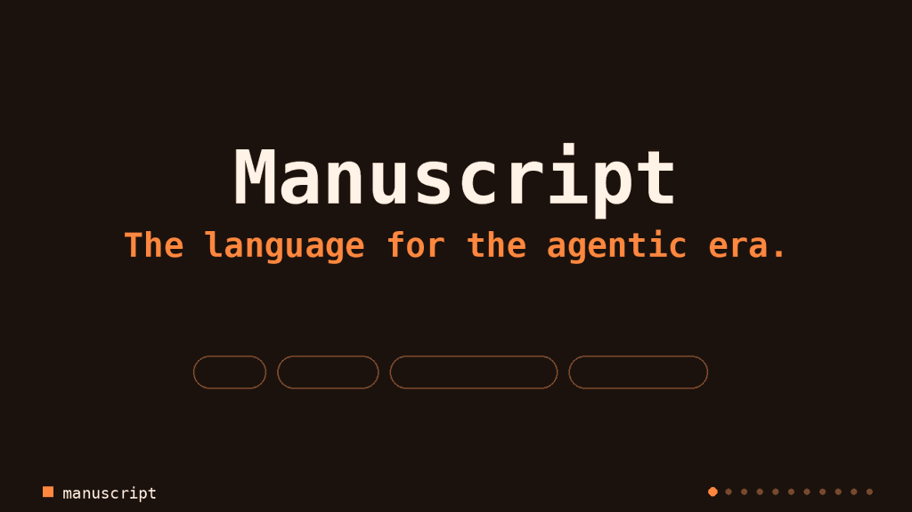

<div align="center">

# Manuscript

**The language for the agentic era.**

[Get started](documentation/learn/getting-started.md) · [Why Manuscript](documentation/learn/why-manuscript.md) · [Guide](documentation/guide/_index.md) · [Performance](bench/perf/README.md) · [Agent benchmark](bench/agent/README.md) · [Vision](VISION.md)



</div>

I built Manuscript to make agent-generated code practical to work with. It's designed to be safe for agents to write: the common footguns are gone, and the syntax is token-efficient and readable at a glance. Built-in diagrams and an interactive code map let you explore what an agent built without reading it line by line.

Under the hood, the compiler enforces one owner per value with no GC. Programs run close to C speed and scale across all cores, and a simple effects system tracks what your code is allowed to do.

The whole toolchain is tuned for agents. Errors tell you how to fix them, and built-in commands let you verify, test, fuzz, benchmark and profile. I use agent benchmarks to evolve the language and toolchain together, and I probe the compiler and standard library adversarially to find and fix correctness and performance bugs.

```manuscript
fn handle(request: HttpRequest) HttpResponse:
    return HttpResponse(200, headers(), "hello {request.path}".to_bytes())

fn listen() Unit!:
    let server = try serve("127.0.0.1:0", buffered(handle))
    print("{server.address()}")
    try server.wait()
    return ok(unit)

export fn main() Int:
    if listen().is_ok(): return 0
    return 1
```

## Ownership without annotations

```manuscript
export fn main() Int:
    var names = List[String]()
    let first = "ada"
    names.append(first)
    print(first)
    return 0
```

```text
$ ms run own.ms
own.ms:4:18: type: `first` is moved here but used again at 5:11 …
```

Use-after-move is a compile error. Every value has one owner and borrows are the default, with no lifetime or ownership annotations to write. No GC, no refcounts, no surprises.

## All cores, regular functions

```manuscript
import promise, wait_all from "@std/concurrency/promise.ms"

fn fib(n: Int) Int:
    return if n < 2: n else: fib(n - 1) + fib(n - 2)

export fn main() Int:
    let tasks = [36, 36, 36, 36].map(fn n: promise(fn: ok(fib(n))))
    print(wait_all(tasks).get(List[Int]()).length())
    return 0
```

No async, no await, no function coloring. Wrap a call in `promise(fn: ...)` and it runs on another core.

## Effects the compiler checks

```manuscript
import write_file from "@std/os/fs.ms"

// ms: effect db.write
// ms: allow_effect std.fs.write
fn save(order: String) Unit!:
    return write_file("orders.log", order).wait()

fn audit(total: Int) Unit!:
    return save("audit {total}")
```

Declare an effect once, and `ms lint` flags every caller that did not allow it.

## Errors that name the fix

```text
$ ms check fixme.ms
fixme.ms:3:5: resolution: unknown binding println; there is no println: use print(value),
which writes any value and a newline; for write errors or bytes import stdout from
"@std/io/io.ms" and call stdout().write("text\n")
```

Every diagnostic gives the cause and the remedy, and `ms check --json` is there for agents. The compiler also recognizes habits from other languages: `len(xs)`, `&&` and `null` each get a pointed fix.

## Review without reading every line

```sh
ms diagram ms.toml --format html -o code-map.html
git diff main... | ms review ms.toml --diff -
```

The first command writes an offline, interactive code map with source, types, calls and ownership side by side, and the declarations a change touched highlighted. The second ranks what deserves your attention first: changed contracts, error flow and resource scopes. See [working with an agent](documentation/guide/working-with-an-agent.md).

## Test, fuzz, benchmark, profile

```sh
ms test ms.toml --fuzz 30s
ms bench ms.toml
ms profile ms.toml
```

Property tests double as a fuzzer, benchmarks time each change, and the profiler gives source attribution, pprof and folded stacks. Nothing to install.

## Try it

```sh
ms init hello
```

Everything here works today, and I harden it with each release. Syntax and APIs still evolve.
