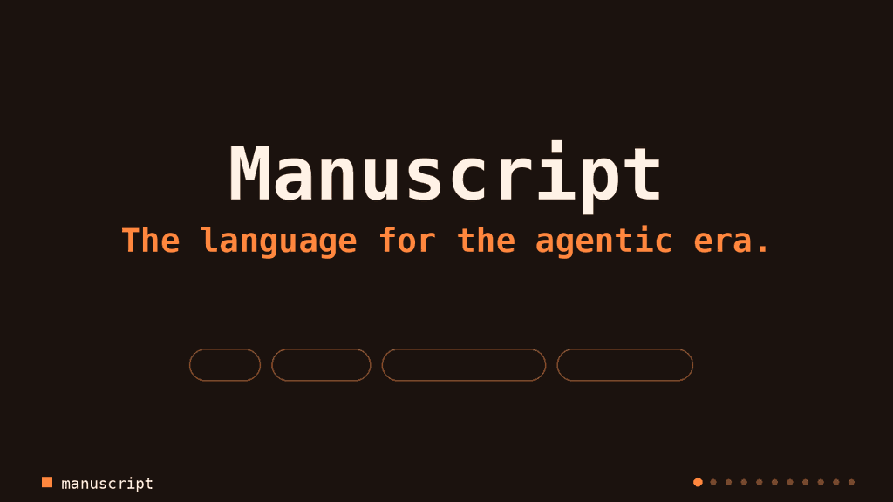

<div align="center">

# Manuscript

**The language for the agentic era.**

[Get started](documentation/learn/getting-started.md) · [Why Manuscript](documentation/learn/why-manuscript.md) · [Guide](documentation/guide/_index.md) · [Performance](bench/perf/README.md) · [Vision](VISION.md)



</div>

Manuscript is a statically typed, natively compiled language. Every value has one owner, so there is no garbage collector and no lifetime annotations. The common footguns are gone, the syntax is token-efficient, and programs run close to C speed across all cores.

That clarity matters more now that agents write much of our code. Every diagnostic names its cause and fix, so an agent can correct itself, and built-in diagrams and an interactive code map let a person review the result.

The toolchain is tuned for agents: built-in commands verify, test, fuzz, benchmark and profile, and adversarial probing and agent feedback drive the language and compiler forward.

A simple HTTP server:

```rust
import buffered, headers, HttpRequest, HttpResponse from "@std/net/http.ms"
import serve from "@std/net/net.ms"

fn handle(request HttpRequest) HttpResponse {
    return HttpResponse(200, f"hello {request.path}".to_bytes())
}

fn main() Void! {
    server := serve("127.0.0.1:0", buffered(handle))?
    print(f"{server.address()}")
    server.wait()?
}
```

HTTP/1.1, HTTP/2 and TLS work too, and each connection runs as its own promise across all cores. Here is what makes programs like this easy to hand to an agent.

## Ownership without annotations

<!-- manuscript-example: {"mode":"error","contains":"is moved here"} -->
```rust
fn main() Void {
    var names = List[String]()
    first := "ada"
    names.append(first)
    print(first)
}
```

```text
$ ms run own.ms
own.ms:4:18: type: `first` is moved here but used again at 5:11 …
```

Use-after-move is a compile error, and there are no lifetime annotations to write. Every value has one owner and borrows are the default. Memory is freed deterministically when its owner ends, with no GC and no reference counts on values. `.clone()` is the only copy.

## All cores, regular functions

```rust
import promise, wait_all from "@std/concurrency/promise.ms"

fn fib(n Int) Int {
    return if n < 2: n else: fib(n - 1) + fib(n - 2)
}

fn main() Void {
    tasks := [36, 36, 36, 36].map(n => promise(() => ok(fib(n))))
    print(wait_all(tasks).get_or(List[Int]()).length())
}
```

No async, no await, no function coloring: wrap a call in `promise(fn: ...)` and it runs on another core. The lambda borrows its captures read-only, so the checker rules out data races. A parked promise costs about 5 KB on Linux, and idle stacks hibernate, so millions fit in memory.

## Effects the compiler checks

```rust
import write_file from "@std/os/fs.ms"

// ms: effect db.write
// ms: allow_effect std.fs.write
fn save(order String) Void! {
    return write_file("orders.log", order).wait()
}

fn audit(total Int) Void! {
    return save(f"audit {total}")
}
```

Declare an effect once, and `ms lint` flags every caller that did not allow it, naming the call chain that brings it in. Effects are comments, so the language gains no extra syntax.

## Errors that name the fix

```text
$ ms check fixme.ms
fixme.ms:3:5: resolution: unknown binding println; there is no println: use print(value),
which writes any value and a newline; for write errors or bytes import stdout from
"@std/io/io.ms" and call stdout().write("text\n")
```

Every diagnostic gives the cause and the remedy, `ms check --fix` applies the mechanical ones, and `--json` is there for agents. Failure is a value (`T!`), and `Error` is one pointer wide, so a fallible function uses no more stack than an infallible one.

## Batteries included

```rust
import parse, stringify, StringifyOptions from "@std/data/json.ms"

type Config {
    name String
    enabled Bool = true
}

fn roundtrip(text String) Result[String, Error] {
    config := parse[Config](text)?
    return stringify(config, StringifyOptions(strict: true))
}
```

HTTP, WebSocket and TLS, JSON, YAML, TOML, CSV and XML, crypto, big and decimal math, files, processes, images and testing ship with the compiler. Decoders are generated per type at compile time, with no reflection.

## Review without reading every line

```sh
ms diagram ms.toml --format html -o code-map.html
git diff main... | ms review ms.toml --diff -
```

The code map shows source, types, calls and ownership side by side, with the declarations a change touched highlighted. `ms review` ranks what deserves your attention first: changed contracts, error flow and resource scopes. See [working with an agent](documentation/guide/working-with-an-agent.md).

## Test, fuzz, benchmark, profile

```sh
ms test ms.toml --fuzz 30s
ms bench ms.toml
ms profile ms.toml
```

Property tests double as a fuzzer, benchmarks time each change, and the profiler gives source attribution, pprof and folded stacks.

## Install

On Linux and macOS:

```sh
curl -fsSL https://manuscript-lang.github.io/manuscript/install.sh | sh
```

On Windows:

```powershell
irm https://manuscript-lang.github.io/manuscript/install.ps1 | iex
```

Or take an archive from the [releases page](https://github.com/manuscript-lang/manuscript/releases). Then try it:

```sh
ms init hello
```

## Agent skill

A short guide that teaches a coding agent to write Manuscript. It installs on its own, without the compiler. On Linux and macOS:

```sh
curl -fsSL https://manuscript-lang.github.io/manuscript/install-skill.sh | sh
```

On Windows:

```powershell
irm https://manuscript-lang.github.io/manuscript/install-skill.ps1 | iex
```

Each release also attaches `manuscript-skill.tar.gz`, stamped with that release's version, so the skill matches its language version.

Everything here works today and is hardened with each release. The core syntax, ownership rules, `ms.toml` keys, `--json` shapes and diagnostic codes are frozen; other standard library names may change; see [what is frozen](documentation/core-language/stability.md).
