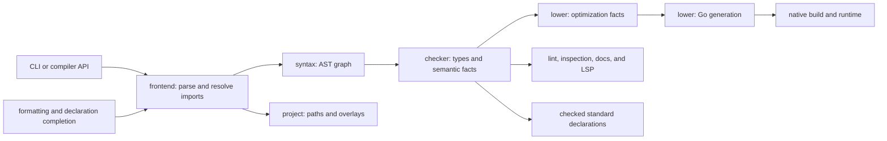

+++
title = "Repository architecture"
weight = 1
+++

# Repository architecture

One Go module. Reusable packages live in `pkg/`, entrypoints in `cmd/`, private CLI and native helpers in `internal/`. Tests sit beside their code; native conformance and publication checks live in `tests/`.

The Rust implementation under `crates/` (`ms-syntax`, `ms-check`, `ms-mir`, `ms-clif`, `ms-rt`, and the rest) is replacing the Go pipeline described below; until cutover both live in this repository. See [Rust toolchain](rust-toolchain.md) for its pipeline and crate map.

## Follow one compilation

1. `internal/cli` validates options and picks a compiler mode; `cmd/ms` only maps status to the exit code.
2. `project.ReadProject` validates `[project]` and `[aliases]`; `ResolveImport` and `SourcePath` give canonical, root-confined paths, including editor overlays.
3. `compiler.CompileSource` and `CompileFile` load through `frontend`, then converge on `compile` in `pkg/compiler/compiler.go`. `frontend.LoadFile` follows imports, detects cycles, dedupes canonical modules, and returns a dependency-ordered `frontend.Graph`. `LoadSource` takes in-memory source with standard imports only.
4. `frontend.Parse` picks strict or recovering parsing. `lexer` emits layout-aware tokens; `parser` emits `syntax.Module`. Recovery is allowed only with `AnalyzeOnly`, and recovered ASTs keep diagnostics that block output. Standard declarations use the same parser.
5. `checker` loads standard declarations on first use. It resolves declarations, nominal types, bounds, implementations, control flow, captures, cleanup, and effects, and keeps what lowering, docs, and editors need.
6. Check, lint, inspection, diagrams, review reports, docs, and lock stop after checking. Formatting uses only the shared parsing stage.
7. Lowering derives a view from the checked program and folds literal boolean expressions without rewriting nodes. An effectful left operand still runs, so `operation() and false` never becomes `false`. Go does native optimization.
8. `lower.Go` builds Go AST declarations and a file directly, with one printer boundary; see [typed Go generation](compiler/lowering/_index.md#typed-go). `Standalone` merges output with the embedded runtime.
9. Native builds compile the embedded runtime in a shared, content-addressed workspace module, replay recorded compile and link commands when imports are unchanged, disable VCS stamping, and query the toolchain once per process. They embed vendored sources and write executable metadata. Executables are not cached.

## Respect the layers

Each layer imports only layers above it in this list; `scripts/repo-check/policy.json` enforces the exact edges.

1. Foundation: `syntax`, `lexer`, `parser`, `project`, `stdlib`
2. `frontend`: parsing and module graph
3. `checker`: types and semantic facts
4. `lower`: checked program to Go source (no native tools, no runtime import)
5. `compiler`: the source-to-Go pipeline facade
6. `build`: native builds, caches, pins, and toolchains
7. Tooling: `tooling/format`, `tooling`, `tooling/docgen`, `tooling/lsp`, `tooling/guide`
8. `internal/cli` and `cmd/ms`

`runtime` and the `internal/` helpers it embeds form a separate leaf stack that generated programs link against.

## Know what each package owns

| Package or directory | Responsibility |
| --- | --- |
| `pkg/syntax/` | Syntax tree, patterns, positions, diagnostics, shared traversal |
| `pkg/lexer/` | Tokenization and layout |
| `pkg/parser/` | Strict parsing; editor recovery |
| `pkg/frontend/` | Shared parsing, in-memory loading, module graph, import diagnostics |
| `pkg/checker/` | Per-module passes, calls, contracts, effects, standard loading, editor queries |
| `pkg/project/` | Manifest parsing; confined import resolution; editor overlays |
| `pkg/compiler/` | Source-to-checked-program pipeline, then `lower.Go`; never touches native tools |
| `pkg/lower/` | Checked program to Go source; consumes only checker identities |
| `pkg/build/` | Native builds: assembly, pins, command replay, shared workspace, SDKs |
| `pkg/runtime/` | Values, numerics, work lifetimes, cleanup, synchronization, host implementations |
| `pkg/stdlib/` | Public `.ms` declarations, `bindings.json` native identities (opaque types, function and contract-method overrides), embedded sources; the signature authority |
| `pkg/tooling/format/` | Formatter; needs only syntax, lexer, and frontend, never the checker |
| `pkg/tooling/` | Lint, navigation, inspection, review, static diagrams |
| `pkg/tooling/lsp/` | Transport, snapshots, typed editor features |
| `pkg/tooling/guide/` | Backs `ms search_symbol` and `ms guide`, generated from checker definitions |
| `pkg/tooling/docgen/` | Markdown/JSON and site API reference from standard declarations |
| `internal/decimal/`, `internal/nativeabi/` | Decimal literal rules, receiver-to-function identities, test-event protocol |
| `internal/hostos/` | Platform helpers for filesystem, process, and OS operations |
| `internal/cli/` | Command orchestration, status codes, signals, documentation commands |
| `embed.go` | Embedded vendor/module dependencies, toolchain payload, and release version; Go embed paths cannot traverse upward, so they stay beside `go.mod` and `vendor/` |

## Keep shared behavior in one implementation

- `syntax.Visitor` owns traversal; passes pick callbacks.
- Semantic lint uses the checker's resolved identities, never re-lexing source.
- `project.CanonicalOverlay` owns import path identity; the frontend consumes it.
- Editors share one source index per request and one nearest-manifest rule.
- The CLI classifies compiler mode once and shares one native build path and cache selection.

## Keep source and generated output distinct

| Location | Ownership |
| --- | --- |
| `documentation/` | Authored tutorials, language rules, compiler/runtime semantics, contributor workflow |
| `.artifacts/docs/documentation/standard-library/reference/` | Ignored API pages generated by `make docs` |
| `website/` | Hugo config, layouts, assets, version archives, vendored Hugo Book theme |
| `website/static/stdlib.md`, `stdlib.json` | Generated API downloads; not committed |
| `.artifacts/book/` | Ignored generated HTML, search data, and downloads |
| `scripts/` | Bootstrap, lint setup, `mktoolchain/`, `package.sh`, `distcheck/`, `docgen/`, maintenance, repo checks |
| `bench/` | Benchmarks: `perf/` and `language/` (speed), `agent/` (agent pass rates), and focused `lists/`, `lowering/`, `tooling/`, `debug-literals/`, `http-headers/` studies |
| `examples/` | Hello project and tooling demo |
| `extensions/vscode/` | VS Code client, grammar, snippets, debug adapter, tests |
| `vendor/` | Pinned offline native dependencies and licenses |
| `.github/workflows/` | Language checks, book publishing, six-target release packaging |
| `skills/`, `.experts/`, `AGENTS.md` | Contributor guidance; `.agents/skills/` and `.claude/skills/` link to shared skills |
| `.artifacts/`, `toolchain/`, `dist/`, `.ms-cache/` | Ignored local reports, SDKs, releases, caches |

Fix generated output through its generator, never by editing HTML or copying standard signatures into another catalog.

## Make a change where its behavior lives

| Change | Trace and validation |
| --- | --- |
| Syntax or type rules | Guide, syntax/lexer/parser/checker, lowering, formatting and LSP, accepted/rejected fixtures |
| Standard operation | `.ms` declaration, native binding, runtime dispatch, editor info, generated reference; test in a called test block |
| Resource work | Checking/dispatch, acquisition, cancellation, close; verify exit ordering |
| Manifest, alias, or import | `project`, module graph, overlays, pin/cache identity; test equivalent paths, escapes, malformed input |
| CLI command | `internal/cli`, relevant package, status/output contract; failed checking preserves outputs |
| Documentation | Markdown or generator, `make docs-check`, `make book-check`, `make book` |
| Build packaging | Embedded inputs, pins and cache, copied standalone binary; `make dist-check` removes host Go and downloads |

Implementation hashes cover `frontend`, `project`, `lower`, and `build` plus syntax, parsing, checking, compiler, runtime, standard declarations, and the dependency bundle. A package that takes over build-affecting behavior must join pin identity, or stale pins survive.

## Read the evidence correctly

- Package tests cover narrow contracts. `tests/e2e` checks native behavior, CLI, faults, signals, and networking; declaration-only fixtures show acceptance, not execution.
- `tests/docs` checks highlighting and API pages; extension tests cover editor and debugger.
- Coverage finds unexercised branches, not language completeness or race freedom. See [development checks](development.md).
- `make repo-check` enforces the dependency policy, frontend isolation, embedded source inputs, exhaustive syntax kinds, and Go-source release triggers. The CLI, native pins, and book share `.msversion`.
