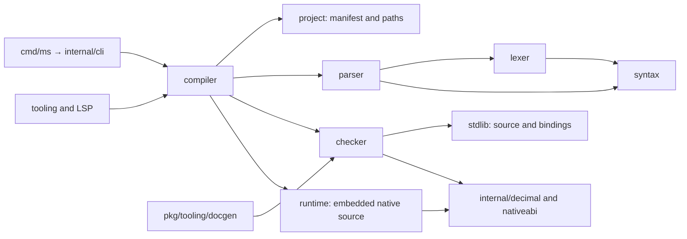

+++
title = "Repository architecture"
weight = 1
+++

# Repository architecture

Manuscript uses one Go module. Reusable implementation packages live in `pkg/`; command entrypoints live in `cmd/`, and private CLI and native helpers live in `internal/`. Tests stay beside the implementation they exercise; native conformance and publication checks live in `tests/`.

The root groups implementation (`pkg/`, `cmd/`, `internal/`), documentation (`documentation/`, `website/`), integrations and examples (`extensions/`, `examples/`), and repository support (`scripts/`, `tests/`, `skills/`, `vendor/`). Go module files, build/version configuration, the README, and contributor guidance remain at the root.

## Follow one compilation

1. `internal/cli` validates command options and selects a compiler mode. `cmd/ms` only translates the returned status into the process exit code.
2. `project.ReadProject` validates `[project]` and `[aliases]`. `project.ResolveImport` and `SourcePath` establish canonical paths, including editor overlays, confined to the project root. This package needs no checker or native tools.
3. `compiler.CompileFile` follows imports, detects cycles, deduplicates canonical module identities, and supplies modules in dependency order. The resolver supplies canonical keys once; graph traversal does not resolve them again. `CompileSource` accepts in-memory source with standard imports; local imports require `CompileFile`.
4. `lexer` produces layout-aware UTF-8 tokens with original source positions. `parser` produces `syntax.Module` trees. Partial parsing is restricted to editor analysis; it never grants permission to build invalid source.
5. `checker` resolves declarations, nominal types, bounds, selected implementations, control flow, captures, cleanup, and effects. Its checked program retains the information used by lowering, documentation, and editor tools.
6. `compiler` lowers a successful checked program to Go. Check, lint, inspection, diagrams, documentation, and lock commands stop after checking. Application entry validation can run without lowering; editor analysis can omit that requirement. Diagnostics prevent generated output. `Standalone` merges checked output and the embedded runtime without a runtime package dependency.
7. Native builds disable VCS stamping for their generated temporary module, query the selected toolchain once, use that same pin for project verification and artifact metadata, and check cache hashes. Pin and metadata comparison operates on typed values rather than serializing both sides back to JSON. Builds embed vendored dependency sources and write executable metadata. Only the lock command needs a toolchain query among the source commands.

## Know what each package owns

| Package or directory | Responsibility and starting point |
| --- | --- |
| `pkg/syntax/` | Syntax tree, patterns, positions, and diagnostics in `ast.go` and `diagnostics.go`; shared executable-syntax traversal in `walk.go` |
| `pkg/lexer/` | Tokenization and layout in `lexer.go`; original-position checks in `lexer_test.go` |
| `pkg/parser/` | Strict source parsing in `parser.go`; editor recovery in `partial.go` |
| `pkg/checker/` | Checking entry point in `checker.go`; calls, contracts, recursion, effects, standard loading, editor queries, and declaration documentation in focused files |
| `pkg/project/` | Manifest parsing in `manifest.go`; confined import and overlay resolution in `paths.go` |
| `pkg/compiler/` | Public orchestration in `compiler.go` and `modules.go`; lowering in `generate.go`; native source assembly in `build.go`; pin/artifact identity in `cache.go`; SDK selection/materialization in `toolchain*.go` |
| `pkg/runtime/` | Value and numeric semantics; work lifetimes in `tasks.go`, `background.go`, and `lifetime.go`; cleanup, synchronization, services, and host implementations; domain-specific native standard-library operations in `library_*.go` |
| `pkg/stdlib/` | Public `.ms` declarations, `bindings.json` native identities, and embedded sources. This is the standard signature authority |
| `pkg/tooling/` | Formatter, advisory lint, navigation, inspection, and static diagrams derived from source or checked programs |
| `pkg/tooling/lsp/` | Transport, workspace/analysis snapshots, typed editor features, completion, references, rename, and versioned edits |
| `pkg/tooling/docgen/` | Portable Markdown/JSON rendering and site reference generation. `call-rules.md` is the embedded source for special compiler-bound calls |
| `internal/decimal/`, `internal/nativeabi/` | Lightweight shared decimal literal rules and receiver-to-function identities; checked `.ms` declarations retain signature authority |
| `internal/hostos/` | Platform helpers for native filesystem, process, and OS operations, included in the embedded dependency bundle |
| `internal/cli/` | CLI command orchestration, status codes, signal forwarding, and shipped documentation commands |
| Root Go files | Embedded vendor/module dependencies and optional native toolchain payload. They must remain beside `go.mod`, `vendor/`, and the build payload because Go embed paths cannot traverse a parent directory |

Public Go imports use `github.com/manuscript-lang/manuscript/pkg/<package>`, including `pkg/tooling/lsp` and `pkg/tooling/docgen`. Callers using the former root package paths must update their imports. `compiler.Project` and `compiler.ReadProject` remain available; their implementation belongs to `project`. The documentation renderer has the Go package name `docgen`. Manuscript imports such as `@std/time.ms` keep their existing names.

## Keep shared behavior in one implementation

`syntax.Visitor` owns traversal through parameter defaults, interpolation, collection elements, closure bodies, branches, and match arms. Checking generic applications and effects, lint, inspection, assignment indexing, and inferred-local hints select the callbacks they need. Defaults remain real expressions; checking does not manufacture statement nodes to feed another traversal.

Semantic lint consumes the checker's resolved symbol and type identities. It does not re-lex checked source to guess whether a name is an import, shadowing local, or field label. Import usage is tracked within each module.

Editor navigation and references reuse one source index per request. An implicit receiver resolves directly to its checked method declaration; finding it does not generate an entire inspection document and hash. Analysis, completion, and workspace enumeration use the same nearest-manifest discovery rule. A malformed nested manifest cannot silently select a parent's aliases.

The CLI classifies each command's compiler mode in one switch, then checks source once and shares terminal diagnostics and output delivery. Native build/run/test/debug/profile retain one build path and one project cache selection. Profile output directories are created only after source checking succeeds.

## Keep source and generated output distinct

| Location | Ownership |
| --- | --- |
| `documentation/` | Authored tutorials, exact language rules, compiler/runtime semantics, current implementation inventory, tooling limits, contributor workflow, and explicitly historical reviews |
| `documentation/standard-library/reference/` and `documentation/standard-library/call-rules.md` | Generated from checked standard declarations and the embedded call rules by `make docs` |
| `website/` | Hugo configuration, custom layouts/assets, static resources, version archives, and the vendored Hugo Book theme with its license and upstream revision |
| `website/static/stdlib.md` and `stdlib.json` | Generated API downloads. Hugo mounts the root version and extension grammar directly; neither needs a copied source |
| `.artifacts/book/` | Ignored generated HTML, search data, and downloads uploaded/deployed as a Pages artifact |
| `scripts/` | `bootstrap-go.sh`, pinned lint setup/doctor, `mktoolchain/`, `package.sh`, `distcheck/`, `docgen/`, maintenance, and repository checks; all checkout/release maintenance commands live here |
| `examples/` | The hello project and tooling demo, with their project-specific instructions |
| `extensions/vscode/` | VS Code client, grammar, snippets, debug adapter, pinned Node dependencies, and editor/DAP tests |
| `vendor/` | Pinned offline native dependencies and licenses; required for emitted-source and standalone release builds |
| `.github/workflows/` | Language checks, strict book validation/publishing, and six-target release packaging |
| `skills/`, `.experts/`, `AGENTS.md` | Contributor guidance and evidence-backed lessons. `.agents/skills/` and `.claude/skills/` link to the shared skills |
| `.artifacts/`, `toolchain/`, `dist/`, `.ms-cache/` | Ignored local reports, SDKs, releases, and native artifact caches |

Keep generated sources reproducible through their generator. Do not edit HTML to repair a source rule or copy standard signatures into a second hand-maintained catalog. Use [implementation coverage](../implementation.md) to check which design facilities are actually available.

## Make a change where its behavior lives

| Change | Trace and validation |
| --- | --- |
| Syntax or type rules | Canonical guide → syntax/lexer/parser/checker → lowering → formatting and LSP → accepted/rejected source fixtures |
| Standard operation | `.ms` declaration → native binding → runtime dispatch → editor information → generated reference; exercise behavior in a called test block |
| Resource or concurrent work | Checking/dispatch → acquisition and delivery → cancellation → close → join; verify observable exit ordering and run race tests |
| Manifest, alias, or import | `project` → module graph → overlays and editor import completion → pin/cache identity; test equivalent paths, escapes, and malformed inputs |
| CLI command | `internal/cli` → relevant package → status/output/artifact contract; verify failed checking preserves outputs and source-only commands work without native tools |
| Documentation | Canonical Markdown or generator → `make docs-check` → `make book-check` → `make book`; source freshness alone does not establish published freshness |
| Build packaging | Embedded source/dependency/toolchain inputs → pins and cache → copied standalone binary; `make dist-check` removes host Go and disables package downloads |

Implementation hashes include source from `project` as well as the frontend, compiler, runtime, standard declarations, and dependency bundle. When moving build-affecting behavior to a new package, include that package's embedded implementation sources in pin identity. Otherwise an implementation update can silently retain stale build pins.

## Read the evidence correctly

Package tests exercise narrow contracts. `tests/e2e` compiles Manuscript fixtures and checks native behavior, CLI commands, faults, signals, networking, and cross-module dispatch. Declaration-only fixtures demonstrate acceptance, not execution. `tests/docs` checks shared highlighting and the published API pages/downloads. Extension tests exercise editor and debugger integration separately.

Statement coverage helps find unexercised branches; it does not establish language completeness, race freedom, or reliable shutdown. Combine [coverage reports and the development checks](development.md) with the feature inventory and observable source-level cases. Keep unimplemented adapter, incremental compilation, host, and tooling contracts explicitly identified.

`make repo-check` enforces the package dependency policy, frontend isolation from host implementations, complete embedded source inputs, exhaustive checked/lowered syntax kinds, and Go-source release triggers. The checker consumes checked standard declarations for native receiver constraints; runtime ABI comparisons are integration tests. The CLI, native pins, and book share `.msversion`.
