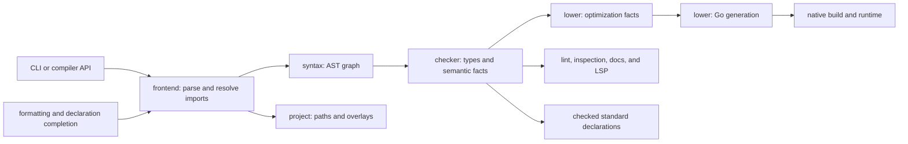

+++
title = "Repository architecture"
weight = 1
+++

# Repository architecture

Manuscript uses one Go module. Reusable implementation packages live in `pkg/`; command entrypoints live in `cmd/`, and private CLI and native helpers live in `internal/`. Tests stay beside the implementation they exercise; native conformance and publication checks live in `tests/`.

The root groups implementation (`pkg/`, `cmd/`, `internal/`), documentation (`documentation/`, `website/`), integrations and examples (`extensions/`, `examples/`), and repository support (`scripts/`, `tests/`, `skills/`, `vendor/`). Go module files, build/version configuration, the README, and contributor guidance remain at the root.

## Follow one compilation

1. `internal/cli` validates command options and selects a compiler mode. `cmd/ms` only translates the returned status into the process exit code.
2. `project.ReadProject` validates `[project]` and `[aliases]`. `project.ResolveImport` and `SourcePath` establish canonical paths, including editor overlays, confined to the project root. This package needs no checker or native tools.
3. `compiler.CompileSource` and `CompileFile` load source through `frontend`, then converge on `compile` in `pkg/compiler/compiler.go`. `frontend.LoadFile` follows imports, detects cycles, deduplicates canonical module identities, and supplies a `frontend.Graph` in dependency order. Its module loader resolves canonical keys once. `LoadSource` accepts in-memory source with standard imports; local imports require file loading.
4. `frontend.Parse` selects strict or recovering parsing for compilation, formatting, and completion. `lexer` produces layout-aware UTF-8 tokens with original source positions; `parser` produces `syntax.Module` trees. Compilation permits recovery only with `AnalyzeOnly`. Recovered ASTs retain diagnostics, which prevent generated output. Standard declarations use the same syntax and parser as application source; `checker` loads their pinned runtime bindings.
5. `checker` loads standard declarations on first use, so commands that never check source start without that cost. It resolves declarations, nominal types, bounds, selected implementations, control flow, captures, cleanup, and effects. Its checked program retains the information used by lowering, documentation, and editor tools.
6. Check, lint, inspection, diagrams, documentation, and lock commands stop after checking. Application entry validation can run without lowering; editor analysis can omit that requirement. Formatting uses only the shared parsing stage.
7. Lowering derives a lowering view from a successful checked program. It folds literal boolean expressions, including short-circuiting, without rewriting source nodes or discarding checked identities and effects. An effectful left operand still runs: `operation() and false` cannot become `false`. Numeric operations retain runtime fault behavior. Go performs native optimization according to the selected build type.
8. `lower.Go` consumes the checked program and optimization facts, constructing Go AST expressions, statements, declarations, and a file directly. Module assembly, function bodies, statements, and expressions have focused implementation files. One printer boundary formats the tree and materializes its source directives; see [structured Go generation](compiler/lowering/_index.md#structured-go-generation). `Standalone` merges generated output and the embedded runtime without a runtime package dependency.
9. Native builds compile the embedded runtime as a separate package in a shared, content-addressed workspace module, select a lean runtime variant when the program imports no network, system, or process module, replay the recorded compile and link commands when the application imports are unchanged, disable VCS stamping, query the selected toolchain once per process (native CLI commands start that query and the implementation digest while checking), use that same pin for project verification and artifact metadata, and check cache hashes. Pin and metadata comparison operates on typed values rather than serializing both sides back to JSON. Builds embed vendored dependency sources and write executable metadata. Executables are not cached: `build` writes its output and execution commands build into a temporary directory. Only the lock command needs a toolchain query among the source commands.

## Respect the layers

Each layer imports only layers above it in this list; `scripts/repo-check/policy.json` enforces the exact edges.

1. Foundation: `syntax`, `lexer`, `parser`, `project`, `stdlib`
2. `frontend`: parsing and module graph
3. `checker`: types and semantic facts
4. `lower`: checked program to Go source (no native tools, no runtime import)
5. `compiler`: the source-to-Go pipeline facade
6. `build`: native builds, caches, pins, and toolchains
7. Tooling: `tooling`, `tooling/docgen`, `tooling/lsp`
8. `internal/cli` and `cmd/ms`

`runtime` and the `internal/` helpers it embeds form a separate leaf stack that generated programs link against.

## Know what each package owns

| Package or directory | Responsibility and starting point |
| --- | --- |
| `pkg/syntax/` | Syntax tree, patterns, positions, and diagnostics; shared executable-syntax traversal |
| `pkg/lexer/` | Tokenization and layout; original-position checks |
| `pkg/parser/` | Strict source parsing; editor recovery |
| `pkg/frontend/` | Shared parsing and in-memory AST loading; project/module graph loading, canonical snapshots, and import diagnostics |
| `pkg/checker/` | Checking entry point and per-module passes (imports, names, type variables, signatures, defaults, bodies); expression kinds; calls, contracts, recursion, effects, standard loading, editor queries, and declaration documentation in focused files |
| `pkg/project/` | Manifest parsing; confined import resolution and canonical editor overlays |
| `pkg/compiler/` | Source-to-checked-program pipeline (frontend, checker, entry validation, then `lower.Go`); build kinds. It never touches native tools |
| `pkg/lower/` | Checked program to Go source: literal-boolean folding, module assembly, lowering, and Go AST printing. It consumes only checker identities |
| `pkg/build/` | Native builds from compiler results: source assembly; pin/artifact identity; command replay; shared workspace; runtime variant; SDK selection/materialization |
| `pkg/runtime/` | Value and numeric semantics; work lifetimes; cleanup, synchronization, services, and host implementations; domain-specific native standard-library operations |
| `pkg/stdlib/` | Public `.ms` declarations, `bindings.json` native function identities (receiver identities live in `internal/nativeabi`), and embedded sources. This is the standard signature authority |
| `pkg/tooling/` | Formatter, advisory lint, navigation, inspection, and static diagrams derived from source or checked programs |
| `pkg/tooling/lsp/` | Transport, workspace/analysis snapshots, typed editor features, completion, references, rename, and versioned edits |
| `pkg/tooling/docgen/` | Portable Markdown/JSON rendering and site reference generation. guides and special call rules are extracted from comments in `pkg/stdlib/*.ms` |
| `internal/decimal/`, `internal/nativeabi/` | Lightweight shared decimal literal rules, receiver-to-function identities, and the CLI/native test-event protocol; checked `.ms` declarations retain signature authority |
| `internal/hostos/` | Platform helpers for native filesystem, process, and OS operations, included in the embedded dependency bundle |
| `internal/cli/` | CLI command orchestration, status codes, signal forwarding, and shipped documentation commands |
| Root Go files | Embedded vendor/module dependencies and optional native toolchain payload. They must remain beside `go.mod`, `vendor/`, and the build payload because Go embed paths cannot traverse a parent directory |

Public Go imports use `github.com/manuscript-lang/manuscript/pkg/<package>`, including `pkg/tooling/lsp` and `pkg/tooling/docgen`. Callers using the former root package paths must update their imports. `compiler.Project` and `compiler.ReadProject` remain available; their implementation belongs to `project`. The documentation renderer has the Go package name `docgen`. Manuscript imports such as `@std/time.ms` keep their existing names.

## Keep shared behavior in one implementation

`syntax.Visitor` owns traversal through parameter defaults, interpolation, collection elements, closure bodies, branches, and match arms. Checking generic applications and effects, lint, inspection, assignment indexing, and inferred-local hints select the callbacks they need. Defaults remain real expressions; checking does not manufacture statement nodes to feed another traversal.

Semantic lint consumes the checker's resolved symbol and type identities. It does not re-lex checked source to guess whether a name is an import, shadowing local, or field label. Import usage is tracked within each module.

`project.CanonicalOverlay` applies the same path identity and confinement as imports, accepting equivalent snapshots and rejecting conflicting spellings of one file. The frontend consumes that snapshot when loading its module graph.

Editor navigation and references reuse one source index per request. An implicit receiver resolves directly to its checked method declaration; finding it does not generate an entire inspection document and hash. Analysis, completion, and workspace enumeration use the same nearest-manifest discovery rule. A malformed nested manifest cannot silently select a parent's aliases.

The CLI classifies each command's compiler mode in one switch, then checks source once and shares terminal diagnostics and output delivery. Native build/run/test/debug/profile retain one build path and one project cache selection. Profile output directories are created only after source checking succeeds.

Within `runtime`, `values.go` owns value representation and construction; `format.go` and `equality.go` own display and comparison. `functions.go` owns callable adaptation, defaults, source returns, and callback admission; `methods.go` owns type-key resolution, lexical implementation selection, and dispatch caches. `frames.go` owns direct-call recursion checks and fault frames. Native test execution lives in `test_runner.go`, with structured reporting in `test_events.go`. Buffered and streaming HTTP handlers share admission and release accounting while retaining their own request and response lifetimes.

## Keep source and generated output distinct

| Location | Ownership |
| --- | --- |
| `documentation/` | Authored tutorials, exact language rules, compiler/runtime semantics, tooling limits, contributor workflow |
| `.artifacts/docs/documentation/standard-library/` and `.artifacts/docs/documentation/concurrency/` | Ignored guides and references generated from `pkg/stdlib/*.ms` by `make docs`, mounted into Hugo content |
| `website/` | Hugo configuration, custom layouts/assets, static resources, version archives, and the vendored Hugo Book theme with its license and upstream revision |
| `website/static/stdlib.md` and `stdlib.json` | Generated API downloads, built by `make docs` and `make book-check` and not committed. Hugo mounts the root version and extension grammar directly; neither needs a copied source |
| `.artifacts/book/` | Ignored generated HTML, search data, and downloads uploaded/deployed as a Pages artifact |
| `scripts/` | `bootstrap-go.sh`, pinned lint setup/doctor, `mktoolchain/`, `package.sh`, `distcheck/`, `docgen/`, maintenance, and repository checks; all checkout/release maintenance commands live here |
| `examples/` | The hello project and tooling demo, with their project-specific instructions |
| `extensions/vscode/` | VS Code client, grammar, snippets, debug adapter, pinned Node dependencies, and editor/DAP tests |
| `vendor/` | Pinned offline native dependencies and licenses; required for emitted-source and standalone release builds |
| `.github/workflows/` | Language checks, strict book validation/publishing, and six-target release packaging |
| `skills/`, `.experts/`, `AGENTS.md` | Contributor guidance and evidence-backed lessons. `.agents/skills/` and `.claude/skills/` link to the shared skills |
| `.artifacts/`, `toolchain/`, `dist/`, `.ms-cache/` | Ignored local reports, SDKs, releases, and caches left by earlier versions |

Keep generated sources reproducible through their generator. Do not edit HTML to repair a source rule or copy standard signatures into a second hand-maintained catalog. Check the relevant implementation and source-level tests before describing a design as available.

## Make a change where its behavior lives

| Change | Trace and validation |
| --- | --- |
| Syntax or type rules | Canonical guide → syntax/lexer/parser/checker → lowering → formatting and LSP → accepted/rejected source fixtures |
| Standard operation | `.ms` declaration → native binding → runtime dispatch → editor information → generated reference; exercise behavior in a called test block |
| Resource or concurrent work | Checking/dispatch → acquisition and delivery → cancellation → close → join; verify observable exit ordering and run race tests |
| Manifest, alias, or import | `project` → module graph → overlays and editor import completion → pin/cache identity; test equivalent paths, escapes, and malformed inputs |
| CLI command | `internal/cli` → relevant package → status/output/artifact contract; verify failed checking preserves outputs and source-only commands work without native tools |
| Documentation | Canonical Markdown or generator → `make docs-check` → `make book-check` → `make book`; source freshness alone does not establish published freshness |
| Build packaging | Embedded source/dependency/toolchain inputs → pins and cache → copied standalone binary; `make dist-check` removes host Go and disables package downloads |

Implementation hashes include source from `frontend`, `project`, `lower`, and `build` as well as syntax, parsing, checking, the compiler, runtime, standard declarations, and dependency bundle. When moving build-affecting behavior to a new package, include that package's embedded implementation sources in pin identity. Otherwise an implementation update can silently retain stale build pins.

## Read the evidence correctly

Package tests exercise narrow contracts. `tests/e2e` compiles Manuscript fixtures and checks native behavior, CLI commands, faults, signals, networking, and cross-module dispatch. Declaration-only fixtures demonstrate acceptance, not execution. `tests/docs` checks shared highlighting and the published API pages/downloads. Extension tests exercise editor and debugger integration separately.

Statement coverage helps find unexercised branches; it does not establish language completeness, race freedom, or reliable shutdown. Combine [coverage reports and the development checks](development.md) with observable source-level cases. Keep unimplemented adapter, incremental compilation, host, and tooling contracts explicitly identified.

`make repo-check` enforces the package dependency policy, frontend isolation from host implementations, complete embedded source inputs, exhaustive checked/lowered syntax kinds, and Go-source release triggers. The checker consumes checked standard declarations for native receiver constraints; runtime ABI comparisons are integration tests. The CLI, native pins, and book share `.msversion`.
