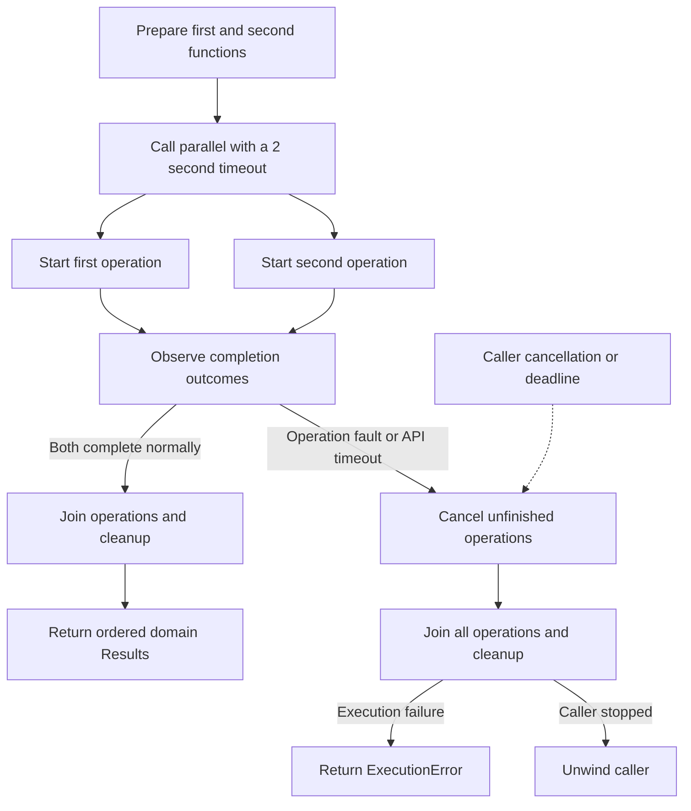

+++
title = "Reading a concurrent-flow diagram"
weight = 114
+++

# Reading a concurrent-flow diagram

[Guide index](../_index.md) · [Chapter index](_index.md) · [Design index](../../_index.md)

Read this diagram from the preparation step downward. The two branches run concurrently, then meet at a join. It shows how [parallel](../../concurrency/parallel.md) handles ordinary results, faults, timeouts, and caller cancellation.

The API prepares all arguments before starting work. Successful positions follow input order regardless of completion order. A domain error is an ordinary returned value; it does not cancel siblings.

Every exit joins all operations, even if joining exceeds the initiating timeout. Caller cancellation unwinds the caller after joining. Resource cleanup follows explicit `with` registrations; no result or capture is recursively closed merely because it is unreturned.

Scheduler submission has a different lifetime edge: an accepted operation runs under its service's fixed parent, survives a submitting request, and is joined during service shutdown. See [Scheduler](../../standard-library/tasks/scheduler.md), [cancellation propagation](../../concurrency/cancellation.md#propagation-and-checkpoints), and [cleanup ordering](../../ownership-and-cleanup/cleanup/exit-order.md).

[Previous: System, flow, and detail views](views.md) · [Next: Architecture diffs](architecture-diffs.md)
