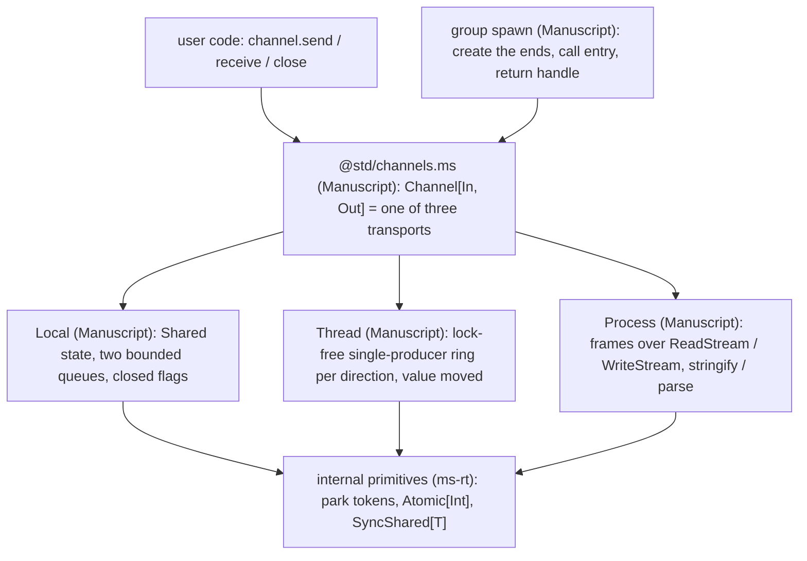

# Channel[In, Out]: one two-ended channel for tasks, threads and processes (design proposal)

## Summary

- Problem: `proposals/taskgroup.md` stage 4 plans one-way `Sender[T]`/`Receiver[T]`; a two-way conversation needs two pairs, and process IPC needs a different type per direction.
- Change: one type `Channel[In, Out]` (sends `In`, receives `Out`) with `send`, `receive`, `close`. A channel always has exactly two ends, and **only `spawn` creates them**: the child's entry receives one end; `spawn` returns the handle of the spawned child (`Task`, `Worker`, `Process`), whose `channel` field is the other end. No constructor, no `create_mirror`, no tuples, no hidden state.
- Layout: all three transports in Manuscript (same-thread queue, cross-thread lock-free ring, process framing) over small internal Rust primitives. Each group's `spawn` picks the transport; user code never sees it.
- Cost: internal primitives only: park-token externs, `Atomic[Int]` externs, and a compiler-built `SyncShared[T]`; one checker gap (methods cannot declare their own type parameters).
- Decision requested: sign-off on the API and the layering below.

## Status

- Proposal, 2026-10-24, against `main` at `6361798f`. Nothing implemented.
- Direction (Chinmay, 2026-10-24): "channels should be bidirectional"; keep `Channel` uppercase; "can the entry take in a Channel directly? why two args"; "our design needs to be more coherent than node"; "having spawn create them is fine, but I need to understand the overall structure"; "spawn should return the handle to what was spawned, not the channel. Channel can be a field on that return type ... so that we can close the thing that was spawned".
- History in this thread: a `channel_pair` returning a tuple (no tuples in the language), `peer()` and `create_mirror` (both need an "already mirrored" mark) were dropped in favor of spawn-created ends.
- Review: the earlier draft had one skeptical subagent review; applicable findings are folded in. This version needs a fresh review.

## Goals and non-goals

- Goals: one channel API across `TaskGroup`, `WorkerGroup`, `ProcessGroup`; a type per direction; one entry parameter; safe errors on a closed channel; Linux, macOS, Windows parity.
- Non-goals: changing group semantics (results, faults, cancellation stay in their proposals); `select`, timeouts, iteration; shared multi-consumer queues; passing channel ends inside messages; channels between sibling tasks without the parent relaying.

## API

```manuscript
# @std/channels.ms
type Channel[In, Out]          # one end: sends In, receives Out

impl Channel[In, Out]:
    var def send(value: In) -> Result[Unit, Closed]   # moves value; parks while full; cancellation point
    var def receive() -> Optional[Out]                # owned value; none once the other end closed and drained
    var def close() -> Unit                           # Closeable; idempotent; also on drop

# handle of one spawned child: Task (TaskGroup), Worker (WorkerGroup), Process (ProcessGroup)
type Worker[T, In, Out]:
    channel: Channel[In, Out]                 # the parent's end

impl Worker[T, In, Out]:
    var def result() -> Result[T, TaskError]  # waits for this child
    var def close() -> Unit                   # stops this child: closes its channel, cancels, joins

# on each group; the entry gets the mirrored end
var def spawn(entry: Callable[[Channel[Out, In]], T]) -> Worker[T, In, Out]
```

```manuscript
def square_all(var ch: Channel[Int, Int]) -> Unit:   # child's end
    var open = True
    while open:
        if let n = ch.receive():
            ch.send(n * n)
        else:
            open = False

def main() -> Int:
    with WorkerGroup[Unit]() as group:     # or TaskGroup / ProcessGroup
        var worker = group.spawn(square_all)   # Worker[Unit, Int, Int]
        worker.channel.send(3)
        if let square = worker.channel.receive():
            ...
        worker.close()                         # closes the channel, stops and joins this worker
    return 0
```

- Entry parameter and bindings that send, receive or close are `var` (`ms check` rejects them otherwise).
- The handle owns the parent's end, so closing the handle closes the conversation; `worker.channel.close()` alone ends the conversation but lets the child finish and return its result.
- Handle and group behavior (results order, faults, timeouts) stay as specified in the group proposals; this proposal only adds the `channel` field and the entry shape.
- Checker gap: `spawn` needs its own type parameters `In`, `Out`; `ms check` today: "method spawn declares its own type parameters, which source methods do not support yet". Either add method type parameters, or expose a free function `spawn(group, entry)`. Verified: a free generic `spawn[T, In, Out](entry: Callable[[Channel[Out, In]], T]) -> Worker[T, In, Out]` infers all three from `square_all` under `ms check`. Decided in stage 0.

## Structure

Rule: write it in Manuscript unless it cannot be. All three transports are Manuscript; Rust supplies only small internal primitives (Chinmay, 2026-10-24: "update the design to do most of this in ms itself").



| Piece | Written in | Why |
| --- | --- | --- |
| `Channel[In, Out]` type, `send` / `receive` / `close`, close and drain rules, `Closed` | Manuscript | source types and methods can be generic; only externs cannot (`documentation/core-language/functions/native-functions.md:23`) |
| Local transport (tasks) | Manuscript | state is a `Shared` record of two bounded queues and two closed flags; `stdlib/queue.ms` is already a Manuscript queue; one thread, so a non-atomic `Shared` is sound |
| Waiting and waking | existing Rust, new externs | `msrt_token_new/park/post/free` (`crates/ms-rt/src/task.rs:1003-1126`) take and return integers, so they can be plain non-generic externs in `stdlib/channels.ms` |
| Process transport | Manuscript | frame encode/decode (4-byte LE length, kind byte message/close/result, UTF-8 JSON body) over the existing `ReadStream`/`WriteStream` (`stdlib/io.ms`) with `stringify`/`parse` |
| Process IPC setup | Rust (child-processes proposal) | socketpair on Unix (fd 3, env `MS_IPC`), owner-only named pipe on Windows; readiness via the poller on Unix, 2 ms slices on Windows |
| Thread transport | Manuscript | one owner per end makes each direction single-producer single-consumer, so a lock-free ring needs no mutex: slots of `Optional[T]`, `head`/`tail` as `Atomic[Int]` (release on publish, acquire on read), wake via `msrt_token_post_remote` (`task.rs:1114`). The value moves (no codec), matching the worker direction "send memory rather than a codec" (`proposals/worker-threads.md:14`) |
| `Atomic[Int]` (new, internal) | Rust primitive, non-generic externs | `load`, `store`, `compare_exchange`, `fetch_add` with acquire/release; exposed only inside `@std`, not to users |
| `SyncShared[T]` (new, internal) | compiler-built like `Shared` (`crates/ms-lower/src/sharedbuilder.rs`) | atomic refcount so both isolates can hold the pair state; `Shared` stays non-atomic. Internal to `@std` |
| Cross-arena free | Rust (worker-threads proposal) | a moved value is freed by the receiving isolate; already required by `proposals/worker-threads.md:89-90`; nothing new here |
| Group `spawn` wiring | Manuscript | create the two ends, call the entry with one, return the handle with the other |

- `Channel[In, Out]` holds one of `Local`, `Thread` or `Process` state; `send`/`receive` dispatch on it. One public type; the transport is never visible.
- Why `Atomic` alone is not enough: the ring state must be reachable from two isolates, and `Shared`'s count is non-atomic, so a holder type with an atomic count (`SyncShared[T]`) is also needed. Both stay internal, so users still get no shared memory, as the TaskGroup plan states (`proposals/taskgroup.md`, "No shared memory, no Atomics, no mutexes"). Exposing them to users is a separate decision.
- Open: `Queue[T]` requires `T: Clonable` (`stdlib/queue.ms`); channel payloads would inherit that bound unless the local transport uses a move-only queue. Verify in stage 0.

### Groups wire the ends in `spawn`

- `TaskGroup.spawn(entry)`: creates a `Local` pair; the task's closure calls `entry(child_end)`; returns a `Task` handle holding the parent end.
- `WorkerGroup.spawn(entry)`: creates a `Thread` pair; the child end moves to the worker isolate with the entry; returns a `Worker` handle holding the parent end. Needs the per-thread runtime of `proposals/worker-threads.md`; nothing here changes how worker groups behave.
- `ProcessGroup.spawn(entry)`: the parent end is bound to the IPC connection from `proposals/child-processes.md` (socketpair or named pipe, `MS_ENTRY`; no ports); the child builds its end on the same connection at start and calls the entry; returns a `Process` handle holding the parent end. One channel per child, so frames carry no channel id; the result frame is distinct from `Out` messages by its kind byte. A child that dies without a result frame makes `result()` return an error carrying the exit status; the parent does not fault.

## Semantics

- Ownership: `send` moves its argument; `receive` returns an owned value; each end is move-only, so one owner per end without runtime checks.
- Close: `close()`, drop, or entry return closes that side. The other end's `receive()` drains buffered values, then returns `none`; its `send` returns `Closed`. Safe errors, not faults.
- Capacity: bounded per direction for `Local` and `Thread`; process sends park on the OS socket buffer. Default capacity is an implementation question.
- Cancellation: `send`/`receive` are cancellation points.
- Limits stated, not solved: two peers that both `send` first on full queues park forever (`task.rs:611` faults only when every task is parked); no fan-in without `select`; sibling tasks talk through the parent.
- Leak dependency: captures of a cancelled task are not dropped today (`proposals/taskgroup.md:49`), so a cancelled child's end would not close. Implementation waits for that fix.

## Components touched

| Component | Change | Test |
| --- | --- | --- |
| `stdlib/channels.ms` (new) | `Channel[In, Out]`, `Closed` | conformance: order, drain-then-none, closed send, drop closes |
| `crates/ms-lower` | `SyncShared[T]` beside `Shared` in `sharedbuilder.rs` | per-type fixtures incl. records and alternatives |
| `crates/ms-rt` | token externs, `Atomic[Int]` externs, atomic refcount for `SyncShared` | runtime tests: cross-thread wake, ring ordering stress on 3 platforms |
| `crates/ms-check` | method type parameters, or none with a free `spawn` | accept/reject fixtures |
| group stdlib modules | `spawn(entry)` returns the child handle with a `channel` field; handle `close()` closes the channel first | one fixture body run against all three groups |
| syntax, formatter, LSP, CLI | unchanged | none |
| docs, `ms guide` | one channel section | docs build |
| sibling proposals | replace `Sender`/`Receiver`/`fork` channel plans; edited after approval | consistency |

## Verification of examples

- `ms check` (built from `6361798f`) against a stub of `Channel`, `Closed`, `Worker[T, In, Out]` and a free generic `spawn` passes `square_all` and the caller (`worker.channel.send`, `worker.channel.receive`, `worker.close()`, `worker.result()`); the stub is not in the repo.
- Found by the check and applied: `var` entry parameters; no `record`, `guard` or tuples in the language; no method type parameters.
- Unverified: the runtime, intrinsics, and the method form of `spawn`.

## Alternatives

- **Do nothing (one-way `Sender`/`Receiver`).** Already planned; two types and two handles per conversation.
- **User-created pairs (`channel_pair` tuple, `peer()`, `create_mirror`).** Need tuples or an "already mirrored" mark; allow building ends whose transport `spawn` did not choose.
- **Shared multi-consumer queue.** Breaks request/response, needs end counts, and does not map onto a process socket.
- **Mailbox per task/worker/process (Erlang).** Routable everywhere, but one inbox type per receiver and no static type per conversation.
- **Smallest version:** `TaskGroup` + `Local` transport only; proves the API and close semantics.

## Drawbacks

- Two new internal primitives (`Atomic[Int]`, `SyncShared[T]`); a lock-free ring written in Manuscript must get memory ordering right, which only a stress test on all three platforms can show. Manuscript transports cost an extra dispatch per call versus a native queue (unmeasured).
- No direct sibling channels and no fan-in until `select`.
- The process transport serializes while the others move; observable only in cost (and JSON limits on `T`).
- Prior art: Unix pipes and sockets (two ends, created together); Go channels (shared, one-way typed); Rust `mpsc` (one-way, cloneable sender); Node `MessagePort` (two ends, event-driven). Manuscript keeps two ends, typed per direction, created only by `spawn`. Benefit is design-level; nothing measured.

## Staging and verification

0. Spike (no merge): local transport in Manuscript over `Shared` + token externs (incl. the `Clonable` bound); method type parameters vs free `spawn`.
1. Docs.
2. `Local` transport + `TaskGroup.spawn(entry)` (after TaskGroup stages 2-3 and the capture-drop fix).
3. `Thread` transport with the worker-threads stages.
4. `Process` transport with the child-processes stages.

Gate per stage: `make conform`, `make verify` on Linux, macOS and Windows; the same fixture body passes for each group added so far; no test disabled on any platform.

## Open questions

- Before approval (decider: Chinmay):
  1. Method type parameters in the checker (general feature) or a free function `spawn(group, entry)`? Recommend the checker feature if it is small after the spike; otherwise the free function.
  2. Is "only `spawn` creates channels" acceptable given sibling tasks must relay through the parent? Recommend yes for v1.
- During implementation: default capacity; process frame size limit.

## Future possibilities

- `select` over several channels (fan-in).
- Passing a channel end inside a message (needs descriptor passing for processes).
