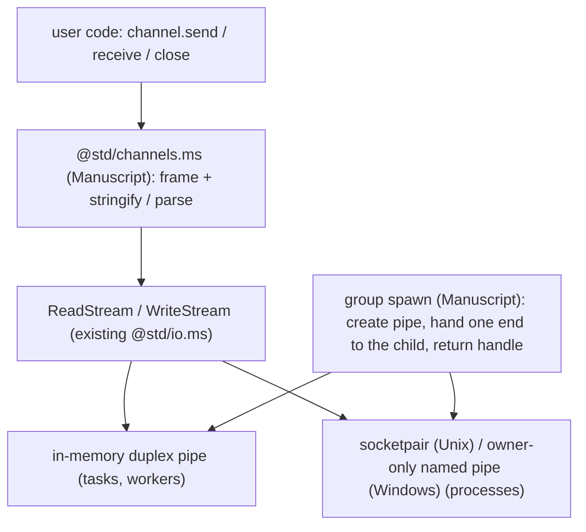

# Channel[In, Out]: framed JSON over a byte pipe, for tasks, threads and processes (design proposal)

## Summary

- Problem: `proposals/taskgroup.md` stage 4 plans one-way `Sender[T]`/`Receiver[T]`; a two-way conversation needs two pairs, and process IPC needs a different type per direction. Earlier drafts here needed tuples, mirror marks, atomics or word intrinsics.
- Change: `Channel[In, Out]` (sends `In`, receives `Out`) is Manuscript code that frames JSON messages over a duplex byte stream. The same code runs at every level; tasks and workers use an in-memory pipe, processes a socketpair or named pipe.
- Only `spawn` creates channels: the child's entry gets one end, and `spawn` returns the child's handle (`Task`, `Worker`, `Process`) whose `channel` field is the other end.
- Cost: one small Rust primitive, an in-memory duplex byte pipe exposed as streams; the OS pipe comes from the child-processes work. Messages are copied and encoded (unmeasured).
- Decision requested: final sign-off.

## Status

- Proposal, 2026-10-24, against `main` at `6361798f`. Nothing implemented.
- Direction (Chinmay, 2026-10-24): "channels should be bidirectional"; keep `Channel` uppercase; "having spawn create them is fine"; "spawn should return the handle to what was spawned, not the channel. Channel can be a field on that return type"; "i want majority of things in ms"; on the atomics design, "this is getting too complicated, whats a simple way?", then "yes" to framed JSON over a byte pipe everywhere; "tasks and workers should be just in memory, no socket, use socket pair only for processes".
- Superseded drafts: `channel_pair` tuple (no tuples), `peer()`/`create_mirror` (needs a mark), `AtomicWords` ring (too complex). Kept in git history.
- Review: an earlier draft had a skeptical subagent review; this version needs a fresh one.

## Goals and non-goals

- Goals: one channel implementation for `TaskGroup`, `WorkerGroup`, `ProcessGroup`; a type per direction; one entry parameter; safe errors on a closed channel; as much as possible in Manuscript; Linux, macOS, Windows parity.
- Non-goals: changing group semantics (results, faults, cancellation stay in their proposals); `select`, timeouts, iteration; shared multi-consumer queues; passing channel ends inside messages; zero-copy moves (possible later behind the same API).

## API

```manuscript
# @std/channels.ms
type Channel[In, Out]          # one end: sends In, receives Out

impl Channel[In, Out]:
    var def send(value: In) -> Result[Unit, Closed]   # encodes and writes one frame; parks while the pipe is full
    var def receive() -> Optional[Out]                # reads one frame; none once the other end closed and drained
    var def close() -> Unit                           # writes a close frame and closes the pipe; also on drop

# handle of one spawned child: Task, Worker or Process
type Worker[T, In, Out]:
    channel: Channel[In, Out]                 # the parent's end

impl Worker[T, In, Out]:
    var def result() -> Result[T, TaskError]
    var def close() -> Unit                   # closes the channel, then stops and joins the child

var def spawn(entry: Callable[[Channel[Out, In]], T]) -> Worker[T, In, Out]
```

```manuscript
def square_all(var ch: Channel[Int, Int]) -> Unit:   # child's end
    var open = True
    while open:
        if let n = ch.receive():
            ch.send(n * n)
        else:
            open = False

def main() -> Int:
    with WorkerGroup[Unit]() as group:     # or TaskGroup / ProcessGroup
        var worker = group.spawn(square_all)
        worker.channel.send(3)
        if let square = worker.channel.receive():
            ...
        worker.close()
    return 0
```

- Entry parameters and bindings that send, receive or close are `var`.
- Worker and process entries are named top-level `def`s (their boundaries reject closures); `TaskGroup` also accepts a lambda.
- Payload rule, one for every level: `In` and `Out` must be JSON-encodable (`stdlib/json.ms`). This rejects handles, closures and `Shared` without a separate boundary check.
- Checker gap: `spawn` needs its own type parameters; methods cannot declare them today ("method spawn declares its own type parameters, which source methods do not support yet"). A free generic `spawn[T, In, Out](entry)` was verified to infer all three under `ms check`. Choose method type parameters or a free `spawn(group, entry)` in stage 0.

## Structure



| Piece | Written in | Notes |
| --- | --- | --- |
| `Channel[In, Out]`, `send`/`receive`/`close`, `Closed` | Manuscript | generic source type; no externs needed |
| Framing | Manuscript | 4-byte LE length, 1 kind byte (message / close / result), UTF-8 JSON body; encode with `stringify`, decode with `parse` |
| Byte transport | existing `ReadStream`/`WriteStream` (`stdlib/io.ms:63-81`) | waiting is ordinary stream I/O through the poller |
| In-memory pipe (tasks, workers) | Rust, new and small | two byte buffers (one per direction) behind a lock, each end a `ReadStream`/`WriteStream`; a reader parks on a token and the writer posts it (`msrt_token_post`, or `post_remote` when the peer is another isolate). One primitive for both levels; no OS handles. Readiness lives in the buffer under its lock; a post is only a wake hint, because posts to an exited isolate, a freed token, or an unconsumed token are dropped. Tokens for a cross-isolate peer are created with `TOKEN_REMOTE` so the owner's scheduler counts a pending wake instead of reporting deadlock (workers branch, PR #1181) |
| OS pipe (processes) | Rust, from `proposals/child-processes.md` (`crates/ms-std-process/src/ipc.rs`) | socketpair on Unix (fd 3, env `MS_IPC`), owner-only named pipe on Windows; each end a `ReadStream`/`WriteStream` pair |
| Group `spawn` wiring | Manuscript | tasks: both ends stay in this process; workers: the child end goes to the worker isolate (its own poller); processes: the child end is inherited (fd 3, env `MS_IPC`) |

- Two pipe kinds, one framing: in memory for tasks and workers, OS pipe for processes. `@std/channels.ms` sees only streams.
- Result frame: for processes the child's return value travels as a `result` kind frame on the same pipe; tasks and workers return results through their group as before.
- Child death: EOF without a result frame makes `result()` return an error carrying the exit status; the parent does not fault.

## Semantics

- Ownership: `send` consumes its argument (encoded, then dropped); `receive` returns a freshly decoded owned value; each end is move-only.
- Close: `close()`, drop, or entry return writes a close frame and closes that end. The other end's `receive()` returns buffered messages, then `none`; its `send` returns `Closed`. EOF counts as close. Both stream handles of an end share one pipe, so closing only the writer does not signal the peer: close is always the close frame, and EOF means the peer process is gone or both handles closed. Safe errors, not faults.
- Backpressure: `send` parks when the OS pipe buffer is full; no separate capacity parameter.
- Cancellation: `send` and `receive` are cancellation points (stream I/O already is).
- Limits: two peers that both `send` first into full pipes park forever; no fan-in without `select`; sibling tasks talk through the parent; JSON losses (`NaN`, map key types) apply at every level.
- Leak dependency: captures of a cancelled task are not dropped today (`proposals/taskgroup.md:49`); a cancelled child's end would stay open. Implementation waits for that fix.

## Components touched

| Component | Change | Test |
| --- | --- | --- |
| `stdlib/channels.ms` (new) | `Channel`, `Closed`, framing | conformance: order, drain-then-none, closed send, drop closes, malformed frame |
| `crates/ms-rt` (or `ms-std-io`) | in-memory duplex pipe as streams, same-isolate and cross-isolate wake | runtime tests; cross-thread stress on 3 platforms |
| OS pipe (with child-processes) | socketpair / named pipe exposed as streams | Linux, macOS, Windows |
| group stdlib modules | `spawn(entry)` returns a handle with a `channel` field | one fixture body for all three groups |
| `crates/ms-check` | method type parameters, or none with a free `spawn` | accept/reject fixtures |
| syntax, lowering, formatter, LSP, CLI | unchanged | none |
| docs, `ms guide` | channel section | docs build |
| sibling proposals | replace `Sender`/`Receiver`/`fork` plans; edited after approval | consistency |

## Verification of examples

- `ms check` (built from `6361798f`) against a stub of `Channel`, `Closed`, `Worker[T, In, Out]` and a free generic `spawn` accepts `square_all` and the caller shape (`worker.channel.send`, `.receive`, `worker.close()`, `worker.result()`). Stub not in the repo.
- Unverified: the pipe, framing, and the method form of `spawn`.

## Alternatives

- **Do nothing (one-way `Sender`/`Receiver`).** Two types, two handles per conversation.
- **Move values in memory (atomics ring, word intrinsics).** No copies, but new runtime primitives and a lock-free ring to get right; rejected as too complex. Can return later behind the same API if a measurement shows the need.
- **Socketpair for every level.** One pipe kind, but a syscall per message and OS handles for in-process channels; rejected by the owner.
- **User-created pairs (`channel_pair`, `create_mirror`).** Need tuples or a mark; rejected.

## Drawbacks

- Every message is copied and encoded, even between tasks; reverses the workers' "send memory rather than a codec" direction for channel payloads (`proposals/worker-threads.md:14`).
- Only JSON-encodable payloads.
- A process channel uses OS handles per child; in-process channels use none.
- Prior art: Unix pipes and sockets; Node's process IPC (JSON over a pipe); Erlang distribution (serialized messages). Manuscript differs by typing each direction and creating ends only in `spawn`.

## Staging and verification

0. Spike: method type parameters vs free `spawn`; in-memory pipe as streams with cross-isolate wake.
1. Docs.
2. `Channel` + `TaskGroup.spawn(entry)` (after TaskGroup stages 2-3 and the capture-drop fix).
3. `ProcessGroup` (OS pipe, inherited end).
4. `WorkerGroup` (in-memory pipe, end handed to the isolate).

Gate per stage: `make conform`, `make verify` on Linux, macOS and Windows; the same fixture body passes for each group added so far; no test disabled on any platform. Record message throughput for tasks at stage 2.

## Open questions

- Before approval (decider: Chinmay): method type parameters or a free `spawn(group, entry)`; recommend the checker feature if small.
- During implementation: frame size limit; in-memory pipe buffer limit (backpressure).

## Future possibilities

- `select` over several channels.
- Zero-copy in-process path behind the same API.
