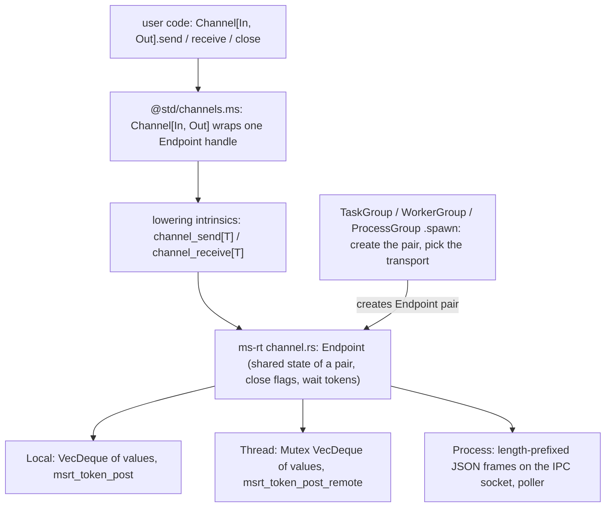

# Channel[In, Out]: one two-ended channel for tasks, threads and processes (design proposal)

## Summary

- Problem: `proposals/taskgroup.md` stage 4 plans one-way `Sender[T]`/`Receiver[T]`; a two-way conversation needs two pairs, and process IPC needs a different type per direction.
- Change: one type `Channel[In, Out]` (sends `In`, receives `Out`) with `send`, `receive`, `close`. A channel always has exactly two ends, and **only `spawn` creates them**: the child's entry receives one end, `spawn` returns the other. No constructor, no `create_mirror`, no tuples, no hidden state.
- Layout: one Manuscript type over one runtime endpoint object with three transports (same-thread queue, cross-thread queue, process socket). Each group's `spawn` picks the transport; user code never sees it.
- Cost: a runtime endpoint (`crates/ms-rt/src/channel.rs`), two lowering intrinsics for moving a generic value through it, and one checker gap (methods cannot declare their own type parameters).
- Decision requested: sign-off on the API and the layering below.

## Status

- Proposal, 2026-10-24, against `main` at `6361798f`. Nothing implemented.
- Direction (Chinmay, 2026-10-24): "channels should be bidirectional"; keep `Channel` uppercase; "can the entry take in a Channel directly? why two args"; "our design needs to be more coherent than node"; "having spawn create them is fine, but I need to understand the overall structure".
- History in this thread: a `channel_pair` returning a tuple (no tuples in the language), `peer()` and `create_mirror` (both need an "already mirrored" mark) were dropped in favor of spawn-created ends.
- Review: the earlier draft had one skeptical subagent review; applicable findings are folded in. This version needs a fresh review.

## Goals and non-goals

- Goals: one channel API across `TaskGroup`, `WorkerGroup`, `ProcessGroup`; a type per direction; one entry parameter; safe errors on a closed channel; Linux, macOS, Windows parity.
- Non-goals: changing group semantics (results, faults, cancellation stay in their proposals); `select`, timeouts, iteration; shared multi-consumer queues; passing channel ends inside messages; channels between sibling tasks without the parent relaying.

## API

```manuscript
# @std/channels.ms
type Channel[In, Out]          # one end: sends In, receives Out

impl Channel[In, Out]:
    var def send(value: In) -> Result[Unit, Closed]   # moves value; parks while full; cancellation point
    var def receive() -> Optional[Out]                # owned value; none once the other end closed and drained
    var def close() -> Unit                           # Closeable; idempotent; also on drop

# on TaskGroup, WorkerGroup and ProcessGroup
var def spawn(entry: Callable[[Channel[In, Out]], T]) -> Channel[Out, In]
```

```manuscript
def square_all(var ch: Channel[Int, Int]) -> Unit:   # child's end
    var open = True
    while open:
        if let n = ch.receive():
            ch.send(n * n)
        else:
            open = False

def main() -> Int:
    with WorkerGroup[Unit]() as group:     # or TaskGroup / ProcessGroup
        var ch = group.spawn(square_all)   # parent's end
        ch.send(3)
        if let square = ch.receive():
            ...
        ch.close()                         # child's receive() returns none; child returns
    return 0
```

- Entry parameter and bindings that send, receive or close are `var` (`ms check` rejects them otherwise).
- Checker gap: `spawn` needs its own type parameters `In`, `Out`; `ms check` today: "method spawn declares its own type parameters, which source methods do not support yet". Either add method type parameters, or expose a free function `spawn(group, entry)`. Decided in stage 0.

## Structure



### Layer 1: `@std/channels.ms` (Manuscript)

- `Channel[In, Out]` is a Manuscript type with one field: an opaque `Endpoint` handle. `send`/`receive`/`close` call the intrinsics below and map runtime status to `Closed`/`none`.
- No transport logic here; one code path for all three locations.

### Layer 2: lowering intrinsics (`crates/ms-lower`)

- Externs cannot be generic (`documentation/core-language/functions/native-functions.md:23`), so moving a `T` through the runtime needs two intrinsics, instantiated per type like the existing `json/stringify` and `json/parse` (`crates/ms-lower/src/native.rs:208`):
  - `channel_send[T](endpoint, value: T)`: for an in-process endpoint, hands the runtime an owned value pointer plus its `TypeDesc` (drop if never received); for a process endpoint, encodes with the same code as `stringify[T]` and passes bytes.
  - `channel_receive[T](endpoint) -> Optional[T]`: the reverse; `parse[T]` for process endpoints.
- The endpoint reports its transport, so the intrinsic chooses move vs encode at run time; the type check for each boundary (JSON-encodable for processes, no `Shared`/handles for threads) is done statically at `spawn` in the group proposals.

### Layer 3: runtime endpoint (`crates/ms-rt/src/channel.rs`, new)

- `Endpoint`: a refcount-free pair object, two ends, each end single-owner. Per direction: a bounded queue (`capacity`), a closed flag, a waiter token.
- Waiting uses the existing park tokens: `msrt_token_new/park/post/free` (`crates/ms-rt/src/task.rs:1003-1126`). Cross-thread wake uses `msrt_token_post_remote` (`task.rs:1114`), which already exists for posts from other threads.
- Transports, one enum inside `Endpoint`:

| Transport | Queue | Wake | Close |
| --- | --- | --- | --- |
| `Local` (tasks) | `VecDeque<value ptr>` | `msrt_token_post` | flag; peer's park returns |
| `Thread` (workers) | `Mutex<VecDeque<value ptr>>`, value moved (no copy) | `msrt_token_post_remote` | atomic flag |
| `Process` | socket frames: 4-byte LE length + UTF-8 JSON; zero length = close | poller readiness on the IPC socket | close frame or EOF (crash, kill) |

### Layer 4: groups wire the pair in `spawn`

- `TaskGroup.spawn(entry)`: creates a `Local` pair; the task's closure calls `entry(child_end)`; returns the parent end.
- `WorkerGroup.spawn(entry)`: creates a `Thread` pair; the child end moves to the worker isolate with the entry; returns the parent end. Needs the per-thread runtime of `proposals/worker-threads.md`; nothing here changes how worker groups behave.
- `ProcessGroup.spawn(entry)`: the parent end is bound to the IPC connection from `proposals/child-processes.md` (loopback socket, `MS_ENTRY`); the child runtime builds its end on the same connection at start (`crates/ms-rt/src/start.rs`) and calls the entry. One channel per child, so frames carry no channel id.

## Semantics

- Ownership: `send` moves its argument; `receive` returns an owned value; each end is move-only, so one owner per end without runtime checks.
- Close: `close()`, drop, or entry return closes that side. The other end's `receive()` drains buffered values, then returns `none`; its `send` returns `Closed`. Safe errors, not faults.
- Capacity: bounded per direction for `Local` and `Thread`; process sends park on the OS socket buffer. Default capacity is an implementation question.
- Cancellation: `send`/`receive` are cancellation points.
- Limits stated, not solved: two peers that both `send` first on full queues park forever (`task.rs:611` faults only when every task is parked); no fan-in without `select`; sibling tasks talk through the parent.
- Leak dependency: captures of a cancelled task are not dropped today (`proposals/taskgroup.md:49`), so a cancelled child's end would not close. Implementation waits for that fix.

## Components touched

| Component | Change | Test |
| --- | --- | --- |
| `stdlib/channels.ms` (new) | `Channel[In, Out]`, `Closed` | conformance: order, drain-then-none, closed send, drop closes |
| `crates/ms-lower` | `channel_send[T]`, `channel_receive[T]` intrinsics | per-type fixtures incl. records and alternatives |
| `crates/ms-rt` | `channel.rs` endpoint, three transports | runtime tests: cancel while parked, cross-thread wake, EOF close |
| `crates/ms-check` | method type parameters, or none with a free `spawn` | accept/reject fixtures |
| group stdlib modules | `spawn(entry)` returns the parent end | one fixture body run against all three groups |
| syntax, formatter, LSP, CLI | unchanged | none |
| docs, `ms guide` | one channel section | docs build |
| sibling proposals | replace `Sender`/`Receiver`/`fork` channel plans; edited after approval | consistency |

## Verification of examples

- `ms check` (built from `6361798f`) against a stub of `Channel`, `Closed` and a group with a free-function `spawn` passes `square_all` and the caller shape; the stub is not in the repo.
- Found by the check and applied: `var` entry parameters; no `record`, `guard` or tuples in the language; no method type parameters.
- Unverified: the runtime, intrinsics, and the method form of `spawn`.

## Alternatives

- **Do nothing (one-way `Sender`/`Receiver`).** Already planned; two types and two handles per conversation.
- **User-created pairs (`channel_pair` tuple, `peer()`, `create_mirror`).** Need tuples or an "already mirrored" mark; allow building ends whose transport `spawn` did not choose.
- **Shared multi-consumer queue.** Breaks request/response, needs end counts, and does not map onto a process socket.
- **Mailbox per task/worker/process (Erlang).** Routable everywhere, but one inbox type per receiver and no static type per conversation.
- **Smallest version:** `TaskGroup` + `Local` transport only; proves the API and close semantics.

## Drawbacks

- Two lowering intrinsics are compiler work for one stdlib type.
- No direct sibling channels and no fan-in until `select`.
- The process transport serializes while the others move; observable only in cost (and JSON limits on `T`).
- Prior art: Unix pipes and sockets (two ends, created together); Go channels (shared, one-way typed); Rust `mpsc` (one-way, cloneable sender); Node `MessagePort` (two ends, event-driven). Manuscript keeps two ends, typed per direction, created only by `spawn`. Benefit is design-level; nothing measured.

## Staging and verification

0. Spike (no merge): intrinsic move of a generic value through an opaque endpoint; method type parameters vs free `spawn`.
1. Docs.
2. `Local` transport + `TaskGroup.spawn(entry)` (after TaskGroup stages 2-3 and the capture-drop fix).
3. `Thread` transport with the worker-threads stages.
4. `Process` transport with the child-processes stages.

Gate per stage: `make conform`, `make verify` on Linux, macOS and Windows; the same fixture body passes for each group added so far; no test disabled on any platform.

## Open questions

- Before approval (decider: Chinmay):
  1. Method type parameters in the checker (general feature) or a free function `spawn(group, entry)`? Recommend the checker feature if it is small after the spike; otherwise the free function.
  2. Is "only `spawn` creates channels" acceptable given sibling tasks must relay through the parent? Recommend yes for v1.
- During implementation: default capacity; process frame size limit.

## Future possibilities

- `select` over several channels (fan-in).
- Passing a channel end inside a message (needs descriptor passing for processes).
