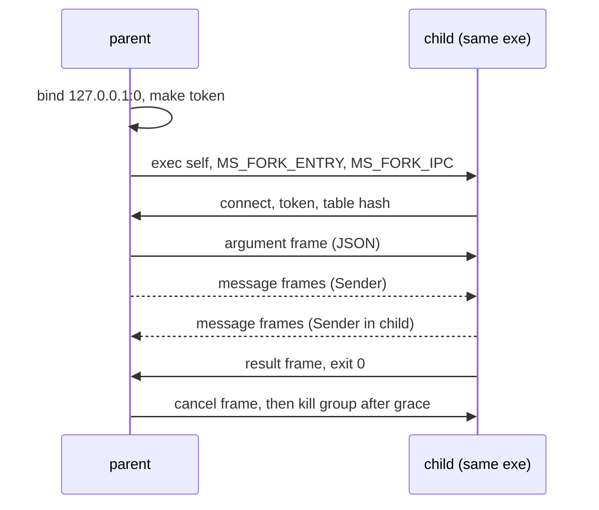

# Child processes and `fork` (design proposal)

## Summary

- Problem: a program uses one core, and cannot run Manuscript code in another process with typed inputs, typed results and scoped lifetime.
- Change: `ProcessGroup[T]` in `@std/processes.ms` runs a named top-level `def` in a re-exec of the same executable. Values cross as JSON over a token-guarded loopback socket. The group joins or kills children at the end of `with`.
- `fork` is JS `child_process.fork`, not POSIX `fork(2)`: spawn the same binary, select an entry, open an IPC connection. No parent state is copied.
- Cost: an entry table, a start-path hook in `ms-rt`, one socket transport; no change to runtime globals (unlike `proposals/worker-threads.md`). Whole cost is process start plus JSON per value.
- Decision requested: approve stage 2 (measure start latency and JSON throughput) and the three open questions below.

## Status

- Proposal, no code. Checked against `origin/main` df8ebe595 (2026-10-24).
- Direction (Chinmay, 2026-10-24): `worker_threads`-style model extended to processes, with fork; a separate proposal from threads; all platforms in the first release; no "sendable" concept; send memory if possible, else JSON; dedicated group type (like `WorkerGroup`).
- Siblings: `proposals/taskgroup.md` (scope, `Channel[T]`), `proposals/worker-threads.md` (same group shape, move transfer).
- `TaskError` and `timeout:` follow the worker proposal (which follows the TaskGroup thread's revision not yet in `proposals/taskgroup.md`); `Child[T]` is this proposal's analogue of `Worker[T]`. Reconcile when the TaskGroup revision lands. The worker proposal writes `timeout: Duration = none`; the repo spelling is `Optional[Duration] = none` (`stdlib/process.ms:59`), used here.
- Review: first draft reviewed by an independent subagent, findings folded in (see Review outcome). This rewrite needs a second review before approval.

## Problem

- One runtime thread runs all Manuscript code (`crates/DESIGN.md` decision 4); CPU-bound work cannot use more cores.
- Threads need per-isolate runtime state (`proposals/worker-threads.md`: 55 `Global<` uses, generated-code TLS). Processes need none of it.
- A faulting child exits 70 without touching the parent's heap; threads cannot offer that.
- Today `Commands.spawn` (`stdlib/process.ms:61`) starts a program for use with `with` (closing it kills the process group) and gives byte pipes; there is no typed IPC and no way to run an exported Manuscript function in the child. Scoped lifetime for plain programs already exists and is not repeated here.
- Affected: batch tools, servers, agents writing fan-out programs.
- Not measured: no benchmark here shows a workload that gains. Stage 2 must record child start latency and JSON throughput.

## Goals and non-goals

- Goals:
  - same group shape as `TaskGroup` and `WorkerGroup`: spawn, results, wait, close, `with`;
  - child scoped to the group: killed on early exit or cancel, joined otherwise;
  - child fault surfaces in the parent;
  - Linux, macOS and Windows in every stage.
- Non-goals:
  - POSIX `fork()` or any copy of parent state;
  - shared memory;
  - sending handles, closures, `Shared` values or channel endpoints inside messages;
  - catching a child fault (shared with TaskGroup's deferred item);
  - changing single-process behavior.

## Design

### Syntax and API

```manuscript
from "@std/processes.ms" import ProcessGroup
from "@std/tasks.ms" import Sender, Receiver

def checksum(input: Receiver[Bytes], output: Sender[Int], seed: Int) -> Int:
    var total = seed
    for chunk in input:
        total = total + chunk.length()
    output.send(total)
    return total

def main():
    with ProcessGroup[Int]() as group:
        let (to_child, from_child, child) = group.fork(checksum, 7)
        to_child.send(read_block())
        to_child.close()
        let results = group.results()
```

- `ProcessGroup[T]`: `Closeable`; every forked child returns `T`.
- `spawn(entry, argument, timeout: Optional[Duration] = none) -> Child[T]`: entry `def f(argument: A) -> R`; same signature as `WorkerGroup.spawn`, so switching from threads to processes is a one-word change.
- `fork(entry, argument, timeout: Optional[Duration] = none) -> (Sender[In], Receiver[Out], Child[T])`: entry `def f(input: Receiver[In], output: Sender[Out], argument: A) -> R`.
- `Child[T].result() -> Result[T, TaskError]`; `results() -> Result[List[T], TaskError]` in spawn order; `wait() -> Result[Unit, TaskError]` for `T = Unit`; `close()` stops then joins.
- Plain programs stay with `Commands.spawn` inside `with`; a group method would duplicate it (simplification pass).
- `entry` is a named top-level `export def`, from any module. One binary, so a function item identifies it; no path string.
- Rejected at the call site (illustrative text): `fork(lambda: f(x), 1)` -> "child entry must be a named top-level def; lambdas and captures cannot run in another process".
- `In`, `Out`, `A`, `R` need a JSON form; whether that is checked at the call is open question 3 (see Semantics for what JSON does today).

### Semantics

- Start: parent runs its own executable (`std::env::current_exe`; `/proc/self/exe` on Linux so a replaced file is not run) with `MS_FORK_ENTRY=<index>` and `MS_FORK_IPC=<port>:<token>`.
- Start hook: `msrt_start` (`crates/ms-rt/src/start.rs:263`) checks `MS_FORK_ENTRY` before running `main`. If set it removes both variables from the environment seen by user code, connects, reads the argument frame, runs the entry as the main task, sends the result frame, exits 0. User `args()` and `main` are untouched; `ARG_SKIP` (`start.rs:21`) is unrelated.
- Entry table: lowering records each entry referenced by `spawn`/`fork` (index, function, `A`/`R` types). Parent and child are one binary, so tables agree; the handshake still carries a table hash and refuses a mismatch.
- Transfer: JSON, not raw memory.
  - Strings, lists, maps and records hold heap pointers, and `Map`/`Set` carry a hash index, so only plain-bits values (`KIND_POD`, `ms-rt-abi/src/lib.rs:343`) could be copied as bytes.
  - `TypeDesc` (`lib.rs:367`) has no field layout for records and alternatives (`KIND_CUSTOM`, `lib.rs:351`), so a binary codec is new compiler work.
  - Messages, argument and result use typed `stringify[T]` (`stdlib/json.ms:153`) and `parse[T]` (`json.ms:78`), length-prefixed UTF-8 frames.
  - Supported: records, alternatives, `Optional`, `Result`, `List`/`Set`/`Map`, `Bytes` (base64), `Int`, `BigInt`, `Decimal`.
  - No user-facing "sendable" concept. What JSON does today with a no-form value (`stdlib/json.ms:~119-122`): a record field is omitted, a list element becomes `null`, a map value is omitted, a root returns `InvalidData`. Decode then returns `InvalidData` for a required missing field, or yields a default or `null`. So a `Listener` inside a record is dropped silently, not faulted; open question 3 asks for a call-site type error instead.
  - `JsonEncode.to_json` types encode custom but cannot decode (`json.ms:~88-90`), so they cannot round-trip across a process.
  - Known losses, documented not patched: `NaN` and infinities become `null` (decode as `Float` fails); `Map` keys limited to JSON's key types.
  - `max_message_bytes` (default 64 MiB) reuses `JsonLimits`.
- IPC: the parent binds `127.0.0.1:0`, passes port and a random 128-bit token, accepts one connection that presents the token, then closes the listener.
  - Sockets are what the poller already waits on everywhere (epoll/kqueue; mio over sockets on Windows, `crates/ms-rt/src/poller.rs:210-215`). A Windows pipe handle would count as ready at once and spin, so pipes are not used.
  - `send` waits when the socket buffer is full; `receive` waits when empty; both are cancellation points.
  - Frames: `argument`, `message(channel_id, bytes)`, `close(channel_id)`, `cancel`, `result`. Sender close delivers end-of-input; socket EOF without a `result` frame means the peer died.
  - Other local users can reach the port until the single accept; the token makes that harmless. A Unix-domain socket may replace it on Unix later with no API change.
- Scope and cancel:
  - `close` (block exit, parent cancel, signal) sends `cancel`; the child cancels its main task so shielded cleanups run; after a grace period (default 5 s) the child's process group is killed (`SIGKILL`, as `Subprocess.stop` does, `command.rs:271-276`) and joined.
  - `process` children and `Subprocess.close` kill immediately: no cleanup.
  - Unix children run in their own process group (`spawn.rs:86`); Windows uses `CREATE_NEW_PROCESS_GROUP` (`spawn.rs:92`) plus a job object.
- Orphans: a parent killed without cleanup closes the socket; the child sees EOF, cancels its main task and exits. `PR_SET_PDEATHSIG` is not used: it fires when the spawning thread exits, not the process, and spawns may run on a pool thread.
- Fault: the child runs its cleanups, writes the fault text to its stderr (inherited), exits 70 without a `result` frame. The parent faults naming the entry and status after the group kills and joins siblings (TaskGroup's v1 abort rule). A child killed by a signal reports -1 and counts as a fault unless the group killed it.
- Stdio: stdout and stderr inherited; stdin is `/dev/null` (inheriting it makes two processes race for the terminal). Environment and working directory inherited.
- Observability of faults is possible here (unlike for tasks): a later `fork_catching` returning `Result[R, ChildFault]` needs no runtime hook. Not in v1.



### Platform parts

- Executable path: `std::env::current_exe` everywhere.
- Exit watching: pidfd on Linux (`spawn.rs:136`); elsewhere the existing slice polling.
- Windows job object: today assigned after spawn (`spawn.rs:118-125`), racy, without `KILL_ON_JOB_CLOSE`; must be assigned at creation and kill on close so grandchildren die with the child.
- Orphan protection is socket EOF on every platform.

## Components touched

| Component | Change | Risk / test |
| --- | --- | --- |
| `crates/ms-check` | function-item entry rule for `spawn`/`fork`, signature check, diagnostics | conformance reject cases |
| `crates/ms-lower`, `ms-mir`, `ms-clif` | entry table emission and reference; entry runs through a new path beside `run_on_big_stack`; `stringify[T]`/`parse[T]` are compiler intrinsics (`ms-lower/src/native.rs`, `json.rs` emit one encoder and decoder per type), so lowering must emit codecs for `A`, `R`, `In`, `Out` per entry and register them in the table for the `ms-rt` transport to call | e2e fork fixture on 3 platforms |
| `crates/ms-rt` | start hook, socket transport, frame codec, parent-death cancel | cancel, fault, EOF, oversize and malformed-frame tests |
| `crates/ms-std-process` | `spawn::start` gains env and `/dev/null` stdin (today stdin/stdout/stderr pipes only, `spawn.rs:61`); waiting through poller, not `Child::wait` which blocks the runtime thread (`spawn.rs:182`); job object fix | per-crate tests incl. Windows |
| `stdlib/processes.ms`, `bindings.json` | `ProcessGroup` (`spawn`, `fork`), `Child`; natives | `make docs`, extern parity |
| `crates/ms-std-json` | unchanged; its runtime is reused through the lowered codecs | round-trip tests for supported types |
| `ms-syntax`, formatter, lint, LSP | unchanged (no syntax) | - |
| Docs | core-language page, cheat sheet (`ms guide`), `crates/DESIGN.md` decision 4, `VISION.md`, `.experts/runtime.md`, `proposals/taskgroup.md` (drop `spawn_worker` string form and sendable text) | `make repo-check`, `make book-check` |
| Conformance | start, results order, cancel, fault exit, orphan EOF, JSON edge values | `make conform` |

## Examples

- End-to-end: `checksum` above with `read_block() -> Bytes` standing for any producer of a 1 MiB block; stage 2 runs it as a 100 MB stream against a plain pipe. Illustrative: iterating a `Receiver` (`for chunk in input`) is deferred in `proposals/taskgroup.md` (only `receive() -> Optional[T]` is specified), so the loop shape follows that decision.
- Spawn form: `group.spawn(hash_chunk, chunk)` over `List[Bytes]`, same call as `WorkerGroup`.
- Rejected (illustrative, if open question 3 is accepted): `group.spawn(handler, listener)` with `listener: Listener` -> "child argument cannot be sent: `Listener` has no JSON form". Without it the field is silently omitted (see Semantics).

## Alternatives

- Do nothing: `Commands.spawn` plus the program's own executable and hand-rolled byte pipes works today. Cost: no typed IPC, no scoped lifetime, every user rebuilds framing.
- Smallest version: only `spawn` (argument in, result out, no channels). Cheap; `fork` adds the Sender/Receiver pair. Open question below.
- POSIX `fork()`: rejected; the runtime is multithreaded (blocking pool; `fork()` keeps one thread and inherits held locks, the poller and coroutine stacks), unavailable on Windows, and breaks single ownership at OS level.
- Raw memory transfer: rejected; heap pointers and the map hash index (see Semantics). Only plain-bits values qualify.
- New binary codec (type-directed): deferred; new compiler work (`TypeDesc` lacks record layout). Revisit only if stage 2 shows JSON is the bottleneck.
- Entry by path string: rejected; typo is a runtime failure and the compiler cannot know which functions to keep or which types to encode.
- Fork a closure: rejected; captured owned state would need encoding.
- Methods on `TaskGroup`: rejected by the owner; a dedicated group names what it scopes.
- Pipes or inherited descriptors for IPC: rejected; Windows pipes cannot park in the poller, and descriptor inheritance needs `pre_exec` and handle lists on each platform. A loopback socket is one path everywhere.
- Wait for worker threads: threads need the isolate refactor first; processes work without changing `ms-rt` globals and add fault isolation.

## Drawbacks

- Process start cost per child (exec of the whole binary) and JSON encode/decode per value; both unmeasured.
- Values with no JSON form are silently omitted inside records, lists and maps unless a call-site check is added (open question 3).
- A third group type beside `TaskGroup` and `WorkerGroup`; learners hold three.
- Loopback listener exists briefly on every fork; firewalls on some systems may prompt (unverified).
- `ProcessGroup.spawn` and `WorkerGroup.spawn` agree, but `fork`'s entry shape differs from `WorkerGroup`'s; `proposals/worker-threads.md` lists the alignment as an open question.
- Plain-bits payloads (`List[Int]`) pay JSON cost that raw copy would not.

## Prior art

- JavaScript `child_process.fork`: same executable-style spawn with IPC channel and JSON-like messages. Differs: function item instead of module path; scoped group; `Result` instead of events.
- Python `multiprocessing`: spawn start method, pickled arguments. Differs: JSON, no closures.
- Erlang `spawn`: lightweight processes, message copy. Differs: OS processes.
- Go `os/exec` plus self-exec: manual. Same do-nothing baseline.
- Rust `std::process::Command` with `current_exe`: same technique, untyped.

## Evidence and cost

- Verified in source: `spawn::start` takes only three stdio descriptors and sets a process group (`spawn.rs:61-92`); the Windows poller waits on sockets only (`poller.rs:210-215`); `msrt_start` has no pre-`main` dispatch (`start.rs:263`); `typed stringify`/`parse` exist (`json.ms:78,153`); CI runs tests on darwin arm64 and windows amd64 (`.github/workflows/cicd.yml:63-64`).
- Not measured: child start latency, JSON throughput, loopback accept cost, grace-period behavior.
- Adds: one stdlib module, an entry table, one runtime start path and transport, one checker rule. Learner concepts: `ProcessGroup`, `Child`.

## Staging and verification

- Each stage is its own PR with auto-merge. Pull requests run Linux only (`.github/workflows/cicd.yml:55-57`); for any stage touching platform code, run the workflow by hand on the branch for macOS and Windows before merging.
1. Docs: canonical pages, DESIGN.md decision 4, VISION, expert entry, `proposals/taskgroup.md` reconciliation. `make repo-check`.
2. Measure: re-exec latency and JSON round trip for `List[Int]` and `Bytes` against a plain pipe; round-trip tests for supported types. Go/no-go: proposed gate is start latency under 50 ms and JSON throughput within 10x a raw pipe; Chinmay confirms.
3. Platform prerequisites: job object assigned at creation with `KILL_ON_JOB_CLOSE`; `spawn::start` env and `/dev/null` stdin; poller-based child wait. Then entry table and start hook: run an entry in a re-exec'd child with argument and result frames, no channels; `spawn` path only.
4. Socket transport and `Sender`/`Receiver`: backpressure, EOF, oversize and malformed frames, parent-death cancel. Depends on TaskGroup stage 4.
5. `ProcessGroup` with `fork`, scope join and kill, fault surfacing.
6. Diagnostics (lambda or method passed to `fork`, `os.fork()`/`child_process.fork` shapes pointing to `ProcessGroup`), cheat sheet.
7. Cross-platform verification: orphan, kill and fault tests on macOS and Windows runners (manual workflow runs); part of the first release.

## Open questions

- Resolve before approval (decider: Chinmay):
  - Entry as function item (recommended) or string path.
  - Keep both `spawn` (no channels, matches `WorkerGroup`) and `fork` (channels), or `fork` only (recommend both: `spawn` is the common case and mirrors threads).
  - Channels inside messages across processes: not in v1 (recommended); JSON has no form for an endpoint, so it needs a separate handle-passing design.
  - Child stdin `/dev/null` (recommended) or inherited.
  - Call-site check (resolves item 3 of the review): reject `spawn`/`fork` types containing a part with no JSON form (resource, closure, `Shared`, handle) as an ordinary type error, the same boundary check `proposals/worker-threads.md` uses and not a user-visible concept (recommended); or accept JSON's silent omission.
- Resolve during implementation:
  - Grace period default (proposed 5 s) and whether it is a parameter.
  - Entry-table hash handshake vs trusting one binary.
  - Unix-domain socket on Unix instead of loopback.

## Rejected ideas

- A `Sendable` trait or rule (owner: avoid).
- Methods on `TaskGroup` (owner: dedicated group).
- Linux-only first release (owner: all platforms).
- Raw memory transfer (not sound across processes; see Semantics).

## Future possibilities

- `fork_catching` returning `Result[R, ChildFault]`.
- Binary frame body if JSON is measured as the bottleneck.
- Environment and working-directory overrides on `fork`.

## Review outcome

- Independent subagent reviewed the first draft against source; folded in:
  - Windows pipes cannot park in the poller, so IPC is a loopback socket on every platform;
  - Linux-only features (`pidfd`, `PDEATHSIG`, `/proc/self/exe`) are optional platform parts, not requirements;
  - group kill is `SIGKILL`, so cleanup needs a cooperative `cancel` frame first;
  - the Windows job object is assigned after spawn and lacks `KILL_ON_JOB_CLOSE`;
  - there is no per-type clone to mirror, so a binary codec is new work (now deferred);
  - `spawn::start` has no extra-fd or `/dev/null` support, `msrt_start` no pre-`main` hook, and `Child::wait` blocks the runtime thread;
  - a leaked `Sender` (TaskGroup's known capture-drop gap) delays EOF, so stage 4 depends on that fix or the `cancel` frame.
- Second independent review of this rewrite (all `file:line` citations verified), folded in:
  - JSON does not fault on a no-form value inside a record or list, it omits it; text corrected and a call-site check added as an open question;
  - lowering must emit per-entry codecs because `stringify`/`parse` are compiler intrinsics;
  - `process()` duplicated `Commands.spawn`; removed;
  - `PDEATHSIG` fires on spawning-thread exit; dropped in favor of socket EOF;
  - names aligned with the worker proposal (`Child[T]`, `wait()`, `Optional[Duration]`), iteration caveat recorded;
  - pull requests run Linux only; macOS and Windows need a manual workflow run;
  - job-object fix moved before `ProcessGroup` lands.
