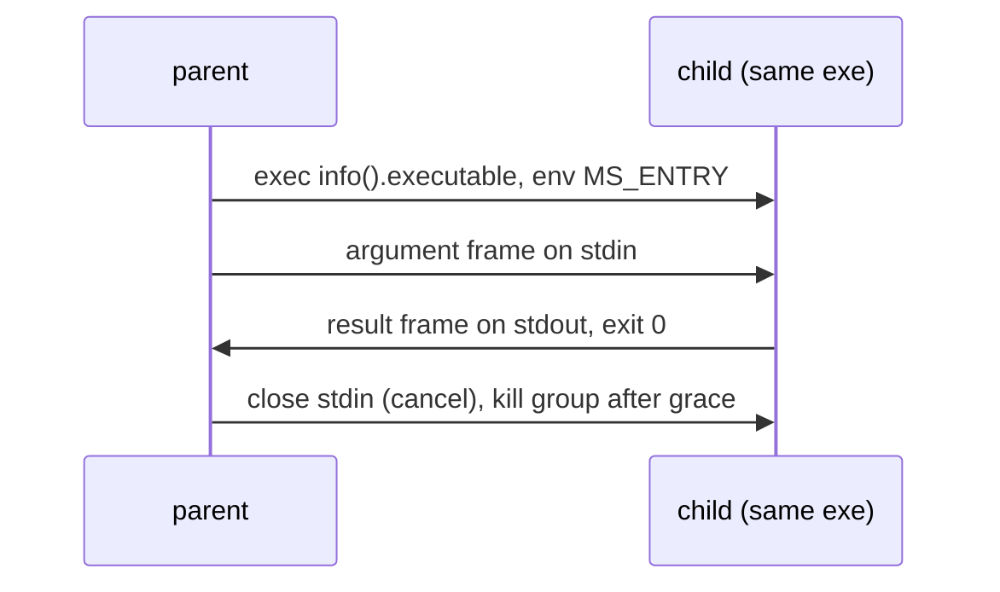

# Child processes and `fork` (design proposal)

## Summary

- Problem: a program uses one core, and cannot run a Manuscript function in another process with a typed argument, a typed result and scoped lifetime.
- Change (v1): `ProcessGroup[T].spawn(entry, argument)` in `@std/processes.ms` re-execs the same binary, runs a named top-level `def` there, and returns its result. The argument and result are JSON frames over the child's stdin and stdout. The group joins or kills children at the end of `with`.
- Change (stage 3, after TaskGroup channels land): `fork` adds a `Sender`/`Receiver` pair over the same pipes. This is JS `child_process.fork`, not POSIX `fork(2)`: no parent state is copied.
- Cost: an entry table, a start-path hook in `ms-rt`, and a small stdlib module over the existing `Commands.spawn`. No new transport, no compiler codecs, no change to runtime globals (unlike `proposals/worker-threads.md`).
- Decision requested: approve the stage 1 measurement and the four open questions, including whether to build this or document the manual recipe.

## Status

- Proposal, no code. Checked against `origin/main` 0d40124f1 (2026-10-24).
- Direction (Chinmay, 2026-10-24): `worker_threads`-style model extended to processes, with fork; separate proposal from threads; all platforms in the first release; no "sendable" concept; send memory if possible, else JSON; dedicated group type like `WorkerGroup`; skeptical review and simplification requested.
- Siblings: `proposals/taskgroup.md` (scope, `Channel[T]`), `proposals/worker-threads.md` (same group shape).
- `TaskError` and `timeout:` follow the worker proposal; `Child[T]` is this proposal's analogue of `Worker[T]`. The worker proposal writes `timeout: Duration = none`; the repo spelling `Optional[Duration] = none` (`stdlib/process.ms:59`) is used here. Reconcile when the TaskGroup revision lands in `proposals/taskgroup.md`.
- Reviews: three independent subagent reviews; the third (simplification) cut the socket transport, table hash, cancel frame, per-entry codecs and four stages. See Review outcome.

## Problem

- One runtime thread runs all Manuscript code (`crates/DESIGN.md` decision 4); CPU-bound work cannot use more cores.
- Threads need per-isolate runtime state (`proposals/worker-threads.md`: 55 `Global<` uses, generated-code TLS). Processes need none of it.
- A faulting child exits 70 without touching the parent's heap; threads cannot offer that.
- Today `Commands.spawn` (`stdlib/process.ms:61`) starts a program for use with `with` (closing it kills the process group) and gives byte pipes. A user can already re-exec `info().executable` with an `args()` marker and exchange `stringify`/`parse` text. What they lack:
  - a function item as the entry instead of a hand-written argv convention;
  - typed argument and result without writing the framing;
  - group semantics: results in spawn order, a child fault surfacing as `TaskError`, cancel and join on `close`.
- Affected: batch tools, servers, agents writing fan-out programs.
- Not measured: no benchmark here shows a workload that gains. Stage 1 must record child start latency and pipe JSON throughput.

## Goals and non-goals

- Goals:
  - same group shape as `TaskGroup` and `WorkerGroup`: spawn, results, wait, close, `with`;
  - child scoped to the group: stopped on early exit or cancel, joined otherwise;
  - child fault surfaces in the parent;
  - Linux, macOS and Windows.
- Non-goals:
  - POSIX `fork()` or any copy of parent state;
  - shared memory;
  - sending handles, closures, `Shared` values or channel endpoints inside messages;
  - catching a child fault (shared with TaskGroup's deferred item);
  - a second transport (sockets, descriptor passing) in v1.

## Design

### Syntax and API

```manuscript
from "@std/processes.ms" import ProcessGroup

def hash_chunk(chunk: Bytes) -> String:
    return sha256_hex(chunk)

def hash_all(chunks: List[Bytes]) -> Result[List[String], TaskError]:
    with ProcessGroup[String]() as group:
        for chunk in chunks:
            group.spawn(hash_chunk, chunk.clone())
        return group.results()
```

- `ProcessGroup[T]`: `Closeable`; every child returns `T`.
- `spawn(entry, argument, timeout: Optional[Duration] = none) -> Child[T]`: entry `def f(argument: A) -> R`; same signature as `WorkerGroup.spawn`, so switching from threads to processes is a one-word change.
- `Child[T].result() -> Result[T, TaskError]`; `results() -> Result[List[T], TaskError]` in spawn order; `wait() -> Result[Unit, TaskError]` for `T = Unit`; `close()` stops then joins.
- `entry` is a named top-level `export def`, from any module; one binary, so a function item identifies it, with no path string.
- Rejected at the call site (illustrative text): `spawn(lambda: f(x), 1)` -> "child entry must be a named top-level def; lambdas and captures cannot run in another process".
- Stage 3 adds `fork(entry, argument, timeout) -> (Sender[In], Receiver[Out], Child[T])` with entry `def f(input: Receiver[In], output: Sender[Out], argument: A) -> R`. Not part of v1.
- Plain programs stay with `Commands.spawn` inside `with`; a group method would duplicate it.

### Semantics

- Start: the parent runs `info().executable` through `Commands.spawn`'s start path (`crates/ms-std-process/src/spawn.rs:61`) with env `MS_ENTRY=<index>`. stdin, stdout and stderr are the existing pipes.
- Start hook: `msrt_start` (`crates/ms-rt/src/start.rs:263`) checks `MS_ENTRY` before `main`. If set, it clears the variable from the environment seen by user code, moves descriptor 1 to descriptor 2 and keeps the original stdout pipe for frames, then runs the entry as the main task.
- Entry table: each `spawn` instantiation registers `(index, thunk)`. The thunk is generic Manuscript in `@std/processes.ms`: read frame, `parse[A]`, call entry, `stringify[R]`, write frame. Lowering instantiates generics per type argument list (`crates/ms-lower/src/lib.rs:4-5`), so the existing `stringify`/`parse` intrinsics (`ms-lower/src/native.rs:208`, `json.rs`) need no new codec code. The table is an index, not a hash: parent and child are one binary.
- Transfer: JSON, not raw memory.
  - Strings, lists, maps and records hold heap pointers, and `Map`/`Set` carry a hash index, so only plain-bits values (`KIND_POD`, `crates/ms-rt-abi/src/lib.rs:343`) could be copied as bytes.
  - `TypeDesc` (`lib.rs:367`) has no field layout for records and alternatives (`KIND_CUSTOM`, `lib.rs:351`), so a binary codec is new compiler work.
  - Supported: records, alternatives, `Optional`, `Result`, `List`/`Set`/`Map`, `Bytes` (base64), `Int`, `BigInt`, `Decimal`.
  - What JSON does with a no-form value (`stdlib/json.ms:~119-122`): a record field is omitted, a list element becomes `null`, a map value is omitted, a root returns `InvalidData`. A required field then fails to decode. A `Listener` in a record is dropped silently unless open question 3 is accepted.
  - `JsonEncode.to_json` types encode custom but cannot decode (`json.ms:~88-90`), so they cannot cross.
  - Losses documented, not patched: `NaN` and infinities become `null`; `Map` keys limited to JSON's key types.
- Frames: a 4-byte little-endian length, then UTF-8 JSON. Parent to child on stdin: the argument. Child to parent on stdout: the result. `JsonLimits` bounds the size (default none, as `parse`).
- Child exit: result frame then exit 0; no result frame, or any other status, is a failure.
- Scope and cancel:
  - `close` (block exit, parent cancel, signal) closes the child's stdin. The child runtime treats stdin EOF as cancellation of its main task, so shielded cleanups run; after a grace period (default 5 s) the child's process group is killed (`SIGKILL`, as `Subprocess.stop` does, `command.rs:271-276`) and joined.
  - Unix children run in their own process group (`spawn.rs:86`); Windows uses `CREATE_NEW_PROCESS_GROUP` (`spawn.rs:92`) plus a job object.
- Orphans: a parent killed without cleanup closes the pipe; the child sees stdin EOF and cancels. This is the same path as `close`.
- Fault: the child runs its cleanups, writes the fault text to stderr (inherited), exits 70 without a result frame. The parent faults naming the entry and status after the group stops and joins siblings (TaskGroup's v1 abort rule). A child killed by a signal reports -1 and counts as a fault unless the group killed it.
- Stdio: the child's stdout is the frame channel, so a child's `print` goes to stderr. The child's own stdin is the argument channel. Environment and working directory are inherited.
- Waiting: pipes park on pidfd on Linux; elsewhere the task polls in 2 ms slices (`command.rs:5-17`, `POLL_MS`). Windows therefore works with no poller change.
- A later `spawn_catching` returning `Result[R, ChildFault]` needs no runtime hook, because the parent observes exit status. Not in v1.



### Platform parts

- Executable path: `ProcessControl.info().executable` (`stdlib/process.ms:121`).
- Exit watching: pidfd on Linux (`spawn.rs:136`), slice polling elsewhere (existing).
- Windows job object: assigned after spawn today (`spawn.rs:118-125`), racy and without `KILL_ON_JOB_CLOSE`; must be assigned at creation and kill on close so grandchildren die with the child.

## Components touched

| Component | Change | Risk / test |
| --- | --- | --- |
| `crates/ms-check` | function-item entry rule for `spawn`, signature check, diagnostics | conformance reject cases |
| `crates/ms-lower`, `ms-mir`, `ms-clif` | entry table: each `spawn` instantiation registers `(index, thunk)`; no new codecs | e2e spawn fixture on 3 platforms |
| `crates/ms-rt` | start hook for `MS_ENTRY`, stdout-to-stderr remap, stdin-EOF cancel | cancel, fault, EOF tests |
| `crates/ms-std-process` | `spawn::start` takes an env addition (today three stdio descriptors only, `spawn.rs:61`); Windows job object at creation with `KILL_ON_JOB_CLOSE` | per-crate tests incl. Windows |
| `stdlib/processes.ms`, `bindings.json` | `ProcessGroup`, `Child`, entry thunk in Manuscript | `make docs`, extern parity |
| `crates/ms-std-json` | unchanged | round-trip tests for supported types |
| `ms-syntax`, formatter, lint, LSP | unchanged (no syntax) | - |
| Docs | core-language page, cheat sheet (`ms guide`), `crates/DESIGN.md` decision 4, `VISION.md`, `.experts/runtime.md`, `proposals/taskgroup.md` (drop `spawn_worker` string form and sendable text) | `make repo-check`, `make book-check` |
| Conformance | start, results order, cancel, fault exit, orphan EOF, JSON edge values | `make conform` |

## Examples

- End-to-end: `hash_all` above; stage 1 runs it over 100 MB of chunks and times it against the manual recipe.
- Manual recipe (works today, the do-nothing baseline; illustrative, not run):

```manuscript
def main():
    let arguments = process.arguments()
    if arguments.length() > 0 and arguments[0] == "--child":
        run_child(parse[Int](read_all_stdin()))
    else:
        with commands.spawn(executable_path(), ["--child"]) as child:
            child.stdin().write(stringify(7))
            child.stdin().close()
            print(child.stdout().read_all())
```

- Rejected (illustrative, if open question 3 is accepted): `group.spawn(handler, listener)` with `listener: Listener` -> "child argument cannot be sent: `Listener` has no JSON form". Without it the field is silently omitted.

## Alternatives

- Do nothing, and document the manual recipe above in the guide:
  - already gives typed JSON through user-called `stringify`/`parse`, scoped kill through `with`, and a result through stdout, on all three platforms;
  - lost without the proposal: a function item as the entry (the recipe uses a hand-written argv marker), group results in spawn order, child faults as `TaskError`, join semantics, and the same call shape as `WorkerGroup`.
- Smallest version: `spawn` only (this proposal's v1). `fork` channels wait for TaskGroup stage 4.
- Sockets (loopback and token) for IPC: cut. Pipes already park on Windows through slice polling (`command.rs:5-17`), `Subprocess` is the existing proof, and sockets add a listener, a port, a token and a firewall risk. Revisit only if pipe latency (2 ms slices off Linux) fails the stage 1 gate.
- Cancel frame plus grace period: cut; stdin EOF is the cancel signal and a kill after the grace period backs it.
- Entry-table hash handshake: cut; one binary.
- Per-entry lowered codecs: cut; generic stdlib thunk plus existing intrinsics.
- POSIX `fork()`: rejected; the runtime is multithreaded (a blocking pool; `fork()` keeps one thread and inherits held locks, the poller and coroutine stacks), unavailable on Windows, and breaks single ownership at OS level.
- Raw memory transfer: rejected; heap pointers and the map hash index (see Semantics). Only plain-bits values qualify.
- New binary codec: deferred; new compiler work (`TypeDesc` lacks record layout). Revisit only if stage 1 shows JSON is the bottleneck.
- Entry by path string: rejected; typo is a runtime failure and the compiler cannot know which functions to keep.
- Fork a closure: rejected; captured owned state would need encoding.
- Methods on `TaskGroup`: rejected by the owner; a dedicated group names what it scopes.
- Wait for worker threads: threads need the isolate refactor first (`proposals/worker-threads.md`); processes need none of it and add fault isolation.

## Drawbacks

- Process start cost per child (exec of the whole binary) and JSON encode/decode per value; both unmeasured.
- A child's `print` goes to stderr; surprising unless documented.
- Values with no JSON form are silently omitted inside records, lists and maps unless a call-site check is added.
- A third group type beside `TaskGroup` and `WorkerGroup`; learners hold three.
- Off Linux, waiting uses 2 ms polling slices: bounded extra latency per frame, no busy loop.
- Plain-bits payloads (`List[Int]`) pay JSON cost that raw copy would not.

## Prior art

- JavaScript `child_process.fork`: same-executable spawn with an IPC channel carrying structured messages. Differs: function item instead of module path; scoped group; `Result` instead of events; stdio frames in v1.
- Python `multiprocessing`: spawn start method, pickled arguments. Differs: JSON, no closures.
- Erlang `spawn`: lightweight processes, message copy. Differs: OS processes.
- Go `os/exec` plus self-exec: manual; the do-nothing baseline.
- Rust `std::process::Command` with `current_exe`: same technique, untyped.

## Evidence and cost

- Verified in source: `spawn::start` takes only three stdio descriptors and sets a process group (`spawn.rs:61-92`); pipes park on pidfd on Linux and poll in slices elsewhere (`command.rs:5-17`); `msrt_start` has no pre-`main` dispatch (`start.rs:263`); typed `stringify`/`parse` exist (`json.ms:78,153`) and generics are instantiated per type argument list (`ms-lower/src/lib.rs:4-5`); the executable path is exposed (`process.ms:121`); pull requests run Linux only, other platforms on main, merge groups and manual runs (`.github/workflows/cicd.yml:55-57`).
- Not measured: child start latency, JSON throughput over a pipe, 2 ms slice latency off Linux, whether stdin EOF reliably cancels the child on Windows.
- Adds: one stdlib module, an entry table, one runtime start path, one checker rule. Learner concepts: `ProcessGroup`, `Child`.

## Staging and verification

- Each stage is its own PR with auto-merge. Pull requests run Linux only; for any stage touching platform code, run the workflow by hand on the branch for macOS and Windows before merging.
1. Measure: re-exec latency, JSON throughput for `List[Int]` and `Bytes` through pipes, and the manual recipe above, on Linux and (manual run) macOS and Windows. Go/no-go (proposed, Chinmay confirms): start latency under 50 ms and throughput within 10x a raw pipe; otherwise document the recipe and stop.
2. `ProcessGroup.spawn`: Windows job object fix, env in `spawn::start`, start hook, entry table, frames, stdin-EOF cancel, fault surfacing, diagnostics, docs and cheat sheet, conformance, three-platform verification. One PR, or two if the job-object fix is reviewed first.
3. `fork` with `Sender`/`Receiver` over the same pipes, once TaskGroup stage 4 lands and its capture-drop gap (`proposals/taskgroup.md:49`) is fixed; frames gain a channel id and a close marker.

## Open questions

- Resolve before approval (decider: Chinmay):
  - Build `ProcessGroup` (recommended: the recipe lacks typed entry, group results and fault surfacing, and v1 is small), or only document the manual recipe.
  - Child stdout carries frames and user `print` goes to stderr (recommended), or extra descriptors for frames (more plumbing on each platform).
  - Call-site check: reject `spawn` types containing a part with no JSON form (resource, closure, `Shared`, handle) as an ordinary type error, the same boundary check `proposals/worker-threads.md` uses and not a user-visible concept (recommended); or accept JSON's silent omission.
  - v1 is `spawn` only and `fork` waits for channels (recommended), or build `fork` first.
- Resolve during implementation:
  - Grace period default (proposed 5 s) and whether it is a parameter.
  - Whether stdin EOF cancellation needs a poll hook on the child's main task off Linux.

## Rejected ideas

- A `Sendable` trait or rule (owner: avoid).
- Methods on `TaskGroup` (owner: dedicated group).
- Linux-only first release (owner: all platforms).
- Raw memory transfer (not sound across processes; see Semantics).
- A loopback socket transport (see Alternatives).

## Future possibilities

- `fork` with channels; `spawn_catching`.
- Binary frame body if JSON is measured as the bottleneck.
- Environment and working-directory overrides on `spawn`.

## Review outcome

- First review (against source), folded in: group kill is `SIGKILL`, so cleanup needs a cooperative stop; the Windows job object is assigned after spawn and lacks `KILL_ON_JOB_CLOSE`; there is no per-type clone to mirror, so a binary codec is new work; `spawn::start` has no extra-descriptor support; a leaked `Sender` delays EOF.
- Second review (all `file:line` citations verified), folded in: JSON omits no-form fields rather than faulting; `ProcessGroup.process` duplicated `Commands.spawn` and was removed; `PDEATHSIG` fires on spawning-thread exit and was dropped; names aligned with the worker proposal; pull requests run Linux only.
- Third review (simplification, asked by Chinmay), folded in:
  - pipes already park on Windows through slice polling, so the loopback socket, token and port were cut; stdin EOF gives orphan detection and cancel;
  - the table hash and the cancel frame were cut;
  - per-entry codecs were cut: a generic stdlib thunk reuses `stringify`/`parse` (generics instantiate per type; confirmed in `ms-lower/src/lib.rs:4-5`);
  - `fork` and its channel frames moved to stage 3;
  - seven stages became three, and the do-nothing recipe is now a stated alternative and an open question.
