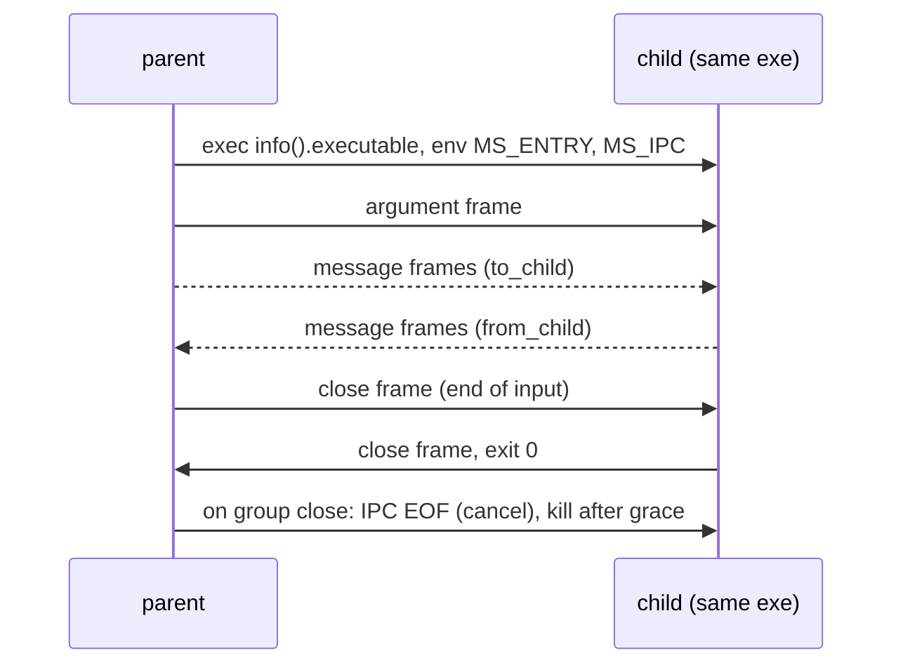

# Child processes and `fork` (design proposal)

## Summary

- Problem: a program uses one core, and cannot run Manuscript code in another long-lived process that it talks to with typed messages.
- Change: `ProcessGroup` in `@std/processes.ms` starts a child process (a re-exec of the same binary) at a named top-level `def`. The child is a long-lived peer: the parent and child exchange typed messages in both directions over `Channel[T]` endpoints. Messages are JSON over a dedicated IPC channel (not stdio).
- A `Process[In, Out]` is the typed sibling of `Subprocess`: same lifecycle (`wait`, `terminate`, `kill`, `close`), same `Stdio` choice per stream, plus one channel pair. There is no result type and no `T` on the group.
- `fork` is JS `child_process.fork`, not POSIX `fork(2)`: spawn the same binary, select an entry, connect a channel. No parent state is copied.
- Cost: an entry table, a start-path hook, an IPC-backed channel endpoint in the runtime, and a stdlib module. No new compiler codecs, no change to runtime globals (unlike `proposals/worker-threads.md`).
- Decision requested: approve the stage 1 measurement and the open questions below.

## Status

- Proposal, no code. Checked against `origin/main` 8de0b942d (2026-10-24).
- Direction (Chinmay, 2026-10-24): `worker_threads`-style model extended to processes, with fork; separate proposal from threads; all platforms in the first release; no "sendable" concept; JSON if raw memory cannot work; dedicated group type; IPC must not use stdio or a TCP port (JS style); child streams forwarded to the parent's and configurable independently; the design must be more coherent than Node; processes are long-lived and talk over channels, so a `Child[T]` result type is wrong.
- Siblings: `proposals/taskgroup.md` (scope, `Channel[T]`), `proposals/worker-threads.md`. The worker proposal still has a result-returning `WorkerGroup[T]`; the same objection (workers are long-lived too) probably applies there. Raised with the coordinator, not changed here.
- Reviews: three independent subagent reviews of earlier drafts (see Review outcome); this version, after the redesign around channels, needs a fourth before approval.

## Problem

- One runtime thread runs all Manuscript code (`crates/DESIGN.md` decision 4); CPU-bound work cannot use more cores.
- Threads need per-isolate runtime state (`proposals/worker-threads.md`: 55 `Global<` uses, generated-code TLS). Processes need none of it.
- A faulting child exits without touching the parent's heap; threads cannot offer that.
- Typical uses are long-lived: a worker serving requests, a supervised helper, a pipeline stage. They need messages both ways, not a single return value.
- Today `Commands.spawn` (`stdlib/process.ms:61`) starts a program for use with `with` (closing it kills the process group) and gives byte pipes. A user can re-exec `info().executable` with an `args()` marker and exchange `stringify`/`parse` text over stdio by hand. What they lack:
  - a function item as the entry instead of a hand-written argv convention;
  - typed messages in both directions without writing framing, and without taking over the child's stdout;
  - one lifecycle shape shared with the other groups.
- Not measured: no benchmark here shows a workload that gains. Stage 1 must record start latency, message round-trip latency and throughput.

## Goals and non-goals

- Goals:
  - one model for starting, talking to and stopping a child: the same `with`, `Stdio` and `Channel[T]` as elsewhere;
  - child stopped when the scope exits, so no child outlives its `with`;
  - child death observable as data (exit status), not a parent fault;
  - Linux, macOS and Windows.
- Non-goals:
  - POSIX `fork()` or any copy of parent state;
  - shared memory;
  - sending handles, closures or `Shared` values in messages;
  - more than one channel pair per process in v1;
  - changing single-process behavior.

## Design

### Syntax and API

```manuscript
from "@std/processes.ms" import ProcessGroup
from "@std/tasks.ms" import Sender, Receiver

type HashConfig:
    algorithm: String

def hasher(argument: HashConfig, input: Receiver[Bytes], output: Sender[String]):
    while let some(chunk) = input.receive():
        output.send(digest(argument.algorithm, chunk))

def hash_all(chunks: List[Bytes]) -> List[String]:
    var digests = List[String]()
    with ProcessGroup() as group:
        let worker = group.spawn(hasher, HashConfig(algorithm="sha256"))
        for chunk in chunks:
            worker.to_child.send(chunk.clone())
        worker.to_child.close()
        while let some(digest) = worker.from_child.receive():
            digests.append(digest)
        worker.wait()
    return digests
```

Illustrative: `while let` and `receive() -> Optional[T]` follow `proposals/taskgroup.md:42`; `digest` and the loop shape are placeholders, and the producer and consumer would normally run in different tasks so the pipes cannot fill.

- `ProcessGroup`: `Closeable`, no type parameter. `close()` stops every still-running child (cancel, grace period, kill) and joins it.
- `spawn(entry, argument, stdin: Stdio = Stdio.Inherit, stdout: Stdio = Stdio.Inherit, stderr: Stdio = Stdio.Inherit) -> Process[In, Out]`.
  - `entry` is a named top-level `export def f(argument: A, input: Receiver[In], output: Sender[Out])`, from any module; one binary, so a function item identifies it, with no path string.
  - The entry returns when its work is done; returning is a normal exit (status 0).
- `Process[In, Out]`:
  - `to_child: Sender[In]` and `from_child: Receiver[Out]`: ordinary channel endpoints, with the transport being the IPC connection.
  - `pid() -> Int`.
  - `wait(timeout: Optional[Duration] = none) -> Result[Int, CommandError]`: the exit status, as `Subprocess.wait` (`stdlib/process.ms:69`). A nonzero status is data.
  - `terminate()`, `kill()`, `close()`: as `Subprocess`.
- `ProcessGroup.wait()`: waits until every child has exited.
- `Stdio`: `Inherit` (default: the child gets the parent's descriptor, so logs go wherever the parent's go), `Null`. `Pipe` (returns the stream on `Process`, as `Subprocess` does) is deferred.
- Rejected at the call site (illustrative text): `spawn(lambda: serve(x), 1)` -> "process entry must be a named top-level def taking (argument, Receiver, Sender); lambdas and captures cannot run in another process".
- `A`, `In`, `Out` need a JSON form; whether that is checked at the call is an open question.

### Semantics

- Start: the parent creates the IPC channel, then runs `info().executable` through `Commands.spawn`'s start path (`crates/ms-std-process/src/spawn.rs:61`) with env `MS_ENTRY=<index>` and `MS_IPC=<fd or pipe name>`; stdin, stdout and stderr follow the `Stdio` arguments.
- Start hook: `msrt_start` (`crates/ms-rt/src/start.rs:263`) checks `MS_ENTRY` before `main`. If set, it clears both variables from the environment seen by user code, adopts the IPC endpoint, reads the argument frame, and runs the entry as the main task. User `print` and stdio are untouched.
- Entry table: each `spawn` instantiation registers `(index, thunk)`. The thunk is generic Manuscript in `@std/processes.ms`: `parse[A]` the argument, bind the IPC-backed `Receiver[In]` and `Sender[Out]`, call the entry. Lowering instantiates generics per type argument list (`crates/ms-lower/src/lib.rs:4-5`), so the existing `stringify`/`parse` intrinsics (`ms-lower/src/native.rs:208`, `json.rs`) need no new codec code. The table is an index, not a hash: parent and child are one binary.
- IPC channel (JS style, as Node's `NODE_CHANNEL_FD`; no TCP port):
  - Unix (Linux and macOS): `socketpair(AF_UNIX, SOCK_STREAM)`; the parent keeps one end `CLOEXEC`, the other is `dup2`'d to a fixed descriptor in `pre_exec` (async-signal-safe, so sound in a multithreaded parent) and its number is `MS_IPC`. Both ends are nonblocking and wait in the existing poller (epoll, kqueue).
  - Windows: the parent creates a named pipe with a random name (`\\.\pipe\ms-ipc-<random>`, first-instance flag, DACL limited to the current user, one accepted connection) and puts the name in `MS_IPC`; the child opens it by name, so no handle inheritance or handle list is needed. The Windows poller waits on sockets only and counts other handles as ready at once (`poller.rs:210-215`), so pipe waits use the same slice polling `Subprocess` already uses: `PeekNamedPipe` in 2 ms slices (`crates/ms-std-process/src/plat/windows.rs:20,29`).
  - One framing layer sits over both transports.
- Frames: a 4-byte little-endian length, a 1-byte kind, then UTF-8 JSON. Kinds: `argument`, `message`, `close` (end of one direction's channel), each carrying a channel id (always 0 in v1, reserved for more channels).
- Channel semantics follow `proposals/taskgroup.md:41-45`:
  - `send` consumes the value and waits when the pipe or the peer's buffer is full; it is a cancellation point;
  - `receive` returns an owned value, or `none` once the peer has closed its sender and the buffer is empty;
  - closing `to_child` (or dropping it) delivers end-of-input; the child's `receive` then returns `none`;
  - `send` after the peer is gone returns a closed result (final shape decided with TaskGroup stage 4).
- Transfer: JSON, not raw memory.
  - Strings, lists, maps and records hold heap pointers, and `Map`/`Set` carry a hash index, so only plain-bits values (`KIND_POD`, `crates/ms-rt-abi/src/lib.rs:343`) could be copied as bytes.
  - `TypeDesc` (`lib.rs:367`) has no field layout for records and alternatives (`KIND_CUSTOM`, `lib.rs:351`), so a binary codec is new compiler work.
  - Supported: records, alternatives, `Optional`, `Result`, `List`/`Set`/`Map`, `Bytes` (base64), `Int`, `BigInt`, `Decimal`.
  - What JSON does with a no-form value (`stdlib/json.ms:~119-122`): a record field is omitted, a list element becomes `null`, a map value is omitted, a root returns `InvalidData`. A `Listener` in a record is dropped silently unless open question 4 is accepted.
  - `JsonEncode.to_json` types encode custom but cannot decode (`json.ms:~88-90`), so they cannot cross.
  - Losses documented, not patched: `NaN` and infinities become `null`; `Map` keys limited to JSON's key types.
- Stop:
  - `close()` (leaving the block, parent cancel, signal) closes the IPC connection. The child runtime treats connection EOF as cancellation of its main task, so shielded cleanups run; after a grace period (default 5 s) the child's process group is killed (`SIGKILL`, as `Subprocess.stop`, `command.rs:271-276`) and joined.
  - `terminate()` and `kill()` act on the child's process group as for `Subprocess`.
  - Unix children run in their own process group (`spawn.rs:86`); Windows uses `CREATE_NEW_PROCESS_GROUP` (`spawn.rs:92`) plus a job object.
- Orphans: a parent killed without cleanup closes the connection (the OS closes the socket end or pipe handle); the child sees EOF and cancels. Same path as `close`.
- Death is data:
  - A child fault runs its cleanups, writes the fault text to its stderr, and exits 70. `wait()` returns 70; `from_child.receive()` returns `none`; `to_child.send` returns closed. The parent keeps running.
  - A child killed by a signal reports -1, as `Subprocess.wait`.
  - This differs from `TaskGroup` v1 (a child fault ends the process), because crash isolation is the reason to use a process and `Commands` already treats exit status as data. Open question 2.
- Waiting for exit: pidfd on Linux (`spawn.rs:136`); elsewhere slice polling (`command.rs:5-17`).
- Environment and working directory are inherited.



### Platform parts

- Executable path: `ProcessControl.info().executable` (`stdlib/process.ms:121`).
- Windows job object: assigned after spawn today (`spawn.rs:118-125`), racy and without `KILL_ON_JOB_CLOSE`; must be assigned at creation and kill on close so grandchildren die with the child.

## Components touched

| Component | Change | Risk / test |
| --- | --- | --- |
| `crates/ms-check` | process entry rule: named top-level def `(A, Receiver[In], Sender[Out])`, diagnostics | conformance reject cases |
| `crates/ms-lower`, `ms-mir`, `ms-clif` | entry table: each `spawn` instantiation registers `(index, thunk)`; no new codecs | e2e fixture on 3 platforms |
| `crates/ms-rt` | start hook for `MS_ENTRY`; IPC-backed channel endpoint (a second transport for the endpoint objects of TaskGroup stage 4: parked-waiter token per endpoint, framing, close); connection-EOF cancel | cancel, EOF, backpressure, malformed-frame tests |
| `crates/ms-std-process` | `spawn::start` gains env, per-stream inherit/null modes (today three pipe descriptors only, `spawn.rs:61`) and an extra inherited descriptor; socketpair with `pre_exec` on Unix, named pipe on Windows; job object at creation with `KILL_ON_JOB_CLOSE` | per-crate tests incl. Windows |
| `stdlib/processes.ms`, `bindings.json` | `ProcessGroup`, `Process`, `Stdio`, entry thunk in Manuscript | `make docs`, extern parity |
| `stdlib/process.ms` | unchanged in v1; sharing `Stdio` with `Commands.spawn` is open question 1 | - |
| `crates/ms-std-json` | unchanged | round-trip tests for supported types |
| `ms-syntax`, formatter, lint, LSP | unchanged (no syntax) | - |
| Docs | core-language page, cheat sheet (`ms guide`), `crates/DESIGN.md` decision 4, `VISION.md`, `.experts/runtime.md`, `proposals/taskgroup.md` (drop `spawn_worker` string form and sendable text) | `make repo-check`, `make book-check` |
| Conformance | start, ping-pong, backpressure, close and EOF, cancel, child death as data, JSON edge values | `make conform` |

## Examples

- End-to-end: `hash_all` above, run over 100 MB of chunks in stage 1.
- Supervised helper: the parent starts a `Process`, sends requests as they arrive, and `with` stops the helper at scope exit; if the helper dies, `receive()` returns `none` and the parent can respawn it.
- Manual recipe (works today, the do-nothing baseline; illustrative, not run): re-exec `executable_path()` with a `--child` marker through `commands.spawn`, write `stringify(request)` lines to the child's stdin and read `parse` lines from its stdout. The child's own prints would corrupt the channel, and typed lifecycle is hand-written.
- Rejected (illustrative, if open question 4 is accepted): `group.spawn(serve, listener)` with `listener: Listener` -> "process argument cannot be sent: `Listener` has no JSON form". Without it the field is silently omitted.

## Alternatives

- Do nothing, and document the manual recipe: gives typed JSON, scoped kill through `with` and a result over stdio on all three platforms. Lost: an entry that is a function item, typed messages in both directions without owning the child's stdout, lifecycle shared with the other groups.
- A result-returning `Child[T]` with `results()`: rejected by the owner; processes are long-lived and talk over channels.
- Smallest version: one process, one channel pair, no `Stdio` choice beyond inherit. This proposal's v1 keeps the pair and `Stdio`, because inherit-by-default and no stdout takeover are the points.
- Frames on the child's stdin and stdout: rejected by the owner. A child's own writes to descriptor 1 would corrupt frames.
- Loopback TCP socket with a token: rejected by the owner (no port).
- POSIX `fork()`: rejected; the runtime is multithreaded (a blocking pool; `fork()` keeps one thread and inherits held locks, the poller and coroutine stacks), unavailable on Windows, and breaks single ownership at OS level.
- Raw memory transfer: rejected; heap pointers and the map hash index (see Semantics). Only plain-bits values qualify.
- New binary codec: deferred; new compiler work (`TypeDesc` lacks record layout). Revisit only if stage 1 shows JSON is the bottleneck.
- Entry by path string: rejected; typo is a runtime failure and the compiler cannot know which functions to keep.
- Fork a closure: rejected; captured owned state would need encoding.
- Methods on `TaskGroup`: rejected by the owner; a dedicated group names what it scopes.
- Wait for worker threads: threads need the isolate refactor first (`proposals/worker-threads.md`); processes need none of it and add crash isolation.
- Table hash handshake, cancel frame: cut; one binary, and connection EOF is the cancel signal.

## Drawbacks

- Process start cost per child (exec of the whole binary), and JSON encode/decode and a socket hop per message; all unmeasured.
- An IPC-backed channel endpoint is real runtime work, a second implementation of the channel endpoint beside the in-process one.
- Two transports (Unix socketpair, Windows named pipe) under one framing layer; Windows waits on the pipe in 2 ms slices, not by readiness.
- Values with no JSON form are silently omitted inside records, lists and maps unless a call-site check is added.
- Depends on TaskGroup stage 4 (`Sender`/`Receiver`); until it lands only the design can be reviewed.
- A third group type beside `TaskGroup` and `WorkerGroup`; learners hold three.

## Prior art

- JavaScript `child_process.fork`: same-executable spawn with a dedicated IPC channel and `send`/`message`. Differs: function item entry, typed `Channel[T]` instead of untyped `send`, scoped group, `Stdio` shared by name with the rest, exit status as data.
- Python `multiprocessing`: spawn start method, `Pipe`/`Queue`, pickled objects. Differs: JSON, no closures.
- Erlang processes: long-lived, mailbox, links. Differs: OS processes, typed channels.
- Go `os/exec` plus self-exec: manual; the do-nothing baseline.
- Rust `std::process::Command` with `current_exe`: same technique, untyped.

## Evidence and cost

- Verified in source: `spawn::start` takes only three stdio descriptors and sets a process group (`spawn.rs:61-92`); `Subprocess.wait`, `terminate`, `kill`, `close` exist (`stdlib/process.ms:69`); pipes park on pidfd on Linux and poll in slices elsewhere (`command.rs:5-17`), including `PeekNamedPipe` on Windows (`plat/windows.rs:20,29`); the Windows poller waits on sockets only (`poller.rs:210-215`); `msrt_start` has no pre-`main` dispatch (`start.rs:263`); typed `stringify`/`parse` exist (`json.ms:78,153`) and generics are instantiated per type argument list (`ms-lower/src/lib.rs:4-5`); the executable path is exposed (`process.ms:121`); pull requests run Linux only, other platforms on main, merge groups and manual runs (`.github/workflows/cicd.yml:55-57`).
- Not measured: child start latency, message round-trip latency, JSON throughput over a socketpair and a named pipe, 2 ms slice latency on Windows.
- Adds: one stdlib module, an entry table, one runtime start path, an IPC channel endpoint, one checker rule. Learner concepts: `ProcessGroup`, `Process`, `Stdio`.

## Staging and verification

- Each stage is its own PR with auto-merge. Pull requests run Linux only; for any stage touching platform code, run the workflow by hand on the branch for macOS and Windows before merging.
1. Measure, no Rust changes: re-exec latency, JSON throughput for `List[Int]` and `Bytes`, and ping-pong round-trip latency through a socketpair (Unix) and a named pipe (Windows, manual run), against the manual recipe. Go/no-go (proposed, Chinmay confirms): start latency under 50 ms and round trip under 1 ms on Unix; otherwise document the recipe and stop.
2. Platform prerequisites: job object at creation with `KILL_ON_JOB_CLOSE`; `spawn::start` env, per-stream `Stdio`, extra descriptor; socketpair and named pipe plumbing with tests.
3. `ProcessGroup.spawn` and `Process`: entry table and start hook, IPC-backed channel endpoints, frames, argument, stop and orphan paths, death as data, diagnostics, docs and cheat sheet, conformance. Needs TaskGroup stage 4 (`Sender`/`Receiver`) landed.
4. Extensions as demand shows: `Stdio.Pipe`, more than one channel pair (endpoints in arguments, channel ids already in the frame), environment and working-directory overrides.

## Open questions

- Resolve before approval (decider: Chinmay):
  1. Share one `Stdio` type (`Inherit`, `Null`, `Pipe`) and one lifecycle shape between `Commands.spawn` and `ProcessGroup.spawn`, which changes the existing `Commands` API (recommended for coherence), or leave `Commands` alone.
  2. Child death as data, with the parent surviving (recommended), or the TaskGroup v1 rule that a child fault ends the parent.
  3. Leaving the `with` block stops running children (recommended: services must not leak), or waits for them to exit.
  4. Call-site check: reject types with no JSON form (resource, closure, `Shared`, handle) as an ordinary type error, the same boundary check `proposals/worker-threads.md` uses and not a user-visible concept (recommended), or accept JSON's silent omission.
  5. One channel pair per process in v1 (recommended), or endpoints in the spawn argument now.
- Resolve during implementation:
  - Windows named pipe by name (recommended) or an anonymous pipe passed by inherited handle (needs a handle list in `CreateProcess`).
  - Grace period default (proposed 5 s) and whether it is a parameter.
  - Whether connection EOF cancellation needs a poll hook on the child's main task.
  - Final shape of `send` to a closed peer (with TaskGroup stage 4).

## Rejected ideas

- A `Sendable` trait or rule (owner: avoid).
- A typed result and `results()` for processes (owner: long-lived, channels).
- Methods on `TaskGroup` (owner: dedicated group).
- Linux-only first release (owner: all platforms).
- Raw memory transfer (not sound across processes; see Semantics).
- Frames on stdin and stdout, and a TCP port (owner; see Alternatives).

## Future possibilities

- `Stdio.Pipe` and more channels per process.
- Binary frame body if JSON is measured as the bottleneck.
- A matching long-lived shape for `WorkerGroup`.

## Review outcome

- First review (against source): group kill is `SIGKILL`, so cleanup needs a cooperative stop; the Windows job object is assigned after spawn and lacks `KILL_ON_JOB_CLOSE`; there is no per-type clone to mirror, so a binary codec is new work; `spawn::start` has no extra-descriptor support.
- Second review (all `file:line` citations verified): JSON omits no-form fields rather than faulting; `PDEATHSIG` fires on spawning-thread exit and was dropped; names aligned with the worker proposal; pull requests run Linux only.
- Third review (simplification): cut the table hash, the cancel frame, per-entry codecs and four stages; a generic stdlib thunk reuses `stringify`/`parse`.
- Owner direction after the third review: no stdio or TCP transport (JS-style dedicated channel); independent `Stdio` per stream; processes are long-lived peers with channels in both directions, so `Child[T]`, `results()`, `spawn`/`fork` as two methods and the group's type parameter were removed, and child death became data.
- Fourth review of this version: pending.
