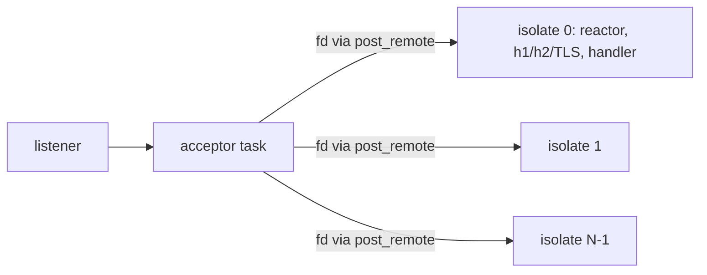

# HTTP server on all cores

## Summary

- Problem: `serve` runs on one thread. The only way onto more cores was `HttpServerOptions.shared` plus a hand-built `WorkerGroup`, which spread connections badly (measured below) and made every program own the worker plumbing. `shared` is removed (#1977).
- Change: a server that serves on every core by default. One acceptor hands each accepted connection to the next serving isolate in round robin; each isolate runs the whole HTTP/TLS/handler stack as today, on its own scheduler, with its own handler built by a per-isolate `init`.
- Model: shared-nothing isolates (`crates/DESIGN.md` decision 4), not M:N tasks over a shared heap. Handler state is per isolate; cross-core state goes over channels.
- Cost: one new `Network` method with a capture-free `init`; in Rust, an accept-only listener with a pick hook, a per-isolate adopt queue and an adopt-only server in `ms-std-net`, and an extern that starts a worker with a function value. Spawn, stop, options and config are Manuscript in `stdlib/`. The per-connection hot path (accept, pick, enqueue, adopt) is Rust.
- Decision requested: the API shape (Open questions 1 to 4).

## Status

Proposal, revised 2026-10-30 after a skeptic review (verdict: revise; its corrections are folded in), checked against `f6755dfd`. Direction (Chinmay, 2026-10-30): "i see that's wrong ... we need to design it ground up" (about the `shared` listener); earlier: "does that mean server requests will fan out on all cores?" Nothing is built yet.

## Problem

- One `serve` is one reactor on one thread (`ms-std-net/src/http/server.rs`; handlers run as scope tasks since `proposals/http-server-request-tasks.md`, still on that thread). A 4-core machine serves with 1 core.
- Measured, `bench/perf/web/results.md` section "2026-10-26, server on several cores" (server on 2 CPUs): `/top?n=10` (CPU-bound handler) 26k req/s on one thread, 58k with two shared-listener workers. A handler that does real work scales, so the cores are worth using.
- The old way did not distribute connections evenly. Measured on main `f6755dfd`, 4 workers on one duplicated listener (4-CPU VM, keep-alive Python client, 200 requests per connection, per-worker reply counts):

  | Connections | Opened | Requests per worker (w0, w1, w2, w3) |
  | ---: | --- | --- |
  | 4 | one by one | 0, 0, 0, 800 |
  | 4 | all at once | 200, 0, 600, 0 |
  | 8 | all at once | 200, 200, 400, 800 |
  | 16 | all at once | 400, 200, 1600, 1000 |
  | 64 | one by one | 600, 2400, 200, 9600 |
  | 64 | all at once | 600, 1000, 2800, 8400 |

  Whichever poller wakes first takes the connection, so one worker can end with most of the load while the others idle. Script: scratchpad `acc/` (Manuscript server with `shared: true`, `client.py`); rerun it in stage 1 as the acceptance test.
- The handler cannot be replicated by the user without ceremony: a closure that captures state exists in one isolate only, so a program has to write a worker entry, a channel handshake and a start/stop protocol (`bench/perf/web/ms/src/main.ms` carried about 30 lines of it).
- Non-goals: sharing mutable memory between cores; moving a request to another core after it was accepted; changing HTTP behavior, limits or TLS; making `fetch` multi-core.

## Design

### Model

- Each core runs one serving isolate (a `Worker`, `proposals/worker-threads.md`): its own arena, scheduler, reactor, task scope and handler. Isolates share nothing but accepted descriptors, which are plain integers (`fd` on Unix, `SOCKET` on Windows), moved through a per-isolate queue.
- One acceptor owns the listener. Accept stays in the Rust reactor (`server.rs` `accept_all`, called from the reactor dispatch); an accept-only mode replaces `add_conn` there with a pick hook: choose an isolate, `into_raw_fd`/`into_raw_socket` the accepted socket (ownership moves to the queue), push the integer.
- Handoff queue, not `post_remote`. A token carries one value and `task.rs:1520` (`post`) drops a post while `posted` is set, so two connections posted before the target parks would lose one and leak a socket. Each serving isolate gets a `Mutex<VecDeque<u64>>` plus the existing one-shot wake; the acceptor locks once per connection. `post_remote` also takes three global mutexes (`isolate.rs:152-171`) and is not used per connection.
- The target isolate drains its queue on wake and calls `Server::adopt(raw)`: an unsafe `from_raw_fd`/`from_raw_socket` into a `socket2::Socket`, then `add_conn` (`server.rs`), before any I/O, so the descriptor is registered in exactly one poller. Adoption needs a listener-less `Server` constructor (`Server::start` always binds today).
- Pick rule (Chinmay, 2026-10-30: "let's do round robin"): connection i goes to isolate i mod N, from a counter local to the acceptor. No shared counters, atomics or close hooks. Connections that differ a lot in lifetime or load can skew cores over time; stage 1 gate (a) measures it, and load-aware picking is the follow-up if it fails.
- Placement is per connection. HTTP/1 keep-alive and an HTTP/2 connection stay on their isolate for life; WebSocket upgrades too. A request is never moved. Balance is therefore by connection count, not load.



The acceptor's isolate is also a serving isolate (core 0); with `cores: 1` it keeps its connections and nothing is queued, which is today's server. With many cores the acceptor's accept work competes with its own requests (measured in stage 1; a dedicated acceptor is the fallback).

### API

```manuscript
import {HttpServer, HttpServerOptions, serve_cores} from "@std/http.ms"

# Named top-level, capture-free: runs once in each serving isolate and returns that isolate's handler.
fn init(config: AppConfig) fn(HttpExchange) Result[Unit, HttpError]:
    let hits: Shared[Int] = share(0)    # per isolate
    ...
    return buffered(handler)

let started = serve_cores("127.0.0.1:8080", init, AppConfig(greeting: "hi"))
```

- `Network.serve_cores[C: Data](address, init, config: C, options) Result[HttpServer, HttpError]` (spelling is Open question 1). It is a method of `Network`, like `serve` (`stdlib/net.ms:484`), so the caller's restrictions (`restrict`) decide whether it may listen. `config` crosses to each isolate as JSON, like a worker message. `init` crosses as its code pointer: `msrt_worker_start` (`ms-rt/src/worker.rs:316`) already hands a capture-free closure's code pointer to a thread of the same process, so no offset primitive is needed.
- Gaps this closes: `WorkerGroup.spawn` takes `fn() Unit` (`workers.ms:221`) and the checker rule for a named top-level entry is written for that one parameter (`ms-check/src/calls.rs:514-540`). A stdlib worker entry cannot know the user's `init`, so a new extern starts a worker with a function value of the `init` type, and the same rule is generalized to check `init` at the `serve_cores` call: a lambda or captured value is rejected there.
- `HttpServerOptions` gains `cores: Optional[Int]`: none means the number of available cores; 1 serves on the calling isolate only. `max_requests` is the total, split evenly over isolates (rounded up). `grace`, `timeout`, `tls` apply per isolate unchanged; the TLS: `Arc<rustls::ServerConfig>` is `Send`, so one built config can likely be shared by every isolate (hypothesis, to verify in stage 2); otherwise each isolate rebuilds it from the PEM text in the options.
- `serve` (closure handler) stays and runs on one isolate. A closure can carry any local state; it cannot be duplicated, so this is the documented single-core form, and `ms lint` can say so (Open question 2).
- `HttpServer` keeps `address`, `wait`, `close`. `close` stops the acceptor, closes every isolate's server with the grace period, then joins the workers. A fault outside a handler in one isolate (a handler fault is a 500 as today) fails `wait` with that isolate's report and closes the others.
- Handler state: `Shared[T]` stays per isolate (non-atomic count, `shared-lock.md`). State the whole server must agree on (counters, caches, sessions) lives with one owner and is reached over channels: the calling isolate runs a task that owns it, and `init` receives the channel end through `config`'s companion `link` (Open question 4). Nothing here adds atomics to user code.

### Semantics

- Cancellation and drain: unchanged inside an isolate (`http-server-request-tasks.md`). The signal flag is main-isolate only: a worker sees just its parent's cancel (`isolate.rs` `pending_cancel`). So SIGINT/SIGTERM drains the workers because the server's worker group cancels them when the calling isolate stops, then each drains within `grace`; stage 3 tests this.
- Permissions: connections adopted by a worker were accepted under the caller's `Network`, so no listen right is needed there. Handlers that call `fetch` or `network()` inside a worker get that thread's unrestricted root network (`ms-std-net/src/net.rs:697-705`), an existing worker gap that a multi-core server would make the default; `init` should receive the restricted network (Open question 3).
- Backpressure: the acceptor accepts while any isolate is under its share of `max_requests`; at the cap it stops accepting and the kernel backlog fills, as one server does today.
- Platform parity: the handoff uses an integer and the runtime's existing one-shot isolate wake (the queue holds the data). Pollers are epoll and kqueue through mio on Unix; on Windows mio plus a helper thread and a loopback wake socket, so each serving isolate costs one extra thread there (`ms-std-net/src/sys/windows.rs`). Registering an adopted, never-polled `SOCKET` should work on all three but is unverified until stage 2 runs on Windows. A `SOCKET` is process-wide on Windows and a descriptor on Unix, so the adopting thread can register it. No `SO_REUSEPORT`, `EPOLLEXCLUSIVE` or per-OS accept behavior is used, so distribution is the same everywhere. All three platforms run the same balance test; none is gated.
- Failure of a handoff (target isolate gone): the acceptor closes the connection and picks again for the next one.

## Components touched

| Component | Change | Test |
| --- | --- | --- |
| `stdlib/net.ms`, `stdlib/http.ms` | `Network.serve_cores`, `cores` option, start/stop/join and fault reporting in Manuscript on `WorkerGroup` | e2e fixture: balance, stop, fault, restricted network |
| `stdlib/workers.ms`, `crates/ms-rt/src/worker.rs` | extern starting a worker with a function value and config bytes | worker fixture |
| `crates/ms-rt` | per-isolate adopt queue and wake | unit tests: concurrent pushes lose nothing |
| `crates/ms-std-net` | accept-only listener with pick hook; listener-less `Server` constructor; `adopt(raw)` (unsafe ownership transfer)| unit tests, h1/h2/TLS adopt cases |
| `crates/ms-check` | generalize the named-top-level entry rule to `serve_cores`' `init` | reject fixture |
| `bench/perf/web`, `ms-conform` fixtures | multi-core server, balance script as a fixture | all three OS in CI |
| docs, `ms guide`, `VISION.md` | serving chapter; remove "Serving on several cores" (done in #1977) | `make docs-check` |
| Syntax, lowering, formatter, LSP | unchanged | |

## Alternatives

- Do nothing (one core): wastes N-1 cores on handlers that compute; rejected by direction.
- Keep the shared listener but make it automatic: the measurement above is this design's balance (the script is scratch and moves into `bench/perf/web` in stage 1). The pattern is first-waker-wins (4 connections opened one by one all landed on one worker), which client CPU noise cannot explain. Rejected on evidence.
- `SO_REUSEPORT` per isolate: the kernel hashes connections (Linux), so balance is statistical but not by load; macOS does not balance across sockets and Windows has no equivalent. Fails parity. Kept as a possible Linux-only optimization behind the same API only if the acceptor measures as a bottleneck.
- `EPOLLEXCLUSIVE` or a mutex-guarded accept: Linux-only or serializing, and still first-wins, not an even spread.
- M:N scheduler over a shared heap (Go, tokio): reverses decisions 1 and 4: atomic reference counts on `Shared` and closures, a thread-safe allocator and scheduler, and a data-race story for `var`. Every single-thread program pays. Rejected as out of scope for a server feature; this proposal needs none of it.
- Worker processes (fork-style, fd passing): crash isolation, but a process costs far more memory (62 MB with 10,000 idle connections on one thread today) and fd passing differs on Windows (`WSADuplicateSocket`). Threads already exist and the runtime treats them as the cheap isolate.
- Move individual requests between isolates: needs body copies and ownership transfer of live exchanges; connection placement is enough until imbalance is measured on real workloads.
- Linux-only `SO_REUSEPORT` fallback with the same API, if the acceptor proves to be the ceiling: simplest, but parity and balance fail elsewhere; decided only on stage 1 numbers.
- Drawbacks of the chosen design: a connection-per-request workload sends every request through one acceptor and one queue lock (a ceiling to measure, stage 1); a few long-lived busy connections can leave cores idle; handler state is per isolate, which changes how programs with global state are written.

## Staging and verification

1. Spike (gate): the queue, accept-only mode and adopt on a scratch branch; measure on 4 CPUs with the client on separate cores (`bench/perf/web`, script committed): (a) uneven load, 4 busy connections plus 60 light ones, per-isolate CPU and request counts; even-count balance alone passes trivially; (b) `/top` on all 4 cores at least 3x one core, `/health` not below one core; (c) `Connection: close` requests per second, at least 70% of the single-thread server's rate, and the acceptor isolate's CPU share. No-go if (a) shows an isolate idle while another queues, or (c) misses its bar; then try a dedicated acceptor or the `SO_REUSEPORT` fallback before dropping.
2. Runtime and `ms-std-net`: adopt entry point, accept-only mode, unit tests on Linux, macOS, Windows.
3. Worker function value, `serve_cores`, `cores`, stop/fault/SIGINT semantics in `stdlib`; balance, shutdown, fault and restricted-network fixtures.
4. Bench page: a dated section in `bench/perf/web/results.md` and the doc chapter; `serve` closure form documented as single-core.

Each stage lands green on the three platforms; no test is disabled per platform.

## Open questions

1. Spelling. Recommendation: a separate `serve_cores`-style function now (keeps `serve` and its closure form working; the multi-core form is the one `ms guide` teaches). Alternative: make `serve` itself take the factory and drop the closure form (breaking, cleaner, one way to serve).
2. Default. "All cores by default" holds for the factory form (`cores` none). A closure `serve` stays on one core. Recommendation: lint-warn on closure `serve` in server programs rather than silently threading.
3. Network inside workers: `init` receives the caller's (possibly restricted) `Network`. Recommendation: pass it as the `config` companion so handlers keep the same limits; the unrestricted worker root is a pre-existing gap to file and fix separately.
4. Shared server state. Recommendation: none in v1 beyond per-isolate state and a channel to an owner task; revisit with an atomic counter or concurrent map primitive only once a real program needs it.
