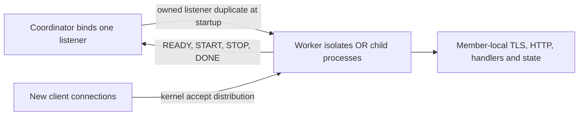

# HTTP as a primary Manuscript workload

## Summary

- Make ordinary API services easy to write and predictable under concurrent load, using the existing HTTP implementation and cooperative runtime.
- Give buffered and streaming servers one configuration contract; bound admitted work from request headers through response completion and make deadlines cover that lifetime.
- Make whole-machine serving a core deliverable: one public address with complete handlers running in a configured set of worker isolates or child processes, including streaming and TLS.
- Follow with a source-level router, response helpers, request decoding, and operational hooks; costs include a buffered-API migration, native ABI/bootstrap work, and lifecycle tests, but no new language syntax or scheduler.
- Implementation is authorized. The stages below remain acceptance criteria; landing the application API alone does not complete this proposal.

## Status

- **Implementation built and skeptically reviewed** in the working tree. Final Linux correctness gates passed; platform and performance acceptance limits are recorded below.
- **Implementation authorized** by the owner ("build it"), 2026-10-25; checked against `0385da26a0bfcd3c891f332ba6883ed7c8372038`.
- User direction: “that’s gonna be a main use of manuscript, we need to have really compelling api structure concurrency stability and feature completeness for it”. Follow-up: “can you write a proposal”.
- Additional requirement: “ability to scale the handlers across workers/processes, so we can consume the whole machine”. Whole-machine handler execution is required, not deferred to application-managed CPU offload.
- Subsequent direction favors a scoped `application(server)` entry, `server.run(routes)`, mounted routers and ordinary middleware, with bytes and streaming responses sharing routing. The user called this “looking good” and requested “functional parity with node go next js express js etc”; the concrete signatures are now checked by native examples and integration fixtures.
- Original runtime evidence below is static inspection unless marked otherwise. The application API now has executed native integration tests.
- Installed the pinned Rust 1.99.1 toolchain and built the native runtime and debug CLI. Ran `ms guide`, symbol search, source checking, and native application tests during implementation.
- Independent skeptical review of the initial draft: direction supported; the review required checked API/lifetime prototypes and cross-platform transfer evidence. Incorporated corrections for startup rollback, handoff ownership, HTTP/2 timers, mixed response modes, and observation loss. Subsequent independent implementation reviews found and corrected optimizer ownership, callback cleanup and streaming sink lifetime defects; the concrete decisions below record the implemented API.

### Implementation and verification ledger

The working tree implements the application API, transport/lifecycle changes,
whole-handler worker and process execution, and the selected web workflows below.
`examples/http-server/main.ms` is a runnable service and
`examples/http-server/build.ms` produces a static site. Final Linux verification
passed 930 workspace tests, lint, documentation, book and distribution checks.
All 21 HTTP fixtures passed in Debug and Release (95 tests in each profile).
The complete Release e2e suite and executing conformance corpus also passed after
the allocator correction; final HTTP-specific regressions cover the later fixes.

The [measured validation report](../bench/http-server/results/2026-10-25-linux/README.md)
contains the exact counts, executable reference comparisons, two-round CPU/churn
measurements, proxy deployment comparison and sustained resource observations.
Whole-handler multicore execution and bounded resource recovery are demonstrated.
Load runs also recorded failures and a severe short-run throughput anomaly; they
do not establish a reliability or latency SLO. macOS and Windows runtime execution
is unavailable here. Windows native code cross-checks passed, which do not replace
runtime validation. Dedicated-runner and cross-platform release acceptance remain
open; implementation completion is not a blanket framework-equivalence claim.

| Capability | Implementation | Regression evidence |
| --- | --- | --- |
| Routing, mounts, middleware, HEAD/OPTIONS/405, JSON | `http.ms` | `http-app`, `http-json` |
| Workers/processes, shared listener, readiness, rollback, drain | native HTTP groups + `serve` | `http-groups` (including HTTP/1.1 and HTTP/2 TLS, both body modes and connection affinity in Debug/Release), native group tests, CLI engine process-lifecycle tests |
| HTTP/1, HTTP/2, TLS/ALPN, limits and deadlines | native HTTP engine | native HTTP/H2 tests, `http-options`, `http-limits`, `http-deadlines` |
| Streaming, SSE, WebSocket, framing | response bodies + exchange | `http-app`, `http-content-length`, production integration probe |
| Counters, bounded access events, trusted proxy metadata | exchange observations | `http-observations`, `http-proxy` |
| Cookies, forms, credentials, CORS, redirects | `web.ms` | `http-web` |
| Signed typed sessions, expiry and key rotation | `web_sessions.ms` | `http-sessions` |
| Static assets, validators, single/multiple ranges | `web_assets.ms` | `http-assets` |
| Streaming multipart, bounded parts, scoped uploads | `web_multipart.ms` | `http-multipart`, interrupted-upload engine test |
| Streaming gzip, negotiation, bounded codecs | `web_compression.ms`, `archive.ms` | `http-compression`, `compression-writer`, interrupted-stream engine test |
| Escaped HTML and streamed fragments | `web_html.ms` | `http-html` |
| Bounded per-member TTL/LRU response cache and invalidation | `web_cache.ms` | `http-cache` |
| Static page generation, staging, rewrites | `web_build.ms`, `Request.rewrite` | `http-build`, build example, interrupted-stage engine test |
| Common Node/Go/Express/Next application contract | pinned reference applications | `bench/http-server/reference/check.py` |
| Resource recovery and scaling | reproducible native harnesses | `bench/http-server/README.md` |

Independent skeptical reviews have corrected routing order, mount collisions,
startup failure reporting, deadline ownership, multipart state ownership, and
streaming cancellation leaks. Ordinary source locals retain Manuscript's existing
fault semantics; library state that crosses application callbacks is explicitly
cleanup-scoped. This is not general stack unwinding.

The reference applications establish a specified HTTP contract, not JavaScript,
React or Next.js source compatibility. HTTP/3, HTTP/2 extended CONNECT, trailers,
live certificate reload and distributed cache/session storage are not implemented
by this proposal. Whole-machine limits are per member; HTTP/2 streams on one
connection remain on one member. Process mode provides forced termination;
worker cleanup requires cooperative code.

## Problem

| Evidence | Observable cost |
| --- | --- |
| Verified: [`stdlib/net.ms:356`](../stdlib/net.ms), `Network.serve` versus `serve_stream`; [`ffi/http_server.rs:32`](../crates/ms-std-net/src/ffi/http_server.rs), `SERVE_MAX_HEADER_BYTES` | Buffered serving takes individual limits, returns `IoError`, fixes request headers at 1 MiB, and cannot select TLS. Streaming takes `HttpServerOptions` and returns `HttpError`. Switching body strategies changes unrelated setup code. |
| Verified: [`server.rs:1350`](../crates/ms-std-net/src/http/server.rs), `advance_body` then `queue` | Buffered HTTP/1 bodies are collected before admission. Setting `max_requests` does not cap the number of uploads occupying memory. |
| Verified: [`server.rs:1561`](../crates/ms-std-net/src/http/server.rs), `dispatch_conn`; [`server.rs:1443`](../crates/ms-std-net/src/http/server.rs), `queue_output` | Admission is released after dispatch, while buffered output can remain queued; `queue_output` clears the connection deadline. A handler concurrency cap does not bound retained slow-client responses. |
| Verified: [`server.rs:1606`](../crates/ms-std-net/src/http/server.rs), `run_buffered`; [`h2serve.rs:664`](../crates/ms-std-net/src/http/server/h2serve.rs), `h2_buffered` | Buffered handlers are checked for elapsed timeout after returning. This alone does not enforce a deadline during a blocked handler or response transmission. |
| Verified: [`stdlib/http.ms`](../stdlib/http.ms), public request, exchange, response, and server declarations | The transport surface exists, but there is no router or server-side JSON response/decode convenience on these types. Applications assemble dispatch and headers themselves. |
| Historical measurement: [`bench/perf/web/results.md`](../bench/perf/web/results.md) | Recorded `/health` p99 rose from 2.9–4.3 ms alone to 137 ms during `/io`. This identifies a useful mixed-load test, not current performance. |

- The historical explanation that file and DNS work block the runtime is outdated: system resolution uses the blocking pool in [`net.rs:317`](../crates/ms-std-net/src/net.rs), and Unix whole-file operations have an offload path in [`ops.rs:148`](../crates/ms-std-fs/src/ops.rs).
- Reproduce the admission gap with many partial POST bodies and `max_requests: 1`; reproduce retained output with large responses and clients that stop reading. These are proposed tests, not claimed executed reproductions.
- Existing assets include HTTP/1 parsing, TLS, HTTP/2 flow-control tests, streaming, WebSockets, SSE support, graceful drain, and a web benchmark. Preserve and extend them rather than replacing the transport stack.
- Older guidance says concurrency is absent, while current `stdlib/tasks.ms`, `workers.ms`, and `processes.ms` implement it. This proposal follows the checked-in code and those APIs; it does not revive retired synchronization APIs.
- Verified: `Server.start` binds its own listener through `Network.listen_tcp` ([`server.rs:654`](../crates/ms-std-net/src/http/server.rs)); worker/process channels encode values as JSON. Neither path currently provides a server group on one address or transports a live accepted socket as an application value.

Non-goals:

- HTTP/3, a transport rewrite, automatic request retries, a database framework, dependency injection, decorators, or new language syntax.
- Preempting arbitrary Manuscript code, shared memory between workers, or promising that cancellation immediately interrupts every operating-system operation.
- Per-request migration of an established connection between isolates, transparent shared application state, automatic retry after member failure, or OpenAPI generation in the first milestone.

## Design

### One transport configuration

- Keep `Network.serve` for buffered handlers and `Network.serve_stream` for incremental exchanges; both use `HttpServerOptions` and return `Result[HttpServer, HttpError]`.
- Proposed buffered signature: `serve(address: String, handler: Callable[[HttpRequest], HttpResponse], options: HttpServerOptions = HttpServerOptions()) -> Result[HttpServer, HttpError]`.
- Give `serve_stream` the same default options value; retain its existing handler type, `Callable[[HttpExchange], Result[Unit, HttpError]]`.
- Preserve low-level `HttpRequest`, `HttpResponse`, `HttpExchange`, and `HttpServer`. Add source-level `Request`, `Response`, `Body`, and a pre-run `Server` facade for the application API; the existing `HttpServer` remains an already-running transport resource.
- Before: callers pass `max_requests`, body limits, `timeout`, and `grace` directly to `serve`. After: those arguments become fields of its `options` value; callers handling `IoError` migrate to `HttpError`.
- Both paths use the same option validation, bind error mapping, TLS configuration, and ALPN negotiation. Verify HTTP/2 negotiation explicitly; accepting TLS options alone does not establish HTTP/2 support.
- Omitted options retain optional, unlimited budgets; `none` does not secretly select a production limit. Removing buffered serving's implicit 1 MiB header cap is an explicit compatibility decision below.
- Provide a production example with explicit capacities and deadlines, explaining each bound. Do not add an opaque production preset or universal recommended capacity.
- Executable examples and migration fixtures are checked with the native compiler; `examples/http-server/main.ms` is the canonical application example. The low-level migration is covered by the HTTP fixture corpus.

### Admission owns the entire exchange

- `max_requests` counts requests from validated headers, before reading a buffered body or sending `100 Continue`, until response completion or cancellation cleanup completes.
- For HTTP/2, count each stream separately and acquire capacity before collecting its body; reject excess streams without terminating unrelated admitted streams.
- Release capacity exactly once on success, parse failure after admission, disconnect, timeout, fault, upgrade close, or shutdown. Buffered output waiting on a slow reader retains its slot.
- Reject excess HTTP/1 requests with 503 and close the connection when their unread body cannot be safely skipped within a fixed bound. Do not queue unlimited application work or send `100 Continue` before admission.
- Add `max_connections: Optional[Int] = none`, positive when supplied. Count sockets from acceptance, including TLS handshakes and idle keep-alive sockets, until actual close; an over-cap accepted socket closes without promising an HTTP response.
- Headers and parser staging remain separately bounded by `max_header_bytes` and fixed transport buffers. HTTP/2 must enforce bounded header decoding and active-stream bookkeeping before application admission; a body window alone is insufficient.
- Retain `max_body_bytes` and `max_response_bytes` as per-request totals. Streaming reads and writes additionally keep fixed-size transport staging and stop producing data when the peer cannot consume it.
- Require a resource-accounting table for both protocols: per-connection staging, per-admitted-request body/output, header decoding, TLS buffers, and protocol control output. All configured bounds must hold under concurrent requests, not only one request at a time.
- Do not add an aggregate memory-budget option initially: finite connection, admission, header, body, and response bounds should produce a calculable bound on server-owned payload storage. Application allocations remain outside that guarantee.

### Deadlines and structured work

- `timeout` is an absolute exchange budget: start at the first request byte for HTTP/1 and the first HEADERS frame for HTTP/2; include headers, body, handler waits, and response transmission without resetting at phase boundaries.
- Add `header_timeout`, `idle_timeout`, and `write_timeout`, each `Optional[Duration] = none`. Negative values return `HttpError.InvalidInput`; zero expires immediately.
- `header_timeout` bounds header assembly from the same start; `idle_timeout` bounds idle connections and TLS handshake time; `write_timeout` bounds lack of transport write progress while output is pending, including HTTP/2 flow-control stalls.
- Active operations use the earliest applicable deadline. Progress can reset a write-idle timer, but never the absolute exchange deadline; `timeout` no longer doubles as the idle keep-alive policy.
- For HTTP/2, only transmission progress for the affected stream resets its write timer; writes on other streams and connection control frames do not. Bound TLS handshakes from acceptance rather than extending them indefinitely on trickled handshake bytes.
- Register request cancellation with existing task/runtime machinery, scoped to the handler invocation. The reactor task can run inline handlers, so a request deadline must be removed before that task serves unrelated work.
- Cancellation reaches nested scoped work through ordinary cleanup; a scoped child must not outlive request cleanup. Downstream operations must observe the request's remaining deadline or cancellation even when their own timeout is longer or absent.
- Before a response starts, preserve the server's existing timeout-response convention where applicable; after headers are committed, close HTTP/1 or reset the HTTP/2 stream instead of attempting a second response.
- A CPU loop without cancellation checkpoints can still monopolize its isolate. Neither `timeout` nor `grace` is a hard wall-clock termination guarantee for such code or for shielded host work.
- Use existing workers for CPU work and existing processes when independent termination is required. Pass plain data over existing channels; do not transfer a live exchange, socket, or request-scoped resource.
- Handler faults remain distinct from expected `Result` errors. Preserve the HTTP host's guarded handler boundary; do not change general task-fault semantics under the HTTP proposal.

### Shutdown and long-lived responses

- `close` stops admission, closes idle sockets, begins HTTP/2 GOAWAY, drains admitted requests for `grace`, then requests cancellation and joins their cleanup.
- Preserve `grace: none` as an unlimited drain and zero as immediate cancellation initiation. Document that the cleanup join can exceed the grace period for uncooperative work.
- SSE remains an ordinary streaming response; it can omit an absolute timeout while using a write timeout. The application owns heartbeat and event policies.
- WebSockets retain a connection and admission slot until closed. Track upgraded sessions for drain and cancellation even after HTTP protocol ownership is transferred.
- Apply the same lifecycle under explicit close and SIGINT/SIGTERM. Preserve idempotence and rejection of a handler synchronously closing its own server.
- Test direct-handler faults and child-task faults separately; an HTTP callback guard must not be advertised as isolation for every descendant fault without execution evidence.

### Whole-machine serving: workers and processes

- Prefer one high-level `serve(address, application, options, execution)` in `@std/http.ms`, with a named top-level application entry taking a member-local server and returning `Result[Unit, HttpError]`. The launcher owns startup, shutdown and joining and blocks until the application finishes.
- `application(server)` creates member-local resources, builds a `Router`, then calls `server.run(routes)`. This call blocks through serving and drain, so surrounding `with` scopes stay open until requests finish; no handler factory returns a closure over already-closed resources.
- `workers(count)` and `processes(count)` construct explicit execution options; omitted counts use available parallelism. Omitted execution runs locally; a supplied execution mode is explicit because it multiplies application state.
- The application entry itself has no captures; handlers and middleware created inside it may capture member-local state under existing ownership rules. Extend the named-entry checks used by `WorkerGroup.spawn` and `ProcessGroup.spawn`; no sendable bound or arbitrary closure serialization.
- Runtime bootstrap constructs the member-local server argument; it does not serialize a live server handle from the parent. An application entry may call `run` once, and calls after shutdown fail predictably.
- Entries execute initialization before `run`; reaching `run` freezes routes and marks the member ready. Returning or failing before readiness is a startup failure; returning after a requested drain is normal completion.
- Group configuration is immutable after launch; internal startup data crosses through runtime-owned messages. Application configuration initially comes from explicit initialization inside each entry; a typed configuration argument remains a checked-prototype question.
- An omitted execution count selects available parallelism, not unrestricted host CPU count; an explicit count must be positive. Report the selected count and fail startup if it cannot be created rather than silently reducing it.
- Workers share a process but own separate heaps, schedulers, HTTP reactors, handlers, and middleware state. Processes own separate address spaces and can be terminated independently; both execute whole handlers on multiple cores.
- Preserve lower-level `Network.serve` and `serve_stream` for direct transport use. The high-level launcher composes over their common engine, rather than adding public buffered/streaming group launch variants.

Connection ownership and distribution:

- Selected implementation: bind one public listener and duplicate its OS reference into each member. Members accept only after the readiness barrier and perform TLS, parsing, routing, handlers, and writes locally. This removes per-connection handoff queues, credits, acknowledgements, and the coordinator accept bottleneck.
- Evidence: a native Linux test runs two independent worker isolates on duplicated listeners, verifies no response before START, observes both member identities, then closes one member and verifies the other still serves. Unix descriptor ownership and actual child-process transfer tests pass. Windows/macOS execution remains a required gate.
- Each listener reference has one owner. The coordinator owns the original until group cleanup; each member owns its own duplicate. Closing a reference deregisters and drops it, never calls shutdown on the shared listening socket.
- Worker bootstrap transfers an owned listener and unsplit control endpoint through system-owned state, never arena pointers. Reconstruct application code identity in the destination isolate.
- Process bootstrap uses SCM_RIGHTS on Linux/macOS and target-process socket duplication on Windows. Receive/validate the listener before starting ordinary control-channel readers. Reject malformed transfer messages and close every received reference.
- The coordinator binds once including port 0, validates the originating Network's permissions, and supervises members. It never parses or forwards requests or response bodies.
- Each accept turn is bounded so connection churn cannot indefinitely starve existing requests or control tasks. A member checks its local connection cap before allocating protocol/TLS state.
- `max_connections`, `max_requests`, and byte limits apply per member, identically to a local server. For N members, the configured aggregate connection/request bounds are N times their respective limits; report both rather than suggesting a hidden global request cap.
- Keep every established connection on its assigned member, including HTTP/1 keep-alive, HTTP/2 streams, and WebSockets. A single busy HTTP/2 connection does not spread its streams across cores; multiple connections or explicit CPU offload are required for that workload.
- Connection distribution is not equal request distribution. Test skewed keep-alive and HTTP/2 workloads and document the limits; per-request redistribution would require a separate proxy architecture.
- The selected shared-listener implementation has no coordinator accept loop. Validate descriptor ownership and cancellation on each supported platform before release.

Startup, failure, and shutdown:

- Bind once, including port 0, start all requested members, and bring every application entry to its `run` readiness point before releasing the readiness barrier. Release the internal readiness barrier only when all members can serve; pending OS-backlog connections are not dispatched before it. The blocking launcher returns success only after normal shutdown, not at readiness.
- Startup timeout, application initialization failure, bind failure, or member death stops startup, releases the listener, and initiates rollback of every started member and transferred socket. Preserve the originating member and stage in the startup error; return only after owned resources have been joined or terminated.
- A startup timeout bounds the readiness attempt, not cooperative worker cleanup: an application entry stuck without checkpoints can prevent rollback from finishing. Require cooperative worker initialization, test that limitation explicitly, and use process execution when startup must have a forced-termination bound.
- Initial failure policy is fail-fast: an unexpected member exit stops admission, marks the group unhealthy, drains/cancels the remaining members, and makes the high-level `serve` return a failure after cleanup. No silent capacity loss or automatic replay of possibly committed requests.
- Do not add automatic restart initially. A later restart policy needs bounded attempts, readiness, and explicit state-loss semantics; external supervisors can restart a failed process today.
- Group close broadcasts STOP so every member stops accepting, then drains against one absolute deadline. Do not spend the full grace period serially per member.
- On grace expiry, close remaining member sockets and request cancellation. Worker cleanup must still join cooperatively; process mode can terminate unresponsive members after the drain deadline, with forced termination recorded as an incomplete cleanup outcome.
- Process termination may skip application cleanup and never guarantees rollback of external side effects. Worker mode cannot promise forced termination of a stuck thread; document this operational difference prominently.
- Parent/coordinator death must not leave process members accepting indefinitely: control-channel EOF initiates shutdown and an independent native watchdog terminates the group after its configured finite cleanup interval if the runtime is stuck. On normal completion the member disarms and joins the watchdog before DONE; the supervisor retains its endpoint through member completion. Tests cover a scheduler-stuck child and normal disarming. Unlimited request drain does not disable parent-loss cleanup.
- Closing the originating `Network` also closes the group. Validate the original network's listen restrictions before binding; handoff is a scoped capability for that socket and must not silently widen unrelated network authority.

### Application APIs, after the transport milestone

- Make `Router` a source-level application dispatcher with `get`, other method registrations, `use`, and `mount`. Registering routes freezes at `server.run`; registration order does not determine whether global middleware applies to a route.
- `Request` exposes metadata and a lazy single-consumer body stream, with explicit buffering and JSON decoding. A handler returns a source-level `Response` with bytes or an incremental producer as its `Body`. JSON, SSE, and ordinary responses use the same method registration; WebSocket upgrade is explicit but goes through the same router and authentication path.
- `text_response`, `json_response`, and `stream_response` are source constructors. Keep these separate from low-level `HttpResponse.body: Bytes` and its native wire layout; a source adapter executes application responses through `HttpExchange`.
- Middleware wraps the request-to-response operation with an ordinary `next` callable: it can short-circuit or modify response metadata before transmission. First registered is outermost; mounted child middleware runs inside parent middleware, and global middleware sees router-generated 404/405 responses.
- `next` can be invoked at most once for a request; a second call is a programming fault, not a replay. A response body starts only after middleware unwinds, so post-`next` header edits precede commitment; a producer failure after commitment closes/resets the response rather than invoking middleware a second time.
- A WebSocket response carries a deferred upgrade action; only the adapter performs the handshake after middleware unwinds. HTTP/2 extended CONNECT remains unsupported until separately implemented and tested; do not imply ordinary HTTP/1 upgrade support covers it.
- HEAD, 204 and 304 responses never invoke a stream producer. Stream producers acquire their resources inside their execution scope and close them on completion or disconnect. Capturing a handle from a handler-local `with` does not extend its lifetime; an application-level resource remains open because `server.run` has not returned.
- A checked example must serve JSON, SSE and WebSockets on one address in local, worker and process execution. Preserve transport validation, admission, deadlines and framing in one engine; handler completion and response completion are distinct events.
- Use explicit method/path registrations, literal segments, named parameters, and prefix groups; no annotation scanning or compiler route recognition. Freeze registrations before serving.
- Literal routes outrank parameter routes; structurally overlapping parameter registrations for the same method are configuration errors. Registration order must not silently change dispatch.
- Unknown path returns 404; a known path with the wrong method returns 405 and `Allow`. Explicit HEAD wins; otherwise GET supplies HEAD metadata with the body suppressed, and OPTIONS derives supported methods unless explicitly registered.
- Reuse the transport's normalized path exactly once, preserving its encoded-slash rejection. Query parsing retains repeated keys; parameter conversion and invalid query encoding produce expected errors, not faults.
- Add response text/JSON/redirect helpers and request JSON decoding using the existing JSON codec. Keep malformed JSON, unsupported media types, and application validation errors distinguishable.
- Compose authentication, CORS, and logging through ordinary handler wrappers with documented outer-to-inner order. Do not add a middleware interface until checked source examples show ordinary callables are insufficient.
- Preserve ownership rules: stored handlers own their captures; ordinary request values do not become shared mutable state. A captured resource still closes with its owning scope.
- Exact router types, helper signatures, and validation error payloads require checked prototypes before that stage is approved. Typed parameter convenience must not require reflection, new generic interface methods, or a second JSON schema system.

### Operations and completeness

- Functional parity with Node/Go HTTP services and Express/Next.js web application workflows is a delivery requirement, not a claim about the current checkout. Preserve Manuscript's scoped application, routing and middleware model while covering equivalent user-visible capabilities.
- Acceptance must cover routing and composition, request/response codecs, uploads, cookies/sessions, authentication integration, CORS, error handling, streaming/SSE/WebSockets, static assets, redirects/rewrites, caching/revalidation, server-rendered HTML, observability, testing/development workflow, deployment and multi-core operation.
- Full-stack rendering, static generation and asset/build workflows require a web-framework layer beyond the transport. The selected source-level rendering/build contract below implements those workflows; framework-specific integrations remain explicit gaps, and HTTP support alone does not establish Next.js equivalence; JavaScript/React source compatibility is a separate question.
- Before any parity claim, select supported reference versions, execute equivalent applications and adverse-path tests, and disclose remaining gaps. Existing ecosystem integrations require working adapters or documented equivalents; named APIs and illustrative examples are insufficient evidence.
- First operational target: generate one completion event per recognized request with method, matched route when available, status when available, elapsed time, bytes, and outcome, including cancellation and rejection. Connection failures before a request is recognizable are separate events; keep credentials and bodies out of default logs.
- Expose peer address and connection scheme before adding forwarded-header helpers. Proxy-derived client identity is accepted only through explicit trusted-proxy configuration.
- Event generation is not guaranteed delivery: use a bounded nonblocking sink, drop new events when full, and expose a dropped-event counter. Update aggregate request/outcome counters independently of event delivery so saturation does not erase the accounting.
- Observability must not stall admission or create an unbounded queue; handlers may opt into an external durable audit path separately, without claiming that the default access log is lossless.
- Prove a complete example: JSON service, validation, authentication wrapper, health/readiness routes, explicit limits, structured logs, streaming, both group execution modes, and graceful shutdown.
- Follow with separately specified cookies/CORS helpers, form and streaming multipart parsing, static files with conditional/range requests, and response compression. Each needs protocol/error/lifetime tests, not just a declaration.
- Compression must state whether response limits count encoded or unencoded bytes and must retain bounded staging. Multipart must bound part headers, counts, and total bytes and remove temporary resources on cancellation.
- Defer route-derived OpenAPI until route and codec metadata can describe the API without duplicating types. TLS certificate reload, trailers, and extended CONNECT need independent scope decisions rather than a blanket claim of HTTP completeness.

### Simplification inventory

| Addition | Why existing mechanisms are insufficient | Smallest scope |
| --- | --- | --- |
| Shared `options` parameter on `serve` | Existing positional limits omit TLS and header configuration | Reuse `HttpServerOptions`; remove the duplicate signature shape |
| `max_connections` | Request admission cannot count idle sockets or TLS handshakes | One optional field; no listener-pool API |
| `header_timeout`, `idle_timeout`, `write_timeout` | An absolute deadline cannot express long-lived streams with bounded idle phases | Three optional fields; no timeout policy object |
| Earlier, longer admission reservation | Existing counter excludes upload collection and pending buffered output | Reuse the admission counter and cleanup machinery |
| High-level `serve`, scoped application entry, `server.run`, `Workers`/`Processes` options | Existing groups cannot host one HTTP address; factories end resource scopes too early | One application shape for local and multi-core serving; existing execution machinery |
| Bytes-or-producer response body | Current buffered responses cannot express SSE through the same route/middleware shape | One explicitly owned body representation; reuse streaming transport |
| Native socket handoff and member bootstrap | JSON channels cannot carry socket ownership between isolates/processes | Private bounded transfer path, acknowledgement, existing worker/process execution machinery |
| Router and web helpers, later | Applications otherwise repeat dispatch and protocol details | Source library; exact new names deferred until checked prototypes |
| Completion observation, later | Handler wrappers cannot see all pre-handler rejections or final transmission outcomes | One lifecycle hook design; no logging framework |

- New keywords, parser rules, and compiler passes: none proposed. Extend existing entry validation and bootstrap lowering; add only the native socket-transfer/launch hooks required by the scaling prototype, with exact symbols frozen before implementation.
- Removed from scope: aggregate memory budgets, an application-visible socket-transfer API, automatic restarts, a middleware hierarchy, OpenAPI in the first milestone, and a generic request-context type. Whole-machine serving is retained as a required milestone.

## Components touched

| Component | Change | Test |
| --- | --- | --- |
| `stdlib/net.ms`, `stdlib/http.ms`, `stdlib/bindings.json` | Common options, errors, new fields and exact lifecycle comments | Called source fixtures for omitted/none/zero/invalid options and TLS |
| `crates/ms-std-net/src/ffi/http_server.rs`, `ffi/handler.rs` | Wire layout, shared validation, request cancellation boundary | ABI and native execution tests; guard cleanup cases |
| `crates/ms-std-net/src/http/server.rs`, `server/h2serve.rs`, `exchange.rs` | Admission, deadlines, bounded staging, drain, upgraded-session ownership | Raw socket and HTTP/2 lifecycle tests, slow-peer and overload cases |
| `crates/ms-std-net/src/http/h1.rs`, HTTP/2 protocol implementation | Audit pre-admission parsing and memory accounting; change only demonstrated gaps | Malformed framing, header limits, partial headers, flow-control tests |
| `crates/ms-rt`, `ms-rt-abi` | Reuse task cancellation and cleanup; modify only if request scoping needs a missing general hook | Timer fairness, scope cleanup, no cancellation leaking to the next request |
| `crates/ms-rt/src/worker.rs`, `isolate.rs`, `crates/ms-std-process`, network platform code | Group bootstrap, bounded socket transfer, readiness, supervision, process-death cleanup | Worker and process serving on Linux/macOS/Windows; failed handoff and partial-start rollback |
| `crates/ms-rt/SYMBOLS.md`, `crates/ms-lower/src/httpserve.rs`, `crates/ms-native` | Synchronize changed server calls and rebuild embedded archive | Fresh CLI runs buffered and streaming calls; stale ABI cannot pass |
| `crates/ms-syntax`, `crates/ms-mir`, `crates/ms-clif` | Language syntax, IR, and codegen unchanged | Existing conformance; no HTTP-specific syntax or pass |
| `crates/ms-check`, `crates/ms-tooling`, `crates/ms-lsp`, VS Code | Source-backed signatures/defaults; extend existing capture-free entry validation to application entries | Check, completion, signature help, navigation, real rejected-factory diagnostics |
| `ms` CLI and formatter | Commands and formatting rules unchanged | Existing checks; new example follows existing `ms test` workflow |
| `stdlib/*.ms`, `examples/`, generated reference | Router/helpers in later stages; production example and canonical API docs | `ms check`, called tests, `make docs-check`, book checks |
| `tests/e2e/testdata/stdlib`, `tests/conformance` | Source-level lifecycle and migration coverage | Native execution on Linux, macOS, and Windows |
| `bench/perf/web` | Mixed-load, saturation, recovery, long-lived connection scenarios | Same-host repeated baseline/candidate results with latency and resource data |

## Alternatives

- **Do nothing:** avoids churn and keeps a capable transport. Rejected as the direction because the signature asymmetry and admission lifetime gaps are visible in source and conflict with making servers a primary workload.
- **Only add routing and JSON helpers:** smallest developer-experience improvement, but leaves uploads and retained responses outside the request cap. Keep these helpers as a later stage rather than claiming they establish service reliability.
- **Only fix accounting and deadlines:** smallest reliability improvement and the recommended first runtime work. It can land independently, but does not solve buffered TLS/configuration or application boilerplate.
- **One streaming API with a buffering adapter:** reduces public entry points, but can obscure common handler ergonomics and risks changing buffering/admission semantics. Retain two handler forms over one underlying transport contract; share internals where measured and simpler.
- **Replace the HTTP engine or scheduler:** potentially buys mature protocol machinery, but migration cost and regressions are unmeasured. Reconsider only if the audit or benchmarks expose defects that the current design cannot reasonably address.
- **Thread per request:** avoids some cooperative blocking concerns but contradicts isolate ownership and increases resource costs. Existing workers already provide explicit parallel execution for CPU work.
- **Application-managed groups on separate ports behind a proxy:** smallest deployment solution and a useful baseline, but it does not provide the requested built-in single-address lifecycle and distribution. Keep it as an alternative deployment, not completion of this requirement.
- **Shared or reuse-port listeners:** avoid the coordinator's accept cost, but load distribution, descriptor duplication, exclusivity, and shutdown differ by platform. The implemented listener-duplication spike established ownership and readiness on Linux; shared listener references were selected instead of per-connection handoff. Platform-specific runtime validation remains required.
- **Forward every parsed request to a worker:** can distribute individual HTTP/2 streams, but centralizes parsing/TLS and complicates streaming, cancellation, WebSockets, and byte-copy limits. Connection ownership is the smaller first design, with its affinity limitation explicit.
- Drawbacks of the chosen design: API migration, multiplied member state, uneven load across persistent connections, platform-specific listener duplication, and no hard worker-thread preemption. Benchmark costs and explain capacity and failure semantics before release.

## Staging and verification

1. **Establish evidence and freeze the first milestone.** Run current HTTP tests and benchmark twice on the same host; add failing regressions for admission, slow writes, deadlines, and shutdown before changing them.
   - Record commit, build mode, platform, CPU allocation, workload, configured limits, p50/p99, throughput, errors, RSS, and descriptors. Check source examples and capture actual migration diagnostics; no-go if the proposed call shape needs new language features.
   - Prototype scoped application entries, response-body ownership, member-lifetime cleanup, worker-local network services, and socket transfer in both execution modes on Linux/macOS/Windows. No-go for the selected group API if it cannot preserve resource lifetimes without new language semantics.
2. **Unify configuration.** Change both server surfaces, native declarations/catalogue, lowering, fixtures, docs, and editor metadata together; enable buffered TLS with verified HTTP/1.1 and HTTP/2 negotiation.
   - Gate: existing behavior tests pass and omitted/none/explicit/invalid options agree across both APIs. No partial signature migration or stale embedded runtime archive.
3. **Finish admission, deadlines, and shutdown.** Reserve before body acquisition, retain through output, scope cancellation, bound staging, and track long-lived sessions.
   - Gate: slot/connection counts never exceed their limits; over-cap input does not allocate full bodies; every exit releases capacity once; slow peers do not cause continuing growth in server-owned buffers.
   - Gate: test body reads, handler waits, downstream calls, flow-control stalls, faults, disconnects, upgrades, repeated close, and signals on all three platforms. Include one stalled HTTP/2 stream beside continuously writing streams; distinguish grace expiry from cleanup completion.
4. **Deliver whole-machine serving and prove isolation.** Implement both worker and process groups, one address, readiness, bounded listener bootstrap, supervision, and coordinated drain; CPU offload alone does not complete this stage.
   - Gate: a native example runs ordinary handlers on multiple member identities in both modes, uses all assigned cores under sufficient independent client connections, and supports buffered, streaming, TLS, HTTP/2, and WebSocket workloads.
   - Measure 1/2/4/N-member throughput, p99, per-member CPU, memory, listener bootstrap cost, errors, and connection distribution on a dedicated runner. Include CPU-bound handlers and a connection-churn workload; compare with independent servers behind a proxy to characterize shared-listener distribution overhead.
   - Gate: repeated scaling runs show higher CPU-bound throughput than one member when additional cores are available; select the numeric scaling target from the stage-1 baseline before implementation. Report HTTP/2 single-connection and keep-alive skew separately, not as hidden exceptions.
   - Exercise member fault/exit, cooperative and stuck application initializers, startup timeout, coordinator death, bootstrap cancellation, control loss after listener adoption, descriptor reuse, all members full, repeated close, and process forced termination. Test uncooperative-worker cases in externally bounded test subprocesses; do not claim finite worker cleanup.
   - Gate: no leaked descriptors, double-close, or request replay; no surviving process members after the finite forced-stop policy. Unlimited grace deliberately has no finite completion assertion.
   - Exercise cheap requests beside disk/DNS traffic, slow uploads/readers, HTTP/2 streams, and CPU work explicitly offloaded to workers.
   - Gate: select absolute cheap-route latency/error objectives on a designated runner from the stage-1 baseline before optimizing. Record both rounds and investigate repeatable regressions; do not invent universal throughput targets from the historical VM numbers.
   - Run a sustained overload/idle/recovery cycle for at least 30 minutes. Active allocations, tasks, connections, and descriptors return to baseline; RSS may retain allocator capacity but must plateau across repeated cycles.
5. **Prototype and ship application APIs.** Update this proposal with checked router/helper signatures, error types, wrapper composition, and tests before implementing their public surface.
   - Gate: an example service handles 404/405/HEAD/OPTIONS, repeated query keys, malformed input, typed JSON errors, authentication, scoped state, and mixed buffered JSON/SSE/WebSocket routes on one address without custom compiler features.
6. **Complete operations and selected web features.** Add lifecycle observation and the feature-specific contracts listed above; validate the complete production example and publish measured limits.
   - Gate: readiness changes before drain, rejected and aborted requests are counted, and slow logging cannot stall requests; saturation drops events with an exact drop counter while aggregate outcomes remain accurate. Make no “feature complete” claim without a protocol/feature coverage matrix.

- For runtime changes, rebuild with `make runtime`, build the CLI, run affected crate tests, `make conform`, and affected e2e fixtures; run `cargo fmt --all --check`, `cargo clippy --workspace --all-targets -- -D warnings`, and `cargo nextest run --workspace` as required by repository guidance.
- Run `make verify` and the applicable `make verify-full` release gates, including docs and distribution checks. Do not skip a platform or disable a lifecycle test to complete a stage.
- The initial proposal lacked a local toolchain; implementation installed it and now runs source/native checks. Full platform and workload acceptance remains required before release readiness.

## Resolved design decisions

- **Buffered migration:** one coordinated breaking migration to `HttpServerOptions` and `HttpError`; no duplicate deprecated adapter.
- **Defaults:** optional budgets remain unlimited. Buffered serving no longer has an implicit 1 MiB header cap. The production example sets finite limits explicitly.
- **Admission:** uploads, handler execution, pending response output and WebSockets all retain capacity through cleanup.
- **Timeouts:** `timeout` is the absolute request budget. `header_timeout`, `idle_timeout` and `write_timeout` are separate policies. Long-lived streams can omit the absolute budget.
- **Distribution:** members accept from owned duplicates of one bound listener. Established connections stay on their member. There is no per-request proxy or per-connection acknowledgement protocol.
- **Execution:** omitted execution is local. `workers()` and `processes()` explicitly select whole-handler parallelism. Processes additionally allow forced termination of uncooperative members.
- **Scope:** each named application entry initializes resources and calls `server.run(routes)` within their `with` scopes. Buffered, streamed and upgraded responses share routing and middleware.
- **Member failure:** fail the group and clean up remaining members; do not silently reduce capacity, restart or replay requests.

### Resource accounting

These are transport staging limits, not a total process-memory promise. Let C be
`max_connections`, R be `max_requests`, B be `max_body_bytes`, and O be
`max_response_bytes`, per member. Omitting any applicable bound intentionally
removes that part of a finite payload budget. Application state, retained responses,
TLS implementation overhead, allocator capacity and kernel socket buffers require
separate accounting. Multiply per-member budgets by the configured member count.

| Storage | Bound and lifetime |
| --- | --- |
| HTTP/1 input staging | Reactor reads at most 1 MiB per turn through a shared 64 KiB scratch buffer; parsing then enforces the header/body limit. Blocked pipeline input pauses at 256 KiB plus the current read. Header rejection does not imply zero read-ahead allocation. |
| Buffered request bodies | At most R admitted bodies; each enforces B. No full buffered body is collected for a rejected request. |
| Buffered responses | Each admitted response enforces O and retains admission until output completes; application-created originals/copies are outside transport ownership. |
| HTTP/1 streamed bodies/output | Pull reads and synchronous writes apply backpressure; helper/caller chunk ownership remains live until the write returns. Request and response totals still enforce B/O. |
| HTTP/2 incoming DATA | 256 KiB per-stream and 1 MiB connection receive windows; window credit follows consumption, with at most 250 peer streams per connection. Admission is additionally limited by R. |
| HTTP/2 headers | Decoded list respects `max_header_bytes`; compressed block cap is max(16 KiB, twice the configured header-list limit), or 2 MiB when that optional limit is absent. HPACK state has its negotiated table bound. |
| HTTP/2 pending output | DATA encoding counts both core and transport queues before producing at most 16 KiB per stream per pump, within a 512 KiB staging budget including frame headers. Buffered streams rotate fairly. The shared hard cutoff is 1 MiB, including headers and peer-provoked control frames; crossing it closes the connection. Control/header generation within a read turn may transiently cross that cutoff before the drain check. |
| TLS | Member-local TLS state and library record buffers live with each of at most C sockets; handshake/idle deadlines bound stalled lifetimes. Closing takes and drops transport/TLS ownership. |
| Access events | Disabled by default; otherwise fixed event capacity. Reservations bound active plus queued events; saturation increments a drop counter without blocking requests. |
| Multipart/compression/cache/static helpers | Explicit part/header/body/codec/cache/manifest budgets; callback-held owners are scoped for cancellation cleanup. Caches and manifests are per member. |

### Operational API implementation contract

The transport will expose `HttpServer.stats()` and `HttpServer.take_events()`.
`HttpServerOptions.event_capacity: Optional[Int] = none` disables event delivery;
a positive capacity enables a bounded queue that drops new events on saturation.
Counters update independently. `take_events()` drains the queue synchronously and
never invokes user logging code from the reactor. Each group member owns its own
counters and queue; summing snapshots is an application/collector operation.

`HttpStats` records recognized requests, admitted/rejected requests, completed,
aborted, timed-out and faulted outcomes, current admissions/connections, bytes,
and dropped events. `HttpEvent` records method, path, optional route label,
optional status, elapsed duration, request/response bytes and outcome. Peer and
scheme come from the accepted transport. Credentials and body contents are never
included. Connection failures before a recognizable request have separate counters.
Admission leases publish completion only after both handler cleanup and transport
output ownership end, including upgrades and HTTP/2 resets. Rejections without
admission publish through the same observer. Event delivery allocates at most its
configured capacity; an application may poll and perform slow logging in its own
scoped task without stalling admission.

A source router attaches its matched pattern to the exchange before sending the
response. Forwarded client identity is a separate explicit helper whose configured
trusted CIDRs must include the direct peer before any forwarded values are used;
transport peer/scheme remain available unchanged.

Observation accounting uses one exclusive terminal outcome (fault > timeout >
abort > completed); recognized means a complete parsed request head, excluding
protocol failures that never produce one. Rejection is an independent pre-dispatch
flag. Request bytes are decoded payload observed by the transport. Response bytes
are payload submitted after HEAD/204/304 suppression, not confirmed peer delivery.
WebSocket frames are excluded. Counters saturate at Int.max. Event capacity bounds
queued events plus in-flight reservations. Text fields have fixed byte caps and
query strings are omitted; disabled/full delivery allocates no event metadata.
A retained closed exchange has only a weak observation reference.

The trusted-proxy helper will explicitly support X-Forwarded-For and
X-Forwarded-Proto, with no implicit trust and no merging with RFC Forwarded.
It validates the direct numeric peer against configured CIDRs before reading
these headers, walks the address chain right-to-left to the first untrusted hop,
and caps bytes and hops. X-Forwarded-Proto must contain exactly one http/https value,
which the trusted proxy must overwrite rather than preserve or append. It reports client IP and the nearest trusted proxy's
reported scheme separately from immutable transport metadata. No forwarding
headers means the direct peer/scheme. Malformed trusted input is InvalidInput;
untrusted forwarding headers are ignored. This source helper uses existing IP,
CIDR and URL parsers, avoiding duplicated native address parsing.

### Web helper implementation contract

A source module `@std/web.ms` will compose the existing Request/Response/Router
API rather than add a second server abstraction. First helpers cover repeated
cookie parsing and Set-Cookie rendering, explicit CORS middleware, bearer/basic
credential extraction, bounded URL-encoded form decoding, validated redirects,
and HTML responses using the existing HTML escaper. Cookie parsing preserves
names and duplicates; rendering validates tokens/attributes, Secure requirements
for SameSite=None and __Secure-/__Host- prefixes, and never joins Set-Cookie.
CORS is an explicit allow-list policy, rejects ambiguous origins and unsupported
preflights, merges Vary, and forbids wildcard origins with credentials. Credentials
are extracted but never authenticated implicitly. Forms preserve repeated keys.
HTML text escaping and raw trusted markup remain explicit separate operations.

Signed sessions will use the existing SHA-256 HMAC and constant-time comparison,
with bounded encoded payloads, expiry, explicit key rotation and cookie settings.
They provide integrity, not confidentiality; application-owned stores remain the
revocation/state integration point. Static/range, streaming multipart, compression,
and rendering/build workflows follow their own bounded streaming contracts.

Signed-session token contract: `v1.key_id.expiry_seconds.payload_base64url.mac_base64url`.
Base64url uses the existing strict padded codec. HMAC-SHA256 authenticates the
entire first four segments under a length-delimited fixed `manuscript-session-v1`
domain prefix containing the configured application purpose and cookie name.
Keys have unique IDs restricted to [A-Za-z0-9_-], at least 32 bytes, and an explicit maximum of 16
rotation keys; the first signs and all configured IDs may verify. Members receive
stable application-configured keys, never auto-generated member-local keys.
The encoded token has a configurable positive maximum (3072 bytes by default, with a separate 4096-byte complete Set-Cookie bound).
Verification bounds and splits the token, finds the declared key, verifies the
MAC in constant time, then parses expiry and typed JSON payload with limits.
Expiry uses explicit/default wall-clock time, and issuance rejects expiry at or
before now. Duplicate named session cookies fail. Sessions provide integrity and
expiry; revocation and CSRF policy remain application/store responsibilities.

Streaming compression will reuse the existing incremental native encoder through
source-owned state and a WriteStream adapter. No producer task or unbounded pipe
is needed: feed at most 64 KiB, drain encoded chunks to the downstream writer,
then accept more input. Native codec calls never park; source writes own cleanup
and backpressure. Explicit flush performs a DEFLATE sync flush, and finish emits
the trailer once. Cumulative encoded and unencoded limits are independent.
HTTP negotiation honors gzip/identity q-values, no-transform, existing encodings,
ranges, HEAD/bodyless statuses and upgrades; Vary is merged. Compression is
explicit middleware, never silently applied to secret-bearing responses.

Static assets will use an explicit immutable path-to-content manifest with strong
content-hash ETags, GET/HEAD, conditional requests and byte ranges. This gives the
render/build layer deterministic assets without joining request paths to filesystem
paths. A separate trusted-file streaming helper must not present lexical root
checks as protection against symlink replacement. Multipart will stream each part
through scoped callbacks, bounded part/header/body counts, and temporary uploads
will use the existing scoped filesystem temporary-directory cleanup.

Header/representation completeness correction: buffered high-level HEAD responses
must report the GET representation length rather than omitting known length metadata.
Extend HttpExchange.send_headers with optional content_length (default none),
propagate buffered body length from the source adapter, and let streaming callers
supply a known length explicitly. The native exchange validates nonnegative
length, forbids body framing for 204, preserves representation length for HEAD/304,
and enforces declared totals for ordinary responses (overflow before write,
underflow abort/reset at finish). HTTP/1 uses fixed-length framing instead of
chunks when declared; HTTP/2 emits the field and retains its stream-local lifecycle.
This does not permit caller-supplied conflicting raw framing headers.

Asset range contract: at most 16 requested byte ranges by default; unsupported
units are ignored, invalid/wholly unsatisfiable byte ranges return 416, and
satisfiable members of mixed lists are served. Single ranges use 206 and
Content-Range; multiple ranges stream multipart/byteranges with fixed bounded
per-part staging over immutable Bytes. Preconditions run before ranges: strong
If-Match, then If-Unmodified-Since when no If-Match, weak If-None-Match, then
If-Modified-Since when no If-None-Match. If-Range requires a strong matching ETag
or an applicable modification date. Range is ignored for HEAD. Entity-tag/date
input is capped; dates support IMF-fixdate and the two obsolete HTTP formats.
Assets use an explicit manifest, never user-controlled filesystem path joining.

Streaming multipart implementation contract: `multipart(request, visit, limits)`
invokes a sequential callback with metadata and a scoped ReadStream for each form
part. Returning success drains unread bytes within the same per-part and aggregate
budgets; returning failure aborts parsing. Every retained reader becomes Closed
at callback exit, including cancellation. Input scanning retains at most a 64 KiB
chunk plus a boundary suffix; finite header bytes, header count, part count,
per-part bytes and aggregate encoded bytes are independently enforced. Only
multipart/form-data is accepted; boundary is 1..70 ASCII MIME boundary characters,
quoted parameter syntax is parsed explicitly, and ambiguous disposition/name
parameters fail. Filenames are metadata only and never filesystem paths. The
caller owns the request body and any scoped temporary directory; parser cleanup
never drains or writes on cancellation. Closing a part reader early skips to its
boundary through the same bounded drain on successful callback return.

Framework workflow contract: compose existing Router/Request/Response with explicit
source helpers rather than introduce a second server or language syntax. Add a
bounded typed HTML tree (escaped text/attributes, validated tags, explicit trusted
raw markup), streamed fragment rendering, and a bounded immutable static-page
manifest built by invoking ordinary page handlers at build time. Deployment writes
only validated relative manifest paths beneath a caller-selected output directory;
request paths never participate in filesystem resolution. Development uses the
existing `ms run --watch`; production builds one native executable and can choose
worker/process execution. Explicit rewrite middleware changes routing path while
retaining the original request target and enforcing a recursion bound.

Response caching is opt-in, per-member, bounded by entry count and body bytes,
with monotonic TTL and tag/path invalidation. Cache only buffered successful public
GET representations; authentication/cookies/no-store/private/Set-Cookie and `Vary`
require bypass unless an application supplies an explicit safe key and policy.
Do not cache streaming bodies or replay per-request native handles. Concurrent
misses may independently compute; synchronous expiration is the initial revalidation
policy, with failure leaving no fresh entry. Distributed invalidation remains an
explicit application integration point, as it is for distributed application state.
Reference apps and the feature matrix distinguish these capabilities from React /
JavaScript source compatibility and Next.js-specific build integrations.

Implementation-discovered correctness prerequisite: multipart parameter regressions
showed second/later String-valued map entries missing from contains/get despite
correct iteration. Lowering incorrectly selected fixed 8-byte-value map probes for
16-byte String values. Restrict specialization to actual scalar word values and
add multi-entry String/Int-key regressions; generic descriptor-based lookup already
supports the representation. This is required for routing/header/parameter correctness,
not a speculative optimization.

### Cancellation ownership correction

A repeated deadline probe exposed two independent leaks: 96 abandoned requests
retained 96 sockets, and source dispatch values survived the runtime's fault jump.
Taking/dropping closed connection I/O and registering streaming-thunk interface
cleanup fixes descriptor ownership. The follow-up probe holds descriptors at 51
but still grows source heap by roughly 240 bytes per timed-out request.

The narrow correction is to make `with` fault cleanup release its immutable owned
binding after closing it, matching normal scope exit, and to place HTTP dispatch,
route selection, continuation and response values in those scopes before calling
application code. Factory functions finish allocating and release their ordinary
locals before the callback runs. This preserves the existing general fault rule
for arbitrary application locals; it does not introduce general stack unwinding.
Doing nothing leaves routine deadline cancellation cumulatively retaining library
state. Adding cleanup for every source local or a per-request allocation arena
would change ownership semantics and costs throughout the language and is outside
this proposal. Validate normal/fault/cancellation close-once behavior, retained
continuations/writers, repeated deadline heap/task/descriptor recovery, both code
generators, and the existing `with` regression corpus.

The expanded interrupted-upload/compression tests also identified compiler-owned
expression temporaries, distinct from named application locals. Calls now register their live statement temporaries after
argument evaluation and discard those records immediately on normal return.
This includes temporary callback closures; early `try` arguments cannot leave
stale cleanup records. Callback parameter copies, explicit `var` writeback parameters and ordinary
source locals retain their existing contract. Response-body pattern selection
finishes in a nonparking factory before invoking the scoped body action. The generated I/O accumulator also has explicit error/cancellation
cleanup, including the read chunk held across a downstream copy write.

Multipart scanner transactions are nonparking and briefly shielded; state is back
in its owning shared slot before every input read. Part metadata/readers, codec
outputs, static-build manifests and upload paths are cleanup-owned across callbacks.
These corrections are exercised by repeated native HTTP cancellation of multipart
reads/callbacks, gzip production, and static staging, with the client in a separate
process so test/client allocations do not contaminate server heap measurements.

The Release cancellation regressions also exposed an optimizer prerequisite:
`CleanupPush` borrows the registered bits on normal execution but consumes the
original ownership on a fault. Copy elimination now preserves registered owners
through copying, branch parameters and optional/variant unboxing. Treating this
as an ordinary borrowing use caused allocator corruption and lost middleware in
Release builds. Optimizer regressions and both native code generators cover it.

The final helper audit extended the same cancellation rule to cache misses,
CORS preparation, rendered HTML fragments and multipart-range output. Cache state
is only taken inside nonparking shielded transactions. Streaming helpers borrow
their output argument and keep a shared sink in a cleanup scope, avoiding explicit
`var` writeback copies whose ownership is not unwound by the language. The native
recovery probe includes real Origin requests, interrupted cache producers, and
clients that stop reading HTML and multipart ranges; Linux checks include RSS and
descriptors as well as small-block heap usage.

HTTP/2 output validation now advertises 64 MiB peer windows while transferring
8 MiB buffered and streamed bodies. DATA production is bounded before encoding,
independent of flow-control credit; a rotating stream cursor prevents starvation.
The Unix poller yields and resumes synthetic readiness queued during a service
turn instead of sleeping for a nonexistent kernel edge. Regressions cover combined
core/transport accounting, stream rotation, full transfers and pending-before-park.

### Allocator cache correction found during sustained validation

- Verified in `ms-rt/src/alloc.rs`: eligible native large zeroed allocations go
  directly to `System`, while their deallocation fills the runtime large cache.
  Repetition cannot reuse those cached blocks through the zeroed path and may
  retain up to the existing 64 MiB per-isolate cache limit.
- Measured during the paired Linux soak: worker RSS remained near 5.9 MiB;
  process-group RSS rose from about 15.8 to 24.2 MiB. Read-only allocator sampling
  found 1.5–2.2 MiB cached freed blocks in each child. This establishes retention,
  but attributing the entire slope to zeroed allocations remains a hypothesis.
- Change only eligible native zeroed allocation routing: consume and zero a
  matching cached block; on a miss, calloc the rounded size class so lazy zeroing
  remains available and the next same-sized request can reuse its freed block.
  Preserve System fallback for workers, high alignment, counting builds and
  threads without an arena. No source API or ownership rule changes.
- Doing nothing preserves unnecessary cache growth. Removing all large caching
  sacrifices established reuse; eagerly clearing every cold large allocation
  sacrifices lazy zeroing. Neither is required for this correction.
- Independent skeptical review confirmed the allocator mismatch and accepted the
  narrow correction, while requiring that soak attribution remain qualified.
  Gate on dirty-block zeroing/reuse, class-boundary and non-class-size repetition,
  existing allocator/runtime tests, and renewed HTTP resource measurements.

### Response commitment correction

- Verified during the final deadline review: HTTP/1 failure completion confused
  selected/staged headers with committed output. It could close without a 500/504
  before any final bytes, unlike the HTTP/2 path.
- Commit a final response only when the transport accepts bytes. Persist an
  incomplete-send flag until the full write and flush succeed, so cancellation or
  a swallowed write error cannot append another status or chunk terminator to a
  partial interim/final response. Upgrade attempts become terminal before I/O,
  preventing retries or an accidental 204 after a failed handshake.
- Preserve the existing success path and HTTP/2 commit model. Test staged failures,
  an already-expired first write, partial 100/final/101 writes, swallowed errors,
  and successful interim-plus-multiple-write responses without timing assumptions.
- Independent review accepted the commit model and required the partial-interim
  and swallowed-upgrade cases; these are part of the implementation gate.

- HEAD failure and rejection responses retain representation Content-Length while
  sending no payload and recording zero response-body bytes, in both protocols
  and both handler modes; pipelined HTTP/1 and subsequent HTTP/2 requests verify
  that error handling preserves connection framing.
