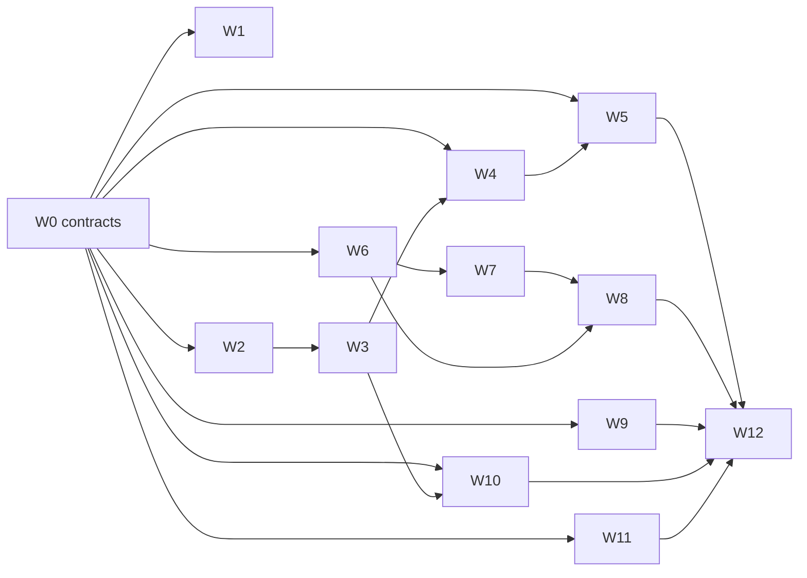

# Proposal: a Rust and Cranelift implementation without garbage collection

Status: proposed. Direction from the project owner on 2026-10-19: move Manuscript off Go entirely (compiler, runtime, and generated code), adopt the value-semantics memory model below, and use Cranelift as the code generator. This document is the plan; nothing in it is implemented outside `experiments/`.

## Summary

Manuscript today lowers to Go source and links a Go runtime. Measurements show the Go backend, not the language's rules, is what keeps Manuscript slower than hand-written Go, and a garbage collector forecloses C-ABI libraries, small WASM output, and predictable latency. The plan replaces the implementation with a Rust compiler and a `no_std`-first Rust runtime, lowering through a Manuscript mid-level IR (MIR) to Cranelift, under a memory model with one owner per value, implicit moves, explicit copies, borrowed parameters, `mut` instead of `var`, and explicit types for shared identity. Work is organized as thirteen workstreams behind five checked-in contracts so that most of it runs in parallel from the first week.

## Evidence

All numbers: Linux amd64, Xeon 2.1 GHz, four vCPUs, 2026-10-19. Sources: `bench/perf/kernels/README.md` (C baselines) and `experiments/cranelift-spike/README.md` (spike).

Run time of the seven whole-program kernels, ratio to hand-written Go (lower is faster):

| kernel | Manuscript today | C, Manuscript semantics, clang -O2 | spike compiler, Cranelift |
|---|---:|---:|---:|
| sieve | 1.66x | 0.50x | 0.57x |
| nbody | 1.03x | 0.93x | 1.18x |
| life | 1.39x | 0.56x | 0.66x |
| matmul | 1.88x | 0.57x | 1.37x |
| trees | 1.73x | 0.79x | 0.95x |
| collatz | 1.47x | 0.92x | 1.85x |
| map_count | 1.37x | 0.63x | 1.39x |

- The same rules (checked Int, bounds checks, cancellation polls) compiled as C are 1.1x–3.5x faster than today's output: the headroom is in representation (inline records, list headers in registers, no pointer-chasing sum types, no GC), which Go lowering cannot reach.
- Deterministic frees cost nothing measurable (`trees` matches hand-written C).
- The remaining cost is checks: overflow checks cost life 3.8x and collatz 1.6x, bounds checks cost matmul 1.3x. Most are removable by range analysis and hoisting, which belong in our MIR.
- A 2.6k-line Rust spike implements the ownership rules in ~600 lines of checking with direct diagnostics, compiles all seven kernels correctly, passes valgrind on a drop-heavy program, and builds in ~50 ms against ~200 ms for `go build` of the equivalent Go and 640 ms for `ms build` after an edit.
- Cranelift output is 1.15x–2.4x slower than clang on the same semantics; the gaps are missing strength reduction, overflow-flag materialization, no loop rotation, and unhoisted bounds checks.
- Two traps found: Cranelift's LICM hoists a non-atomic cancellation load (the poll must be atomic), and Cranelift 0.136's inliner copies symbol global values without remapping their names (inline in our MIR instead, and report upstream).

## Goals and non-goals

Goals:
- No Go anywhere: compiler, runtime, standard library, tools, and generated code. One self-contained `ms` binary for the six release targets.
- The memory model below, with no tracing collector.
- Dev builds at least as fast as `go build` of equivalent Go; run time at or below hand-written Go on `bench/perf` after MIR optimizations, and within 25% of the C baselines where a release backend is later justified.
- Parity of every user-facing tool: check, lint, format, test, build, inspect, review, diagram, search_symbol, guide, LSP, debugger, profiler, VS Code.

Non-goals for this plan: an LLVM backend (gated, below), self-hosting, WASM, user-level `unsafe` or C FFI, and standard-library API changes beyond what the memory model requires.

## Language model (the contract every workstream builds against)

The canonical rules move into `documentation/core-language/` in workstream W1; this section is the agreed summary.

1. **Values.** Records, lists, maps, sets, strings, bytes, and alternatives are values with one owner. A plain value (scalars and records of plain values) copies implicitly. Any other value moves at its last use into a consuming position (binding, assignment, construction, `append`, `return`); using it afterwards is a compile error whose fix is `.copy()`.
2. **`mut` replaces `var`.** `let` is fully immutable, including contents. `mut x = ...` declares a changeable value. Parameters borrow read-only; `mut` parameters are marked at the declaration and at the call (`push(mut items)`), and a `mut` argument may not overlap another argument. Methods that change their receiver declare it; receivers carry no call-site marker.
3. **Projections borrow.** `xs[i]` and `r.field` are places: readable, assignable when rooted at a `mut` binding, and copyable into a binding only when plain. Moving out of an element or field requires `.copy()` or a removing method.
4. **Identity is explicit.** `Shared[T]` (immutable, atomically reference counted, sendable), `Weak[T]`, `Arena[T]` with generation-checked `Id[T]` for graphs, and the existing `Synchronized[T]` for shared mutable state.
5. **Resources are unique.** `Closeable` types cannot be copied; a record holding one is unique too; `with` is unchanged.
6. **Strings and bytes** are immutable reference-counted buffers; slices share the buffer; builders construct them.
7. **Closures** capture by copy or move. A closure that captures a `mut` binding cannot escape (it cannot be stored, returned, or sent), inferred without syntax.
8. **Concurrency** keeps one function kind and API-only concurrency. Values cross tasks by move or copy; only `Shared` and `Synchronized` are shared.
9. **Checks and faults keep their current contract**: overflow-checked Int, bounds-checked indexing, cancellation observed in loops, and faults that propagate to the task boundary while running cleanup ([cleanup faults](../documentation/core-language/cleanup/cleanup-faults.md)). The new runtime therefore needs unwinding that runs drops and close actions; aborting the process is not acceptable.

Observable changes for existing programs: aliasing through assignment ends (`tests/e2e/testdata/stdlib/mutation-aliases.ms` inverts), `var` becomes `mut`, mutated parameters need `mut`, and bound methods capture a copy of their receiver. The repository holds 357 `.ms` files (31k lines, 445 `var` bindings) and 165 Manuscript code fences in `documentation/`, all migrated in W1.

## Architecture

A Cargo workspace at the repository root with crates under `crates/`, each owned by one workstream:

```text
.ms ─▶ ms-syntax ─▶ ms-check ─▶ ms-mir ─▶ ms-opt ─▶ ms-clif ─▶ object ─▶ ms-link ─▶ executable
        (parse,      (types,     (IR, verifier,  (ranges,   (Cranelift,           (bundled linker,
         format)      ownership,  interpreter)    checks,     DWARF, frames)        runtime archives)
                      diagnostics)                 inlining)
runtime: ms-rt-core (no_std: alloc, strings, collections, faults, unwinding)
         ms-rt-exec (scheduler, coroutines, event loop, timers) ─ ms-std-* (standard library modules)
tools:   ms-tooling (lint, inspect, review, diagram, docgen, guide) · ms-lsp · ms-dap · ms-cli (`ms`)
```

Technical decisions carried from the spike, revisited only with measurements:
- Values flatten into scalar SSA variables; `mut` parameters lower as copy-in/copy-out below a size threshold and by pointer above it.
- Drop flags for owned locals; temporaries die at the end of their statement; the cancellation poll is an atomic load.
- Inlining, range analysis, check elimination, and simple strength reduction happen in MIR, not Cranelift.
- Frame pointers stay on; a compact PC-to-source table gives fault frames and profiling without per-call bookkeeping (preserving the decision recorded in `.experts/compiler.md`).
- The MIR interpreter is the reference oracle: every conformance test runs on it and on native code, and results must agree.
- Each module compiles to its own cached object keyed by its content and its dependencies' interface hashes.
- Generics monomorphize first; dictionary passing in dev builds is adopted only if build time demands it.

## Contracts (week one, then change only by contract PR)

Five artifacts let every workstream start at once and build against stubs:

| Contract | Artifact | Lets these start |
|---|---|---|
| C1 Semantics | `documentation/core-language` rules plus `tests/conformance/` acceptance and rejection cases tagged by feature | W1, W2, W3, W11 |
| C2 MIR | `crates/ms-mir`: types, builder, verifier, text format, and interpreter skeleton | W3 (target), W4, W5 (hand-written MIR inputs) |
| C3 Runtime ABI | `crates/ms-rt-abi`: symbol list, value layouts, calling convention, unwinding and fault protocol, generated header | W5, W6, W7, W8 |
| C4 Checker queries | a `Program` query trait (definitions, types, references, diagnostics as JSON) | W10 against fakes before W3 lands |
| C5 Build and CI | workspace skeleton, per-crate CI jobs, conformance runner, results dashboard | everyone |

Contract changes go in a separate PR labeled `contract`, are challenged by an independent reviewer subagent, and list the affected workstreams in the body.

## Workstreams

| ID | Scope | Needs | First deliverable |
|---|---|---|---|
| W0 | Contracts C1–C5 | this proposal | skeleton workspace, contracts merged |
| W1 | Semantics docs, diagnostics catalog, `ms migrate`, migration of every `.ms` file and doc example | C1, W2 parser for the tool | rewritten binding, record, and collection pages |
| W2 | Lexer, parser, AST, module graph, manifest, formatter | C1 | parses every repository `.ms` file |
| W3 | Types, generics, interfaces, contracts, effects, ownership and exclusivity, diagnostics parity | C1, C2, W2 | core conformance tags pass on the interpreter |
| W4 | Checked AST to MIR, drop elaboration, MIR interpreter, range analysis, check elimination, inlining | C2 | kernels run on the interpreter |
| W5 | MIR to Cranelift, layouts and ABI, unwinding tables, DWARF line tables, frame table, object caching | C2, C3 | hand-written MIR kernels match the C baselines' checksums |
| W6 | Runtime core: allocator, String/Bytes, List/Map/Set, Shared/Weak/Arena, Int and Float helpers, faults and unwinding | C3 | layout-compatible collections with Rust tests |
| W7 | Execution runtime: stackful coroutines, scheduler, cancellation, timers, event loop, TaskGroup, Synchronized, BlockingQueue, signals, shutdown | C3, W6 allocator | cancellation and join semantics under test |
| W8 | Standard library: the 48 modules in `pkg/stdlib`, in parallel batches | C3, W6, W7 for I/O | pure modules first (json, csv, toml, yaml, url, semver, path, html, encoding, math, bits, binary, random, decimal, bigint, regex) |
| W9 | `ms` CLI, build cache, linker and libc payload, six-target packaging, distcheck | C3, C5 | `ms build` links a W5 object on all targets |
| W10 | LSP, lint, inspect, review, diagram, docgen, guide and search_symbol, debugger (DAP), VS Code | C4, then W3 | syntax-level LSP on W2 |
| W11 | Conformance runner, differential testing (interpreter versus native), program fuzzing, `bench/perf` and `agent-bench` runners, performance CI | C5 | runner with per-feature pass rates |
| W12 | Cutover: delete Go sources, vendor, payload scripts; update AGENTS.md, skills, experts, taste, architecture pages, book | all | release candidate without Go |

Dependencies are on contracts, not on finished workstreams, except where the table says otherwise:



### How the parallel work runs

- One agent session per workstream, and one per standard-library batch in W8 (about eight batches of six modules). Sessions own directories; a change outside a session's directory goes through the owning session or a contract PR.
- Branches are `rust/<workstream>/<topic>`; PRs touch one crate where possible and stay small enough that per-crate CI is meaningful.
- Stubs land with every contract, so no session waits on another to compile. Codegen is developed against hand-written MIR text; the checker against the interpreter; tools against a fake checker; standard-library modules against the ABI with Rust unit tests.
- The conformance corpus is the shared definition of done: the ~270 `.ms` fixtures in `tests/e2e/testdata` (145 accept, 71 standard library, 49 project, 2 reject) plus the Go-side rejection tests are migrated, tagged by feature, and run on both the interpreter and native code. The dashboard reports pass rates per tag and per workstream.
- The Go implementation stays buildable and is feature-frozen from the start of P1; it receives only fixes until cutover.
- A weekly integration build runs every conformance test, `bench/perf`, and a sample of `agent-bench` against the head of every workstream.

## Phases and gates

| Phase | Exit criteria | Kill or rethink if |
|---|---|---|
| P0 Contracts | C1–C5 merged; skeptical review of this plan addressed; agent pilot: agents write the kernels and two server-style programs under the new rules on the spike or interpreter | the pilot needs clearly more correction cycles than the same tasks in current Manuscript |
| P1 Vertical slice | the real kernel sources compile through the new pipeline; core conformance tags pass on interpreter and native; dev-build run time at or below hand-written Go on at least five of seven kernels; `ms build` after an edit at or below `go build` of the equivalent Go | after MIR optimizations, run time is still worse than today's Go backend on most kernels |
| P2 Breadth | generics, interfaces, closures, strings, concurrency, 90% of conformance, every example runs, standard library batches merged, LSP and lint usable | concurrency or unwinding forces a model change not covered by C1 |
| P3 Cutover | 100% of migrated conformance, six-target distribution checks, debugger, book, `agent-bench` pass rate at or above today's; W12 removes Go | any gap above |
| P4 Release backend (optional) | measured gap on real programs justifies LLVM or C emission from the same MIR as a release-only backend | — |

## Risks

| Risk | Mitigation |
|---|---|
| Rewrite scale: 65k lines of Go and 39k lines of Go tests | contracts and stubs for parallel work; reuse of the `.ms` conformance corpus and standard-library declarations; Rust crates for TLS, compression, regex, and parsing |
| Unwinding without Go: faults and cancellation must run drops and cleanup | decide in C3 between Cranelift exception tables (`try_call`) and explicit fault returns; prototype both on the kernels and a cleanup-heavy program before P1 |
| Cranelift miscompiles or rarely used paths (inliner, multi-value returns) | pinned version, differential testing against the interpreter, fuzzing, avoiding rarely used features, upstream reports |
| Migration breaks users and examples | `ms migrate` for mechanical edits, a report for alias-dependent sites, a minor-version release with migration notes |
| Concurrency bugs without Go's race detector | the model allows no shared mutation outside `Synchronized`; runtime tested under `loom` and ThreadSanitizer builds |
| Runtime size and link time (a Rust `std` runtime made linking take 110 ms) | `no_std` core, prebuilt per-target archives, section garbage collection |
| Cross-target linking and libc | one pinned linker and sysroot payload per target, validated by distcheck; candidate: `zig cc` as linker driver |
| Performance cliffs (atomic string counts, copies of large values) | `bench/perf` and the standard-library benchmarks in CI with thresholds |

## Alternatives considered

- **Do nothing and keep optimizing Go lowering.** Recent work closed much of the gap, but today's output is still 1.03x–1.88x hand-written Go, and the C baselines show the remaining 2x–3x needs inline layouts, register-resident list headers, and control over check codegen that Go source cannot express. It also keeps the GC.
- **Keep the Go frontend and emit MIR for a Rust backend.** Lower first-step risk, but the checker must learn ownership rules either way, so they would be written twice, and the owner's direction is to remove Go entirely.
- **LLVM only.** Better code, but dev builds near `clang -O0` (179 ms for the C kernels against ~50 ms for the spike) and a large dependency in every install. Kept as the optional P4 release backend.
- **C emission through a bundled C compiler.** Readable output and easy debugging, with build times similar to LLVM. A fallback release path from the same MIR.
- **Reference semantics with reference counting** (keeps today's programs valid). Retains aliasing bugs, needs a cycle collector, and makes data races memory-unsafe without a sharing rule.
- **A Rust-style borrow checker.** Rejected for readability: lifetimes and stored borrows are the complexity this design avoids.

## Open questions

Each has an owner workstream and should be settled by measurement or a small prototype before the phase that needs it.

- Updating two elements of one list at once (`nbody`): a `swap`/`pair` API or an exclusivity exception for provably distinct indices (W1, P1).
- Receiver mutation syntax for methods (W1, P0).
- Unwinding mechanism (W5 with W6, P0).
- Atomic or non-atomic string reference counts, given values move across tasks (W6, P1).
- Read-only borrowing by scoped TaskGroup work (W7, P2).
- Linker and libc payload: `zig cc` or curated `lld` with sysroots (W9, P1).
- Debugger: lldb-dap or a DAP over our own DWARF (W10, P2).
- Monomorphization versus dictionary passing in dev builds (W4, P2, by build-time measurement).

## What this supersedes on delivery

Until W12 lands, the current decisions remain in force for the Go implementation. At cutover they are replaced: `.experts/compiler.md` "Lowering is typed Go" and "Fault frames come from the Go stack" (the no-bookkeeping principle carries over); `.experts/language.md` "Mutable data uses explicit shallow cloning" and the aliasing parts of "Recursive data uses references"; `.experts/runtime.md` "Sharing, resource lifetime, and work lifetime are separate" where it allows sharing every value; `skills/language-design-taste/SKILL.md` on garbage-collected references and Go lowering; and the Go-specific parts of `AGENTS.md` and `documentation/contributing/`.
