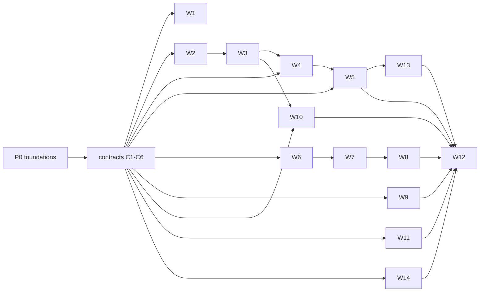

# Proposal: a Rust and Cranelift implementation without garbage collection

Status: proposed, revised after an independent skeptical review (summarized at the end). Direction from the project owner on 2026-10-19: move Manuscript off Go entirely (compiler, runtime, standard library, tools, and generated code), adopt a value-semantics memory model without a tracing collector, and use Cranelift as the code generator. Nothing here is implemented outside `experiments/`.

## Summary

The plan runs in two shapes. **P0 is serial and small**: a few sessions settle the memory model, the standard-library changes it forces, unwinding, and the agent experience, each with a measured gate. Only when those gates pass are the contracts frozen and the work **fanned out to fourteen parallel workstreams** that build a Rust compiler (MIR, Cranelift), a Rust runtime, the standard library, and every tool against six checked-in contracts. The review showed the model is not yet sound or complete; fanning out before it is would churn every session.

## Evidence and its limits

Numbers are from one shared four-vCPU Linux amd64 VM on 2026-10-19 ([C baselines](../bench/perf/kernels/README.md#c-baselines-for-a-no-gc-backend), [spike](../experiments/cranelift-spike/README.md)). Run time of seven CPU kernels as a ratio to hand-written Go:

| kernel | Manuscript today | C, Manuscript checks, clang -O2 | spike, Cranelift |
|---|---:|---:|---:|
| sieve | 1.66x | 0.50x | 0.57x |
| nbody | 1.03x | 0.93x | 1.18x |
| life | 1.39x | 0.56x | 0.66x |
| matmul | 1.88x | 0.57x | 1.37x |
| trees | 1.73x | 0.79x | 0.95x |
| collatz | 1.47x | 0.92x | 1.85x |
| map_count | 1.37x | 0.63x | 1.39x |
| geometric mean | 1.48x | 0.68x | 1.06x |

What this supports:
- The memory model has real headroom: C with the same checks is about 2.2x faster than today's output (geometric mean), and the spike is about 1.4x faster than today without any mid-level optimization.
- A small compiler can implement the model and produce correct results for well-formed programs; deterministic frees were not a measured cost.
- Cranelift dev builds are fast to produce: ~50 ms for the spike against 184–211 ms for `go build` of the equivalent Go and 480–640 ms for `ms build` after an edit.

What it does not support, and P0 must measure:
- **The spike is slower than hand-written Go on four of seven kernels**, and slower than today's backend on nbody and collatz.
- **Both baselines omit contract costs**: the 200,000-frame recursion limit with a catchable fault, cancellation polling in recursive calls, per-task (not global) cancellation flags, unwinding landing pads, and seeded hashing for maps. `trees` matching C partly reflects the missing recursion polls.
- **Part of the gap is the rules, not Go**: life is 6x slower than plain C with the checks on, and some of the representation wins (inline lists of records, compact ordered maps, cached list headers) are expressible in Go once the semantics change. Only removing the collector is not.
- **The workloads are narrow**: CPU kernels only. `bench/perf/programs` shows string and I/O workloads already within ~9% of Go (string_append 0.71x), exactly where atomically counted strings could regress. There is no server benchmark, no latency or memory measurement, and same-suite runs vary by up to 38%.
- **The build comparison is not like for like**: the spike compiles no standard library, has no module graph, emits no debug info, and links a 228-line runtime.
- **The spike's checker is unsound**: it accepts reassigning a `match` scrutinee while payload borrows are live, which frees the tree under the borrow (segfault, valgrind invalid reads). Copy-in/copy-out `mut` parameters are also unsound with unwinding (below). The spike's faults exit the process, so neither path was exercised.

## Goals and non-goals

Goals: no Go anywhere and one self-contained `ms` binary for the six release targets; the memory model without a tracing collector, proven sound by a rejection corpus and sanitizer runs; dev builds no slower than `go build` of equivalent Go on the repository's own corpus; run time and memory no worse than today on CPU, string, I/O, and server benchmarks, with the CPU geometric mean below hand-written Go; parity of every user-facing tool.

Non-goals for this plan: an LLVM release backend (gated), self-hosting, WASM, user-level `unsafe` or C FFI. Standard-library API changes are in scope only as the P0 standard-library delta decides.

## Memory model (draft; P0 makes it a contract)

Settled direction:
1. **Values with one owner.** Records, lists, maps, sets, strings, bytes, and alternatives are values. Plain values (scalars and records of plain values) copy implicitly; others move at their last use into a consuming position. Duplicates are explicit with `.copy()`. P0 measures this against copy-on-write (see Alternatives) before it is frozen.
2. **`mut` replaces `var`.** `let` is immutable including contents; `mut` bindings and `mut` parameters (marked at the declaration and the call) may change; a `mut` argument may not overlap another argument.
3. **Explicit identity.** `Shared[T]` (immutable, sendable), `Weak[T]`, `Arena[T]` with generation-checked `Id[T]`, and `Synchronized[T]`.
4. **Checks and faults keep today's contract**: checked Int, bounds-checked indexing (including negative indexes from the end), cancellation in loops and recursive calls, the recursion limit, and faults that propagate to the task boundary while running cleanup.

Open in the model, each a P0 deliverable:
- **Exclusivity for every borrow.** Every construct that creates a borrow living across statements (`match` and `if let` payloads, loop variables, `with` bindings, guard payloads, interface views, accessor results) must forbid mutating or reassigning the borrowed root while the borrow is live. The rule is lexical (Swift access enforcement, Hylo projections), not lifetime inference, and every case gets rejection fixtures.
- **Projections and accessors.** `get`, `first`, `last`, and Optional payloads return `T` today. Decide between returning projections (borrows usable within an expression or a scoped binding) or copies, and whether user code can declare projections. Indexed assignment (`xs[i].f -= 1`) is a new syntax change; today indexing is read-only.
- **Mutator results.** List, Map, and Set mutators return the same collection for chaining; under the model they return `Unit` or a new value.
- **Handle types.** `Synchronized`, `BlockingQueue`, `TaskGroup`, schedulers, servers, clients, and loggers have identity and synchronize internally. Name them as a third category beside values and unique resources: copying a handle shares the service. Decide which native types (`HttpHeaders` today is "shared mutable") become values.
- **Resources and drops.** Whether dropping a unique `Closeable` closes it, the order of drops and `close`, moving a resource out of `with`, and how concurrent handlers share a database or client (through handles).
- **Unwinding state.** What a `mut` argument holds when the callee faults or is cancelled after reallocating it: copy-out in landing pads, or pass by reference whenever the value needs dropping. Same question for temporaries and partially built values.
- **Closures.** Mutating a captured `mut` binding must act on the binding, so such a closure is a borrow. Escape must be a signature-level property (inferred within a module, declared on exported, interface, and native function parameters), not whole-program inference.
- **Generics.** Duplicating a `T` needs a copyability bound; decide whether it is implicit (plain types) or a new compiler bound.
- **Equality and hashing** of `Shared`, `Weak`, and `Id`.
- **Concurrency.** Per-task cancellation without thread-local caching bugs under coroutine migration; coroutine stack sizing against the recursion limit; atomic or non-atomic string counts.

## Architecture

A Cargo workspace at the repository root, crates under `crates/`:

```text
.ms ─▶ ms-syntax ─▶ ms-check ─▶ ms-hir ─▶ ms-mir ─▶ ms-opt ─▶ ms-clif ─▶ object ─▶ ms-link ─▶ executable
runtime: ms-rt-core (no_std: alloc, strings, collections, faults, unwinding, frames)
         ms-rt-io (std + Tokio: coroutines as futures, scheduler, timers, sockets, files, processes)
         ms-std-* (standard library; Rust crates such as hyper, rustls, regex, flate2 behind the ABI)
tools:   ms-tooling (lint, inspect, review, diagram, docgen, guide) · ms-lsp · ms-debug · ms-cli (`ms`)
```

Decisions carried from the spike and the review, revisited only with measurements:
- Values flatten into scalar SSA variables; drop flags for owned locals; temporaries die at the end of their statement; the cancellation poll is an atomic load of a per-task flag.
- Inlining, range analysis, check elimination, strength reduction, and loop rotation happen in MIR. The spike showed Cranelift alone does not do them, and Cranelift 0.136's inliner mis-maps symbol global values.
- Frame pointers stay on; a PC-to-source table gives fault frames and profiles without per-call bookkeeping.
- The MIR interpreter is an oracle for the compiler, not the runtime: it runs every conformance test and must agree with native code. Runtime bugs are caught by the runtime's own tests, sanitizers, and `loom`.
- **I/O runs on Tokio.** Each Manuscript task is a stackful coroutine wrapped as a Tokio future; an I/O call registers the coroutine's waker and yields. The Rust networking crates (hyper, rustls, h2, tungstenite) assume Tokio, so a custom reactor buys adapters, not capability. The core stays `no_std`; dev builds link the std/Tokio runtime as a prebuilt shared library to keep links fast, and release builds link statically.
- Each module compiles to an object cached by content and dependency interface hashes; generics monomorphize first.

## P0: foundations (serial, small team)

Two to four sessions, each owning one item. P0 ends when every gate passes or the owner changes direction.

| Deliverable | Gate |
|---|---|
| Sound exclusivity and ownership rules (C1 draft) with a soundness corpus of rejection cases | every corpus case rejected; a program fuzzer finds no accepted program that fails under ASan or valgrind across one million generated programs |
| Standard-library delta: every one of the ~939 declarations in `pkg/stdlib` classified as unchanged, `mut` receiver, handle, or redesigned | owner sign-off on the redesign list |
| Unwinding prototype: Cranelift exception tables (`try_call`) and explicit fault returns, on all six targets, including callbacks through runtime frames | chosen design measured on the kernels and a cleanup-heavy program; overhead stated |
| Copy-on-write versus unique ownership, measured on the spike for kernels, strings, and agent ergonomics | decision recorded with numbers |
| A check-only frontend for the model (Rust, reusable as W3's start) | runs over the repository's 31k lines of `.ms` after a migration dry run |
| Agent pilot | at least 20 `agent-bench` tasks on at least 2 models: pass rate within 5 points of current Manuscript and correction cycles at most 1.15x |
| Re-measured baselines | kernels with recursion polls, per-task flags, landing pads, seeded maps, and inlined-by-compiler closures; plus a server benchmark (throughput, p99 latency, RSS) and string/I/O programs; on a dedicated runner, reported as geometric means with confidence intervals |

## Contracts (frozen at the end of P0; changed only by contract PR)

| Contract | Artifact | Unblocks |
|---|---|---|
| C1 Semantics | canonical rules in `documentation/core-language` plus the tagged conformance and soundness corpus | W1, W2, W3, W11 |
| C2 HIR | `crates/ms-hir`: the typed, resolved tree with ownership facts that lowering, lint, and tools consume | W4, W10 |
| C3 MIR | `crates/ms-mir`: types, builder, verifier, text format, interpreter | W4, W5 |
| C4 Runtime ABI | `crates/ms-rt-abi`: symbols, layouts, calling convention, unwinding and fault protocol, `mut` argument state during unwinding, per-task context, handle protocol | W5, W6, W7, W8 |
| C5 Checker queries | a `Program` query trait (definitions, types, references, diagnostics as JSON) | W10, W13 against fakes |
| C6 Build and CI | workspace skeleton, per-crate CI, conformance runner, dashboard, Cargo vendoring and license policy | everyone |

A named contract owner merges contract PRs, each challenged by an independent reviewer subagent and versioned, with the affected workstreams listed.

## Workstreams (fan-out after P0)

| ID | Scope | Needs |
|---|---|---|
| W1 | Canonical docs, diagnostics catalog, `ms migrate`, migration of all `.ms` sources and doc examples | C1, W2 |
| W2 | Lexer, parser, AST, module graph, manifest, formatter | C1 |
| W3 | Types, generics, interfaces, contracts, effects, ownership and exclusivity, HIR, diagnostics parity | C1, C2, W2 |
| W4 | HIR to MIR, drop elaboration, interpreter, range analysis, check elimination, inlining, strength reduction | C2, C3 |
| W5 | MIR to Cranelift, layouts, unwinding tables, DWARF line tables, frame table, object cache | C3, C4 |
| W6 | Runtime core: allocator, strings, bytes, collections with seeded hashing, Shared/Weak/Arena, faults, unwinding, iterative drop for long chains | C4 |
| W7 | I/O runtime: coroutines on Tokio, scheduler, per-task cancellation, timers, files, sockets, processes, signals, shutdown, TaskGroup, Synchronized, BlockingQueue | C4, W6 |
| W8 | Standard library in batches. Rust-backed modules test against the ABI first; modules written in Manuscript (yaml, toml, and others) need W3–W5. Behavior differences from Go libraries (Unicode classes in regex, HTTP and x509 details) are decided per module | C4, W6, W7 |
| W9 | `ms` CLI (build, run, test, init, emit, verify), build cache, linker and libc payload, six-target release on per-OS runners, distcheck, port of `scripts/repo-check` | C6 |
| W10 | LSP, lint, inspect, review, diagram, docgen, guide and search_symbol, VS Code | C2, C5 |
| W11 | Conformance and soundness runners, differential testing, program fuzzing, performance CI, server benchmark, `agent-bench` | C6 |
| W12 | Cutover: delete Go, vendor, payload scripts; update every file in the supersedes list | all |
| W13 | Debugger and profiler: DAP over a native debugger or bundled lldb (size measured against the LLVM objection), sampling profiler replacing `runtime/pprof` and `trace` | C5, W5 |
| W14 | Behavior extraction: the 1,043 Go test functions (58 files embed `.ms` source) become `.ms` conformance or soundness fixtures before Go is frozen | C1, C6 |



### How the parallel work runs

- One agent session per workstream and one per standard-library batch (about eight). Sessions own directories; changes elsewhere go through the owner or a contract PR.
- Branches `rust/<workstream>/<topic>`; small single-crate PRs; per-crate CI on changed crates and their dependents.
- Contracts ship with compiling stubs: codegen develops against hand-written MIR, the checker against the interpreter, tools against a fake checker, Rust-backed standard-library modules against the ABI.
- The conformance corpus is the shared definition of done, tagged by feature and run on the interpreter and native code; a generated dashboard reports pass rates per tag and workstream. The P1 slice uses fixtures that need only the core language; fixtures that import `@std/testing`, use interpolation, or call I/O join in P2.
- Go is feature-frozen when P1 starts, after W14 has extracted the behaviors its tests encode.
- An integration build on every merge runs conformance, soundness, `bench/perf`, the server benchmark, and an `agent-bench` sample against every workstream's head.

## Phases and gates

| Phase | Exit | Rethink if |
|---|---|---|
| P0 Foundations | every P0 gate above | a gate cannot be met without changing the model |
| P1 Vertical slice | core-language conformance and the full soundness corpus pass on interpreter and native; kernels (written without closures or I/O) at a CPU geometric mean at or below hand-written Go with 95% confidence, including contract costs; `ms build` after an edit at or below `go build` across the repository's `.ms` corpus | the geometric mean stays above today's Go backend after MIR optimizations |
| P2 Breadth | generics, interfaces, closures, strings, concurrency, 90% of conformance, every example runs, LSP and lint usable; server benchmark throughput and p99 at or better than today, RSS reported; hello-world binary size and link time with TLS reported against Go | unwinding, concurrency, or the standard-library delta force a model change |
| P3 Cutover | 100% of migrated conformance; six-target distribution checks; debugger and profiler; `agent-bench` at or above today's pass rate | any gap above |
| P4 Release backend (optional) | a measured gap on real programs justifies LLVM or C emission from the same MIR | — |

## Migration

`let` becomes immutable including contents, so migration reaches far more than `var`: about 445 `var` bindings, 883 mutator calls, 238 field assignments, 701 closures, and 67 `.clone()` calls in the repository's 357 `.ms` files, plus 165 Manuscript code fences in `documentation/`. Some programs change meaning silently: `mut a = bodies.get(i)` followed by `a.vx -= 1` compiles but no longer updates the list. `ms migrate` applies mechanical edits and flags every mutation of a binding that came from an accessor, projection, or parameter for review. The release that ships the model is a new minor version with migration notes.

## Risks

| Risk | Mitigation |
|---|---|
| Unsound ownership checking (already demonstrated in the spike) | lexical exclusivity per construct, soundness corpus, fuzzing with sanitizers as a P0 gate and in CI |
| Mutable value semantics at scale (Hylo is still a research language) | P0 pilot and copy-on-write comparison before freezing |
| Rewrite scale: 65k lines of Go and 39k lines of Go tests | P0 bounds the design first; contracts and stubs; W14 preserves tested behavior |
| Unwinding across Cranelift code, Rust runtime frames, and six targets | prototype on all targets in P0 |
| Cranelift bugs in rarely used paths | pinned version, differential testing, fuzzing, our own inliner, upstream reports |
| Runtime size and link time with Tokio, hyper, rustls | shared runtime library in dev builds, static in release, measured in P2 |
| Standard-library behavior drift from Go libraries | per-module decisions in W8, conformance fixtures from W14 |
| Concurrency bugs without Go's race detector | no shared mutation outside handles and `Synchronized`; `loom` and ThreadSanitizer for the runtime |
| Benchmark noise | dedicated runner, geometric means with confidence intervals |

## Alternatives considered

- **Do nothing and keep optimizing Go lowering.** Today's output is 1.48x hand-written Go (geometric mean). Some representation wins are reachable in Go once the semantics change, but the collector stays, and the owner's direction is to remove Go.
- **Value semantics on the Go backend first** (check-only mode in Go, or the Rust frontend emitting Go). Validates the model before the backend rewrite. Its intent is kept as P0's check-only frontend and agent pilot, written in Rust so it is not discarded.
- **Copy-on-write value semantics** (Swift-style): no use-after-move errors, no `.copy()`, cheap accessors, a smaller checker and migration, at the cost of uniqueness checks and hidden copies. Measured in P0 rather than dismissed.
- **LLVM only.** Better code, but dev builds near `clang -O0` and a large install. Kept as the optional P4 release backend.
- **C emission through a bundled compiler.** A fallback release path from the same MIR.
- **Reference semantics with reference counting.** Keeps programs valid but keeps aliasing bugs, needs cycle collection, and makes races memory-unsafe without a sharing rule.
- **A Rust-style borrow checker with lifetimes.** Rejected for readability; the model instead limits borrows to lexical scopes so no lifetimes appear in source.

## What this supersedes on delivery

Until W12 lands, current decisions stay in force for the Go implementation. At cutover W12 updates every file that encodes aliasing, garbage collection, or Go lowering. Found by searching for those terms, the list is: `AGENTS.md`; `.experts/compiler.md`, `language.md` (including "Mutable data uses explicit shallow cloning", "Equality and hashing are source interfaces", and the aliasing parts of "Recursive data uses references"), and `runtime.md` (including "Sharing, resource lifetime, and work lifetime are separate", "Prepared queries must preserve callback-visible list mutations", and "List traversal follows the captured Go slice header"); the skills `compiler`, `language-design`, `language-design-taste`, `manuscript-change`, `runtime`, and `tooling`; `documentation/glossary.md`, `learn/getting-started.md`, and under `core-language/`: `cleanup/exit-order.md`, `cleanup/resource-release.md`, `cleanup/scopes.md`, `functions/function-values-and-closures.md`, `modules/declarations.md`, `types/collections.md`, `types/equality-and-hashing.md`, `types/references.md`, `basics/bindings.md`, `basics/expressions.md`, `errors/faults.md`; under `contributing/`: `concurrent-runtime.md`, `go-lowering-representation.md`, `go-lowering-units.md`, `architecture.md`, and the compiler pages; under `developer-tooling/`: `implementation.md` and the build pages; and the standard-library declarations `collections.ms`, `http.ms`, `io.ms`, `fs.ms`, `json.ms`, `sync.ms`, and `yaml.ms`.

## Review record

An independent reviewer subagent challenged the first draft and recommended reworking P0 before fanning out. Accepted and applied:
- the use-after-free it found (reproduced: segfault, valgrind invalid reads);
- copy-in/copy-out unsoundness under unwinding;
- the standard library's reliance on aliasing, accessors, and mutator results;
- handle types and the resource and drop rules;
- contract costs missing from both baselines;
- overstated evidence (now geometric means, with the four kernels slower than Go stated);
- a copy-on-write comparison;
- the missing HIR contract;
- unowned work: debugger, profiler, Go-test extraction, release cross-builds, repo checks, Cargo policy;
- unreachable or unfirable gates, replaced with numeric ones;
- the migration scope;
- closure escape as a signature property;
- generic copyability;
- the full supersedes list.

Kept against the review: Tokio is chosen for I/O, with the `no_std` constraint limited to the runtime core.
