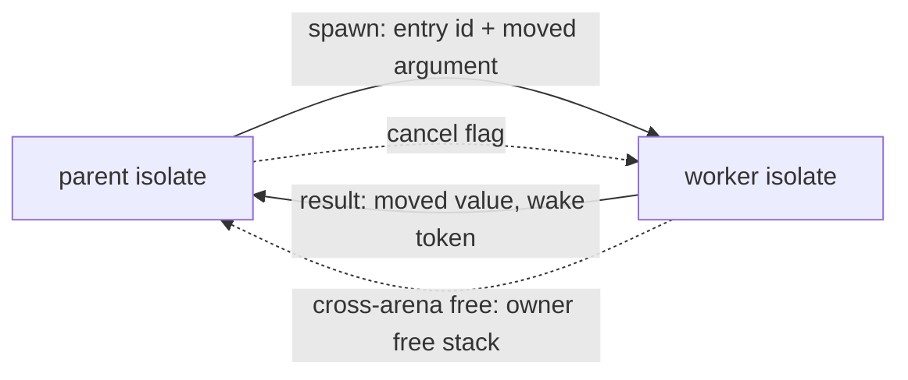

# Worker threads (design proposal)

## Summary

- Problem: a program uses one core. `TaskGroup` interleaves on one thread; CPU-bound work cannot scale.
- Change: `WorkerGroup[T]` in `@std/workers.ms` runs a named top-level `def` on an OS thread with its own runtime state (an isolate). The result is moved back; the group joins or cancels workers at the end of `with`.
- Cost: the runtime keeps process-global state in 55 `Global<T>` uses (`crates/ms-rt/src`); all per-isolate state must become thread-local, and generated code reads two runtime globals directly. This is the whole cost of the proposal.
- Transfer between threads is a move of the value's words (no copy, no encoding). A worker-boundary type check rejects the few types that are unsafe to move.
- Decision requested: approve the stage 1 spike (access-mechanism and scaling measurements, with a go/no-go gate) or defer until the processes proposal (`proposals/child-processes.md`) is measured.

## Status

- Proposal, no code. Checked against `origin/main` bffdc2fc (2026-10-24).
- Direction (Chinmay, 2026-10-24): `worker_threads`-style model; separate proposals for threads and processes; dedicated group type; `Channel` uppercase; no user-facing "sendable" concept; Linux, macOS and Windows from the first release; send memory rather than a codec.
- Skeptical review (independent subagent, 2026-10-24): findings folded in; see Review outcome.
- Siblings: `proposals/taskgroup.md` (scope and channel API), `proposals/child-processes.md` (same group shape, JSON transfer).
- TaskGroup API names below (`Task[T]`, `TaskError`, `timeout:`) follow the TaskGroup thread's 2026-10-24 revision, which is not yet in `proposals/taskgroup.md`; reconcile when it lands.

## Problem

- One runtime thread runs all Manuscript code (`crates/DESIGN.md` decision 4, `crates/ms-rt/src/task.rs`).
- A CPU-bound fan-out (hashing, parsing, compression, search) takes N times as long as on N cores.
- Affected: server and CLI authors, and agents writing batch tools.
- Not measured: no benchmark here shows a workload that gains. Stage 5 must record scaling at 1, 2 and 4 workers.

## Goals and non-goals

- Goals:
  - parallel execution with the same scoping, result and cancellation shape as `TaskGroup` and `ProcessGroup`;
  - no shared mutable state, no locks, no atomics in user code;
  - Linux, macOS and Windows in every stage.
- Non-goals:
  - shared memory or `SharedArrayBuffer` analogues;
  - sending handles, closures or `Shared` values;
  - detached workers, worker pools beyond a group, a thread limit;
  - catching a worker fault in the parent (shared with TaskGroup's deferred item);
  - changing single-thread behavior or performance.

## Design

### Syntax and API

```manuscript
from "@std/workers.ms" import WorkerGroup

def hash_chunk(chunk: Bytes) -> String:
    return sha256_hex(chunk)

def hash_all(chunks: List[Bytes]) -> Result[List[String], TaskError]:
    with WorkerGroup[String]() as group:
        for chunk in chunks:
            group.spawn(hash_chunk, chunk)
        return group.results()
```

- `WorkerGroup[T]`: `Closeable`; every worker returns `T`. Mixed types: one group per type or an alternative as `T`.
- `spawn(entry, argument, timeout: Duration = none) -> Worker[T]`; `Worker[T].result() -> Result[T, TaskError]`.
- `results() -> Result[List[T], TaskError]` in spawn order; `wait() -> Result[Unit, TaskError]` for `T = Unit`; `close()` cancels then joins.
- Same names and shapes as `TaskGroup[T]`; `ProcessGroup[T]` has the same surface plus `fork`.
- `entry` is a named top-level `def` with one parameter (use a record for several). One binary, so a function item identifies it: no module path string.
- Rejected at the call site (illustrative text): `spawn(lambda: f(x), 1)` -> "worker entry must be a named top-level def; lambdas and captures cannot run on another thread".
- An untyped group with `Worker[R]` handles is deferred until source types have generic methods.

### Semantics

- Isolate: each worker thread owns an allocator arena, scheduler and task tree, fault context, cleanup stack, drop queue and poller. A worker may use a `TaskGroup` internally.
- Transfer: the argument moves into the worker; the result moves back. The sender gives up ownership as for any move.
- Worker-boundary type check (not a user concept, an ordinary type error). Rejected in `spawn` argument, result and cross-worker `Channel[T]` payload:
  - `Resource` values and handles (thread-affine fds and reactors);
  - `Shared[T]` and `Weak[T]` (non-atomic refcounts);
  - closures and function values;
  - `ref` borrows and views.
  - Everything else is accepted: scalars, `String`, `Bytes`, `List`, `Map`, `Set`, `Optional`, `Result`, records, alternatives, `Sender`/`Receiver`.
  - The check cannot be removed: without it a `Shared` or handle crossing threads is a silent data race.
- Cancellation: `close` sets each worker's cancel flag, then joins. Points are existing runtime calls, I/O, channel operations and sleep. A worker in a loop with none cannot be cancelled and `close` blocks on it (same as tasks).
- Timeout: expiry sets the worker's cancel flag; `TaskError` reports a timeout once the worker stops.
- Fault (v1): the worker runs its cleanups; the process exits 70 through one process-wide fault latch so main's cleanups and exit hooks do not race.
- stdout/stderr: one process-wide writer, line-atomic writes, flushed at exit and on fault. stdin: main isolate only; a worker read faults with a message.
- Channels (stage 4): `Channel[T](capacity)` returns `(Sender[T], Receiver[T])`, as in TaskGroup. Cross-isolate transport is a bounded mutex queue of moved values; blocking uses the target isolate's token and wake fd; sender count is atomic.

### Memory and runtime mechanism

- `Global<T>` (`global.rs:8`, a single-thread cell) is replaced by two explicit cells, `Isolate<T>` (thread-local, const-initialized) and `Process<T>` (read-only or synchronized). `Global` is removed, so an unclassified static is a compile error, not a silent race. The stage 2 audit assigns each of the 55 uses.
- Arena: today one 16 GiB anonymous mapping (`alloc.rs:17`, `STATE` at `alloc.rs:93`, lazy `init` at `alloc.rs:108`), owner test `in_arena` (`alloc.rs:258`). Per isolate: a 16 GiB range aligned to 16 GiB (reserve 32 GiB and trim on Unix; Windows cannot trim a reservation, so it reserves at an aligned address or uses a smaller range), so owner = `addr >> 34` looked up in a table of registered isolates (exact match, checked before `in_arena`, because `System` addresses can alias an index).
- Address-space cost: 16 GiB plus a 256 KiB page table (`alloc.rs:113`) per isolate; exposed to `ulimit -v`, overcommit and container limits. `spawn` therefore needs a worker cap and a failure path (`TaskError`, not a fault). Range size may be smaller for workers; to be set by the spike.
- Remote free: a block freed by a non-owner is pushed on the owner's lock-free stack (link stored in the freed block's first word, which `free` already reuses) and drained by the owner on its next allocation.
- Lifetime rule: a moved value points into its sender's arena, so that arena stays mapped until its live-block count reaches zero. A finished worker's arena becomes an orphan drained by remote frees and unmapped at zero; a worker result stays valid after join.
- Why remote free is required: today `StdHeap::dealloc` (`alloc.rs:611`) leaks a foreign arena block (`owns` true, `is_current` false). With several arenas that same test would route another isolate's block wrongly, so the lookup must be by owner table.
- Rust-side data in `ms-std-*` uses `System` inside workers; only runtime-allocated Manuscript objects use isolate arenas. `StdHeap` is Linux-only today (`cfg(target_os = "linux")`); the ms-rt arena is not.
- Tokens: `task.rs:123` `INBOX` (with `INBOX_FULL` fast path) is one process mutex keyed by reusable ids into one scheduler. Cross-isolate wake needs an isolate id, per-isolate inbox and wake fd, and token generation counts. The blocking pool posts to the issuing isolate.
- Generated code reads two runtime globals directly (verified): `msrt_stack_limit` (`ms-clif/src/lower.rs:2191`, recursion guard in `DepthEnter`) and `msrt_cancel_flag` (`lower.rs:2183`, atomic load in `Op::Poll`, enabled by `opts.poll`). The runtime reads them too (`start.rs:50` signal handler, `glue/mod.rs:70`, `ms-std-net/src/rt.rs:38`).
  - `msrt_stack_limit` is already per-task state: `fault.rs:202` swaps it with `STACK_LO/HI`, `TASK_CANCEL`, `CLEANUPS` and `GUARDS` on every task switch. The swap code needs the isolate's address; the generated-code load needs it too.
  - `msrt_cancel_flag` has two writers: the signal handler (any thread) and a parent cancelling one worker. It becomes a field of a shared per-isolate record: the signal handler sets every registered isolate's flag; the parent sets one by record pointer.
  - Mechanisms for the generated-code access (all unverified for the pinned Cranelift and for the LLVM path on COFF and Mach-O; no TLS use exists in `ms-clif` today): (a) TLS access via Cranelift or LLVM `thread_local`, (b) out-of-line accessor call (simplest, slowest), (c) per-stack header found by masking the stack pointer (needs aligned task stacks), (d) isolate pointer as a hidden argument (ABI change to every function).
  - The spike (stage 1) chooses by measurement. If none passes the gate the proposal stops.
- Per-thread stack-overflow handling: only the main thread installs a `sigaltstack` (`start.rs:147`). Each worker needs its own alt stack, `STACK_LO/HI` and a TLS-reachable handler context (TLS is not async-signal-safe on every target, so the handler may need a registry lookup by stack address instead).
- Fault guards (`GUARDS`, `CLEANUPS`) use long-jumps and stay within one thread's stacks, safe once per-isolate.



### State classification (stage 2 audit confirms)

- Per-isolate: allocator `STATE`, `DROP_DEPTH`, `PENDING`, `CLEANUPS`, `GUARDS`, `SHIELD`, `FAULTING`, `SECONDARY`, `PRIMARY`, `GUARD_MESSAGE`, `PENDING_SIGNAL`, `TASK_CANCEL`, `msrt_stack_limit` (also swapped per task), `msrt_cancel_flag` (shared record, see above), `STACK_LO/HI`, `SCHED`, `EQ`, string `HINT`, poller state, `WAKE_FD`, `WAKER`, `TRAP`, debug counters.
- Process-wide read-only: `TABLES`, argc/argv, `MAIN_FN`, `START_NANOS`, static string tables.
- Process-wide synchronized: blocking pool, signal flag, `EXIT_HOOKS` (needs a lock), profiler buffers.
- Rework: `PARKED` fd table (`glue/mod.rs:101`), `MAIN_RESULT`, `TTY`, `CLOSED`, Windows `trap_windows` buffers.
- `ms-std-*` statics to classify: `ms-std-io` STDIN, `ms-std-terminal`, `ms-std-system` caches, `ms-std-net` thread-local reactors (hold arena objects), `ms-std-process` signal atomics, `ms-std-log`, `ms-std-fs`, `OnceLock`s in tls, hpack, time, process.

## Components touched

| Component | Change | Risk / test |
| --- | --- | --- |
| `crates/ms-rt` | thread-local `Global<T>`, `Process<T>`, per-isolate arenas and remote free, isolate start/join, token routing, fault latch | allocator stress, cross-arena free test, cancel/fault tests on 3 platforms |
| `crates/ms-clif`, LLVM path | per-isolate `stack_limit` and cancel-flag access | benchmark gate (`bench/perf`) |
| `crates/ms-check` | named-def entry rule, worker-boundary type check, diagnostics | conformance reject cases |
| `crates/ms-lower` / `ms-mir` | entry reference lowering for `spawn` | e2e worker fixture |
| `stdlib/workers.ms`, `bindings.json` | `WorkerGroup`, `Worker`; natives in a new `ms-std-*` or `ms-rt` glue | `make docs` regenerate |
| `crates/ms-std-*` | statics classified; reactors per thread | per-crate tests |
| `ms-syntax`, formatter, lint, LSP | unchanged (no syntax) | - |
| Docs | core-language page, cheat sheet (`ms guide`), `crates/DESIGN.md` decision 4, `VISION.md`, `.experts/runtime.md` | `make repo-check`, `make book-check` |
| Conformance | ordering, rejection, cancel, fault exit | `make conform` |

## Examples

- End-to-end: `hash_all` above, run at 1, 2 and 4 workers in stage 5.
- Rejected (illustrative): `group.spawn(hash_chunk, shared_counter)` with `shared_counter: Shared[Int]` -> "Shared values cannot be moved to a worker".

## Alternatives

- Do nothing: processes (`proposals/child-processes.md`) give parallelism with no runtime refactor, at higher start and JSON cost, plus crash isolation. Viable; no evidence threads are needed.
- Smallest version: a single `spawn` returning a handle, no group, no channels. Rejected: scoping is the point; a bare thread leaks.
- Shared heap with atomics (Go/Rust style): rejected; atomic refcounts and a thread-safe allocator tax every single-thread program and add races the ownership checker does not model.
- `List.parallel_map` only: rejected as the base; needs the same runtime plus closures crossing threads. May layer on workers for named functions.
- Entry by module path string: rejected; stringly typed, needs dynamic load.
- Copy on send (deep copy or JSON): rejected for threads by the owner; kept for processes.
- Fork a thread from `TaskGroup` (`spawn_worker`): rejected; separate group type, as `ProcessGroup`.

## Drawbacks

- Largest runtime change in the repo's history; an error is a silent cross-thread data race.
- Single-thread slowdown risk from TLS indirection in allocation, drop and prologues.
- Second implementation of the same group surface beside `TaskGroup` and `ProcessGroup`; learners hold three group types.
- Uncancellable CPU loops block `close`.
- stdin restriction and process-wide stdout writer are visible behavior.

## Prior art

- JavaScript `worker_threads`: separate isolates, message passing, structured clone. Differs: raw move instead of clone; function item instead of a path string.
- Rust `std::thread::spawn` with `Send`: compile-time marker. Differs: no user-visible trait.
- Go goroutines: shared heap. Rejected above.
- Erlang processes: per-process heap, copy on send. Differs: move.
- Swift actors / `Sendable`: closest to the boundary check; ours is internal.

## Evidence and cost

- Verified in source: 55 `Global<` uses in `crates/ms-rt/src`; `StdHeap` is Linux-only; arena is a single 16 GiB mapping; cancel flag and stack limit are read by generated code; `INBOX` is process-wide.
- Not measured: TLS cost on any target; scaling of any workload; remote-free overhead.
- Adds: one stdlib module, one checker rule, two runtime primitives (isolate, remote free). Learner concepts added: `WorkerGroup`, `Worker`, and one diagnostic.

## Staging and verification

- Each stage is its own PR with auto-merge, green on Linux, macOS and Windows.
1. Spike (no merge to main unless it is small): measure (i) generated-code access options a-d for `stack_limit` and cancel flag on `bench/perf` with callgrind instruction counts, (ii) thread-local `Global` cost in the allocator hot path, (iii) a two-thread prototype with remote free to bound scaling and remote-free overhead. Gate (proposed, to be confirmed by Chinmay): single-isolate instructions within 2% on `bench/perf`; two threads reach at least 1.6x on a CPU-bound kernel. On failure stop and keep processes as the parallelism route.
2. `Global<T>` replaced by `Isolate<T>`/`Process<T>`, one isolate, no behavior change; static audit including `ms-std-*`; gate repeated.
3. Per-isolate arenas with owner table and remote free; per-isolate `stack_limit` and cancel flag; second isolate in runtime tests (start/join, cross-arena free, orphan arena drain, per-thread stack guard, cancel, fault latch, token routing).
4. Checker and library: entry rule, boundary check, `WorkerGroup`, `Worker`, worker cap; conformance fixtures.
5. Cross-isolate `Channel[T]` (separable).
6. Diagnostics, cheat sheet, scaling measurement at 1, 2, 4 workers; design pages updated (`crates/DESIGN.md` decision 4, `VISION.md`, `.experts/runtime.md`).

## Open questions

- Resolve before approval (decider: Chinmay):
  - Build now, or only after processes are measured (recommend: measure processes first; do stage 1 spike only if they prove too slow)?
  - Keep the worker-boundary rejections (`Shared`, handles, closures, borrows); required for memory safety of moves (recommend: yes).
  - Single-argument entry `def f(argument: A) -> R` vs `ProcessGroup`'s `(Receiver, Sender, argument)` shape; align once TaskGroup channels land (recommend: add the channel form in stage 4 so both match).
- Resolve during implementation:
  - TLS mechanism for generated code (a/b/c).
  - stdout writer flush policy; stdin restriction.
  - Workers spawning workers.

## Rejected ideas

- Copy-based transfer for threads (owner: send memory).
- A declared `Sendable` trait (owner: avoid).
- `TaskGroup.spawn_worker` (owner: dedicated group).
- A second code path for the main isolate to dodge TLS cost (doubles test surface).

## Review outcome

- Independent reviewer checked the first draft against source; folded in:
  - cross-arena free corrupts rather than leaks;
  - generated code reads `stack_limit` and the cancel flag;
  - `PARKED`, `PENDING_SIGNAL`, `GUARD_MESSAGE`, `EXIT_HOOKS` and `ms-std-*` statics were missing;
  - token inbox cannot be reused as is;
  - workers need their own `sigaltstack`;
  - do-nothing is stronger than first written.
- Second review of this rewrite, folded in:
  - `stack_limit` is per-task state swapped at `fault.rs:202`, not just per-isolate;
  - the cancel flag has two writers (signal handler on any thread, parent), so it lives in a shared isolate record;
  - TLS options are unverified for Cranelift and for COFF/Mach-O; added a hidden-argument option and a spike-first stage;
  - arena sizing, alignment on Windows, worker cap, lifetime of a moved value's arena;
  - today a foreign block leaks (not corrupts); corruption only applies to the multi-arena design;
  - stage 1 split, gate given proposed thresholds, `Global` removed instead of defaulted.
