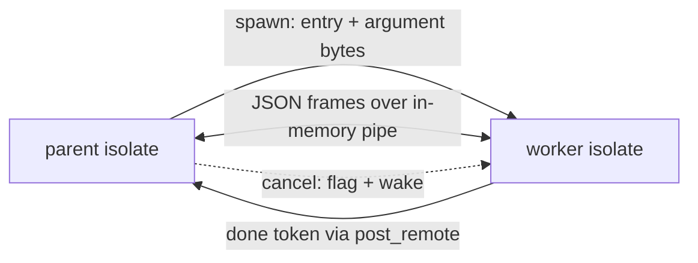

# Worker threads (design proposal)

## Summary

- Problem: a program uses one core. `TaskGroup` interleaves on one thread; CPU-bound work cannot scale.
- Change: `WorkerGroup` in `@std/workers.ms` runs a named top-level `def` on an OS thread with its own runtime state (an isolate: arena, scheduler, task tree, fault context, poller). Parent and worker talk over `Channel`s in both directions; the group joins or cancels workers at the end of `with`.
- Transport: channel messages are JSON frames over an in-memory duplex byte pipe, written in Manuscript (`@std/channels.ms`, channels thread). No sockets for threads (sockets are for processes). Values are encoded, not moved between arenas.
- Runtime (built, this branch): thread-local isolate state, one arena per isolate, per-task header blocks, per-isolate wake inboxes, worker spawn/cancel/join. Rust keeps only these primitives; `WorkerGroup`, `Worker` and the channel framing are `.ms`.
- Decision requested: none outstanding for the runtime; the `.ms` surface waits on the channel API.

## Status

- Implemented on branch `claude/project-thread-lgd5qy` (PR #1181): runtime isolates, `WorkerGroup`, checker rule, pipes, fixtures and docs. Open: macOS and Windows verification. Nothing merges until the whole feature works (owner, 2026-10-24).
- Direction (Chinmay, 2026-10-24): `worker_threads`-style model; separate proposals for threads and processes; dedicated group type; `Channel` uppercase; no user-facing "sendable" concept; Linux, macOS and Windows in every stage; 2 GiB default arena per worker; channels are bidirectional and in memory for tasks and workers (socketpair only for processes); majority of the work in Manuscript, small general Rust primitives.
- Reversed since the first draft: raw-memory moves between arenas (replaced by JSON frames) and a result-returning `results()` (replaced by channels both ways).
- Siblings: `proposals/taskgroup.md` (landed: `stdlib/tasks.ms`), `proposals/child-processes.md` (same group shape), channels (`proposals/channels.md`, PR #1185).
- Windows runtime paths (fiber header block via `msrt_isolate_hdr`, thread start) compile-checked only; CI is the first run.

## Problem

- One runtime thread runs all Manuscript code (`crates/DESIGN.md` decision 4, `crates/ms-rt/src/task.rs`).
- A CPU-bound fan-out (hashing, parsing, compression, search) takes N times as long as on N cores.
- Affected: server and CLI authors, and agents writing batch tools.
- Measured (Linux, 4 cores, release build, eight `fib(38)` jobs round-robin over N workers): 1 worker 1.82 s, 2 workers 1.03 s (1.8x), 4 workers 0.60 s (3.0x).

## Goals and non-goals

- Goals:
  - parallel execution with the same scoping, cancellation and error shape as `TaskGroup` and `ProcessGroup`;
  - no shared mutable state, no locks, no atomics in user code;
  - Linux, macOS and Windows in every stage;
  - most of the surface in Manuscript; Rust limited to small general primitives.
- Non-goals:
  - shared memory or `SharedArrayBuffer` analogues;
  - sending handles, closures or `Shared` values;
  - detached workers or pools beyond a group;
  - catching a worker fault in the parent other than by re-raising it;
  - changing single-thread behavior or performance.

## Design

### Syntax and API (as built)

```manuscript
from "@std/workers.ms" import WorkerGroup, worker_channel

def hash_worker() -> Unit:
    var ch = worker_channel[String, Bytes]()
    # receive chunks, send digests, until the starter closes its end

def hash_all(chunks: List[Bytes]) -> Result[List[String], WorkerError]:
    with WorkerGroup[Bytes, String]() as group:
        var worker = try group.spawn(hash_worker)
        # send chunks, read digests, then worker.channel.close() and worker.join()
```

- `WorkerGroup[In = Unit, Out = Unit]`: `Closeable`. `spawn(entry: Callable[[], Unit]) -> Result[Worker[In, Out], WorkerError]`. The starter's end is `worker.channel: Channel[In, Out]`; the worker takes the other with `worker_channel[Send, Receive]()` (`Channel` and `Transport` come from `@std/channels.ms`).
- `entry` is a named top-level `def` with no parameters. The checker rejects anything else (lambda, local function, captured value) at the `spawn` call, because the entry crosses as a capture-free closure: the runtime copies its code pointer into a system block and rebuilds a closure in the worker's arena (one binary, so the pointer is valid in both). This replaces the earlier idea of passing the channel end as an entry parameter, which needed a generated typed thunk: `worker_channel` is an ordinary generic function, so no compiler support beyond the checker rule is needed.
- `Worker.join()` closes the starter's end, waits, and returns `Result[Unit, WorkerError]` (`Faulted(report)`, `Cancelled`, `NotStarted`); later calls return the same outcome. `Worker.cancel()` raises the worker's cancel flag. Leaving `with` cancels, closes and joins every worker.
- A fault in a worker does not end the program: it comes back from `join` as `Faulted(report)`. The group does not re-raise (decision changed from the first draft: the caller can choose, and a fault is data like a task's error).
- Transport: `WorkerTransport[In, Out]` implements `Transport` over `msrt_pipe_*` (`ms-rt/src/pipe.rs`). The pipe is a duplex queue of whole messages in system memory, bounded at 16 messages per direction; a waiting task parks on a remote token that the other end posts. Encoding and decoding are `stringify` and `parse` in Manuscript. Framing is not needed in memory; the process transport (socket pair) will add it in Manuscript. This deviates from "pipe written in Manuscript" in one place: the shared queue lives in Rust because two isolates share no Manuscript memory; it is about 250 lines with no knowledge of messages.

### Semantics

- Isolate: each worker thread owns an arena, scheduler, task tree, fault context, cleanup stack and poller. A worker may use a `TaskGroup` internally.
- Transfer: only channel messages and the spawn argument cross. They are JSON-encoded, so the payload rule is "JSON-encodable"; `Resource` values, handles, `Shared`/`Weak`, closures and `ref` borrows are not encodable and are rejected by the checker, not by a user-visible concept.
- Cancellation: `close` raises the worker's cancel flag and wakes its poller; points are runtime calls, I/O, channel operations and sleep. A loop with none cannot be cancelled and `close` blocks on it, as for tasks.
- stdout/stderr: one process-wide writer with line-atomic writes. stdin: main isolate only; a worker read faults with a message.

### Memory and runtime mechanism (as built)

- Statics: `Global<T>` is gone. `Process<T>` is one copy for the process (set before other isolates start, or main-only); `isolate_static!` is a const-initialized thread-local. An unclassified static does not compile.
- Arena: one reservation per isolate, committed on demand: 16 GiB for the main isolate, 2 GiB for a worker, falling back to the system allocator when full. A registry of up to 256 arenas (base, end, side table, remote-free stack) is used only off the hot path. Local free keeps the `in_arena` range compare.
- Foreign free: a block outside the caller's arena is pushed on its owner's lock-free stack and drained on the owner's next slow-path allocation. Channel payloads are encoded, so this is a safety net for stray frees, not the transfer mechanism. A worker's arena is unmapped when its isolate ends, so nothing from it may escape (spawn arguments cross as a system-allocated byte block, outcomes as bytes).
- Threads that never claimed an arena (blocking pool, helpers) use the system allocator.
- Header blocks: generated code needs the running task's recursion limit and cancel flag. Every task stack on Linux and macOS is a 256 MiB-aligned slot with a `Hdr { limit, cancel, shield }` page at its base; `DepthEnter` and `Op::Poll` find it by masking the stack pointer (no TLS, no call). On Windows, fibers cannot be aligned, so generated code calls `msrt_isolate_hdr()`, which returns the running task's block. Measured: a recursive `fib(40)` runs in 0.68 to 0.72 s before and after.
- Main as a task: the thread entry no longer runs `main` on the OS thread's stack; it spawns `main` as the isolate's main task and waits shielded. A stop signal reaches the main task through an atomic pointer to the main isolate's current block.
- Tokens: a token id carries the owner isolate's slot (12 bits) and a 20-bit generation. `msrt_token_post_remote` queues on the owner's inbox and kicks only that isolate's poller; the blocking pool posts to the issuing isolate.
- Worker externs (`ms-rt/src/worker.rs`): `msrt_worker_arg_new/take` (argument bytes), `msrt_worker_spawn(entry, arg, done_token) -> handle`, `msrt_worker_cancel(handle)`, `msrt_worker_join(handle, msg_out) -> 0 returned | 1 fault | 2 cancelled`. At most 256 live workers. Each worker gets its own `sigaltstack` overflow handler.



### State classification (implemented)

- Per-isolate (`isolate_static!`): `DROP_DEPTH`, `PENDING`, `EQ`, string `HINT`, `TRAP`, `CLEANUPS`, `FAULTING`, `SECONDARY`, `TASK_CANCEL`, `PRIMARY`, `GUARDS`, `CUR_HDR`, `ROOT_HDR`, `SCHED`, poller `STATE`, allocator `STATE`, task-scope tables, `TIMED_OUT`.
- Process-wide, set before other isolates or read-only: `TABLES`, argc/argv, `MAIN_FN`, `MAIN_RESULT`, `START_NANOS`, `STACK_LO/HI` (read by profilers on other threads), profiler buffers.
- Process-wide, main isolate only: `OUT`, `TTY`, `CLOSED` (stdout buffer; a worker writes straight to descriptor 1 under a lock, unbuffered), `EXIT_HOOKS`. Per-isolate since workers: `FAILURE`, `STDIN_PENDING`.
- `ms-std-*` crates keep `ms_rt::ffi::Global` cells (`ms-std-io` STDIN, `ms-std-terminal`, `ms-std-system` caches): main-isolate-only; `Global::get` faults in a worker ("only available on the main thread").

## Components touched

| Component | Change | Risk / test |
| --- | --- | --- |
| `crates/ms-rt` | `Process<T>` / `isolate_static!`, per-isolate arenas and remote free, header blocks, worker externs, token routing (done) | unit tests: remote free, worker run/fault/cancel; conform |
| `crates/ms-clif`, LLVM path | header block via masked stack pointer (Windows: call) (done) | benchmark gate (`bench/perf`) |
| `crates/ms-check` | named-def entry rule at `WorkerGroup.spawn` (done); JSON encodability is checked by `stringify`/`parse` at run time | `worker-entry-lambda` fixture |
| `crates/ms-lower` / `ms-mir` | none: the entry is an ordinary capture-free closure | e2e `workers.ms` |
| `stdlib/workers.ms` | `WorkerGroup`, `Worker`, `worker_channel`, `WorkerTransport` in Manuscript (done) | `make docs-check` |
| `crates/ms-std-*` | statics classified; reactors per thread | per-crate tests |
| `ms-syntax`, formatter, lint, LSP | unchanged (no syntax) | - |
| Docs | core-language page, cheat sheet (`ms guide`), `crates/DESIGN.md` decision 4, `VISION.md`, `.experts/runtime.md` | `make repo-check`, `make book-check` |
| Conformance | ordering, rejection, cancel, fault exit | `make conform` |

## Examples

- End-to-end: `hash_all` above, run at 1, 2 and 4 workers in stage 6.
- Rejected (illustrative): `group.spawn(lambda: hash_chunk(c))` -> "worker entry must be a named top-level def; lambdas and captures cannot run on another thread".

## Alternatives

- Do nothing: processes (`proposals/child-processes.md`) give parallelism with no runtime refactor, at higher start cost, plus crash isolation. Viable; the owner chose to build threads too.
- Move values between arenas (raw words): built as a safety net (remote free) but dropped as the transfer; JSON frames are simpler, need no boundary type rules beyond encodability, and share one code path with processes.
- Shared heap with atomics (Go/Rust style): rejected; atomic refcounts and a thread-safe allocator tax every single-thread program.
- Thread-local access from generated code: rejected; Cranelift TLS is a runtime call (`__tls_get_addr`, `tlv_get_addr`), measured as unacceptable on recursion.
- `List.parallel_map` only: rejected as the base; may layer on workers later.
- Entry by module path string: rejected; stringly typed.
- Fork a thread from `TaskGroup`: rejected; separate group type.

## Drawbacks

- Largest runtime change in the repo's history; an error is a silent cross-thread data race.
- Third group type beside `TaskGroup` and `ProcessGroup`.
- Uncancellable CPU loops block `close`.
- stdin restriction and the process-wide stdout writer are visible behavior.
- Messages are encoded and decoded, so large payloads cost more than a move.

## Prior art

- JavaScript `worker_threads`: separate isolates, message passing, structured clone. Differs: raw move instead of clone; function item instead of a path string.
- Rust `std::thread::spawn` with `Send`: compile-time marker. Differs: no user-visible trait.
- Go goroutines: shared heap. Rejected above.
- Erlang processes: per-process heap, copy on send. Differs: move.
- Swift actors / `Sendable`: closest to the boundary check; ours is internal.

## Evidence and cost

- Allocator state as `thread_local!`: `bench/perf/programs` 4,182.5M to 4,184.1M instructions (+0.04%, callgrind); pure alloc/free microbench +2.9%. After header blocks: `fib(40)` 0.68 to 0.72 s vs 0.68 to 0.72 s before; `scripts/conform.sh` 2239/2239.
- Not measured: scaling of any workload (stage 6); macOS and Windows costs.
- Adds: one stdlib module, one checker rule, the worker externs. Learner concepts: `WorkerGroup`, `Worker`, one diagnostic.

## Staging and verification

- Nothing merges until the whole feature works, green on Linux, macOS and Windows (`make verify-full`).
1. Spike: done. Cranelift TLS is call-based; header blocks chosen; allocator TLS cost measured.
2. Done: `Global<T>` split into `Process<T>` / `isolate_static!`; static audit for `ms-rt`.
3. Done: per-isolate arenas with registry and remote free; per-isolate wake inboxes; header blocks with slot-aligned stacks; main as a task; worker spawn/cancel/join with unit tests (spawn, fault report, cancel, remote free).
4. Done: checker rule (named-def entry), `WorkerGroup`/`Worker`/`worker_channel` in `stdlib/workers.ms`, `Global<T>` faults in a worker, conformance fixtures `workers.ms` and `worker-entry-lambda.ms`.
5. Done: in-memory duplex message pipe (`pipe.rs`) and the transport.
6. Done on Linux: docs (`concurrency/workers.md`, `crates/DESIGN.md`, `VISION.md`, `.experts/runtime.md`), scaling (gate of 1.6x on two workers met). Open: green `make verify-full` on macOS and Windows.

## Open questions

- Whether `ms-std-net` reactors and similar thread-affine natives should be usable inside workers (default: fault).
- Workers spawning workers (default: allowed, counted against the 256 cap).
- Rust code in a worker (the Rust standard library's allocations, including the scheduler's `Vec`s) uses the system allocator on Linux, because process-wide caches (`OnceLock<Vec>` in `ms-std-net`) could otherwise point into an unmapped arena; macOS and Windows already use the system allocator for Rust code.

## Rejected ideas

- Raw-memory transfer of channel payloads (owner reversed to JSON, 2026-10-24).
- A declared `Sendable` trait (owner: avoid).
- `TaskGroup.spawn_worker` (owner: dedicated group).
- A result-returning `results()` on workers (owner: channels both ways).
- A second code path for the main isolate to dodge TLS cost.

## Review outcome

- Independent reviewer checked the first draft against source; folded in:
  - cross-arena free corrupts rather than leaks;
  - generated code reads `stack_limit` and the cancel flag;
  - `PARKED`, `PENDING_SIGNAL`, `GUARD_MESSAGE`, `EXIT_HOOKS` and `ms-std-*` statics were missing;
  - token inbox cannot be reused as is;
  - workers need their own `sigaltstack`;
  - do-nothing is stronger than first written.
- Second review of this rewrite, folded in:
  - `stack_limit` is per-task state swapped at `fault.rs:202`, not just per-isolate;
  - the cancel flag has two writers (signal handler on any thread, parent), so it lives in a shared isolate record;
  - TLS options are unverified for Cranelift and for COFF/Mach-O; added a hidden-argument option and a spike-first stage;
  - arena sizing, alignment on Windows, worker cap, lifetime of a moved value's arena;
  - today a foreign block leaks (not corrupts); corruption only applies to the multi-arena design;
  - stage 1 split, gate given proposed thresholds, `Global` removed instead of defaulted.

## Appendix: static classification (implemented in `crates/ms-rt/src/global.rs`)

- `Process<T>`: one copy for the process; `isolate_static!`: thread-local, `ManuallyDrop`, const-initialized.
- Stage 2 first tried a per-isolate allocator state and `conform` failed (`docs/learn-common-tasks-5` segfault) because blocking-pool threads allocate and free runtime blocks; stage 3 fixed it with the arena claim (unclaimed threads use the system allocator) plus the owner registry.
- Signal handlers run on any thread: the main isolate's cancel flag and shield depth live in the task header block, reached through an atomic pointer, not a thread-local.
